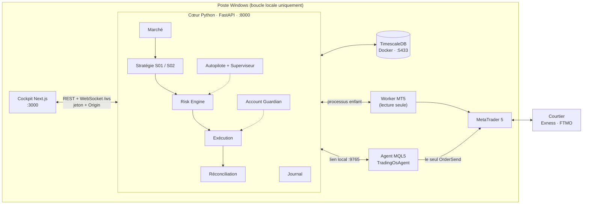
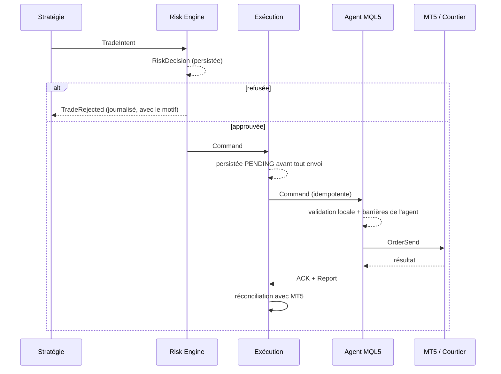

<div align="center">

# Trading Operating System

**Le poste de travail d'un trader intraday, où le process est le produit, pas le signal.**

Un système local qui prépare la séance, applique les règles du trader, exécute sa stratégie formalisée et tient le journal tout seul, sans jamais prétendre savoir quoi trader.

-3776AB?logo=python&logoColor=white)


<br>


[Vision](#-vision) · [Fonctionnalités](#-ce-que-fait-le-système) · [Architecture](#-architecture) · [Garde-fous](#-garde-fous) · [Démarrer](#-démarrage-rapide) · [État](#-état-du-projet) · [Docs](#-documentation)

</div>

> [!WARNING]
> **Logiciel de trading à usage strictement personnel.** Pas de distribution, pas de vente, pas d'utilisateur tiers. Un logiciel de trading peut causer des pertes financières. **Ce dépôt ne contient aucune prétention de performance** : aucune logique n'est présentée comme rentable, et tout objectif de performance reste une hypothèse.

---

## 🎯 Vision

La plupart des pertes d'un trader discipliné ne viennent pas d'un mauvais signal, mais d'une **règle violée** : un trade de trop après un verrou, un stop déplacé, une news ignorée, une limite de prop firm oubliée.

Le Trading OS s'attaque à ça. Il **automatise, mesure et fait respecter** le process de son unique utilisateur.

| Ce que c'est | Ce que ce n'est pas |
|---|---|
| ✅ Un poste de travail qui fait respecter *tes* règles | ❌ Un générateur de signaux |
| ✅ L'exécutant autonome de *ta* stratégie formalisée, dans des limites strictes | ❌ Un optimiseur ou un balayage de paramètres |
| ✅ Un journal complet sans saisie manuelle | ❌ Un backtester ou un outil de recherche d'edge |
| ✅ Un tableau de bord de la marge réglementaire par compte | ❌ Un clone de MetaTrader |

> **Le KPI du produit est le taux de conformité au plan, pas le P&L.**
> Le P&L sur 20 trades, c'est du bruit. Le respect du process, non.

### Les quatre goulots

| Goulot | Ce que fait la plateforme |
|---|---|
| 🧭 **Préparation pré-séance** | Assemble le contexte du jour sans intervention : niveaux, sessions, publications économiques, état des comptes. |
| 🛡️ **Exécution et discipline** | Rend impossible, ou coûteux, de violer ses propres règles. Chaque règle est une *gate* du Risk Engine, jamais un bouton grisé. |
| 📓 **Revue et journal** | Reconstitue chaque trade et son contexte (intention, décision de risque, commande, exécution, issue), sans une seule saisie. |
| 🏦 **Admin prop firm** | Connaît à tout instant la marge de manœuvre par compte (Exness, FTMO), règles du fournisseur sourcées et versionnées. |

---

## ✨ Ce que fait le système

| Module | Rôle |
|---|---|
| **Risk Engine** | **Point de contrôle unique** (ADR 0007). Limites jour/semaine/totale, nombre de trades et de positions, risque dynamique par trade, verrous persistants levés par accusé, kill switch, dimensionnement sur la spécification réelle du symbole. Politique effective : la règle la plus stricte l'emporte, et on voit d'où elle vient. |
| **Stratégie S01** | La stratégie formalisée *par le trader* (sweep aligné, ICT/SMC). Évaluée à chaque clôture de bougie, dans ses fenêtres horaires (heure de New York). Spécialisée sur **XAUUSD** (ADR 0045). |
| **Stratégie S02** | ICT 2022 (biais H4 + H1, FVG, Discount/Premium). `off` par défaut, mode `measure` disponible. |
| **Autopilote** | Au lancement : rattache le compte, démarre le système et le tient en marche dès que les 16 contrôles de préparation sont verts (ADR 0043). **Ne pilote jamais un compte en argent réel.** |
| **Account Guardian** | Surveillance indépendante : limite atteinte → positions du cœur fermées, position sans stop depuis 30 s → fermée, spread, glissement, santé, réconciliation. |
| **Position Manager** | Break-even à +1 R, fin de séance, ordres `LIMIT` périmés annulés, stop remis s'il manque. Ne touche qu'aux positions ouvertes par le cœur. |
| **Exécution** | Commande persistée **avant** tout envoi, idempotence aux deux bouts, états explicites (`UNKNOWN` ne se rejoue jamais), réconciliation avec MT5. Cinq natures : marché, `LIMIT`, `MODIFY`, `CLOSE`/`PARTIAL_CLOSE`, `CANCEL`. |
| **« Pourquoi pas de trade ? »** | Une phrase et les raisons classées (Guardian, gates de risque, préparation, étape de chaque stratégie), directement sur le tableau de bord. |
| **Fermer toutes les positions** | Prévisualisation, confirmation explicite, un `CLOSE` humain par position, réconciliation, rapport. Fonctionne dans tous les modes, `HALTED` compris. |
| **Banc de validation** | Mesure *une* configuration figée sur une période passée (coûts réels, métriques en R, Monte Carlo par blocs). Chaque regard est enregistré. Aucun moyen de comparer ni de choisir (ADR 0026). |
| **Lanceur** | `TradingOS.bat` : démarre, arrête, diagnostique la base, le cœur, le cockpit et les terminaux MT5. N'arrête que les processus qu'il possède. |
| **Serveur MCP** | Interface en **lecture seule** pour un assistant IA : classer, résumer, expliquer, jamais décider (ADR 0005). |

---

## 🏗️ Architecture

Un monolithe modulaire **Python-native** (ADR 0016) : un seul processus porte tout le métier. Le cockpit affiche, l'agent MQL5 exécute, MT5 n'est qu'un point d'exécution et de télémétrie.



### Le chemin d'un ordre

Aucun raccourci : toute entrée suit le même chemin, et un refus est une décision tracée, pas une erreur silencieuse.



### Stack

| Couche | Technologies |
|---|---|
| **Cockpit** | Next.js 16 · React 19 · TypeScript 5 · Tailwind 4 · Radix / shadcn · Vitest. Types générés depuis les schémas du cœur (un test échoue s'ils sont périmés). |
| **Cœur** | Python ≥ 3.12 (développé en 3.14) · FastAPI · Pydantic 2 · psycopg 3 · uvicorn. ~59 opérations REST, un WebSocket (~54 événements, instantané en première trame). |
| **Courtier** | Paquet `MetaTrader5` dans un processus enfant à liste blanche · agent **MQL5** `TradingOsAgent` 1.15. |
| **Données** | PostgreSQL / TimescaleDB (Docker), migrations numérotées additives avec sommes de contrôle. |
| **Qualité** | pytest (unitaires, intégration, base jetable, tests d'architecture) · ruff · mypy strict · ESLint · tsc. |

---

## 🛡️ Garde-fous

La sûreté est une **défense en profondeur**. Chaque couche suffit à refuser un ordre ; aucune ne suffit à en autoriser un.

| # | Barrière | Ce qu'elle garantit |
|---|---|---|
| 1 | **Stratégie configurée** | Seule la stratégie que le trader a formalisée décide des entrées. Jamais une IA, jamais une optimisation. |
| 2 | **Préparation** | 16 contrôles (agent, battement, kill switch, stratégie valide, limites écrites…). Un rouge bloque les nouvelles entrées. |
| 3 | **Risk Engine** | Gate unique et testée : pertes, trades, positions, risque par trade, verrous, news, règles du fournisseur. |
| 4 | **Account Guardian** | Surveillance indépendante qui ferme ce que le cœur a ouvert si une limite tombe. |
| 5 | **Agent MQL5** | Un seul `OrderSend`, dans une seule fonction. Le source du dépôt est compilé `OBSERVE` (tout est refusé). Un build `CONFIRM` n'est produit que par le lanceur, sur une copie, et ne trade que les logins listés dans `InpTradableLogins`. |
| 6 | **Compte réel** | L'autopilote ne pilote **jamais** un compte `LIVE` : il s'arrête et le dit. |
| 7 | **`HALTED`** | L'arrêt d'urgence coupe toute entrée. Seules les sorties humaines passent (ADR 0033). En sortir est un geste humain. |

Et aussi : boucle locale uniquement, jeton du cockpit **et** Origin vérifiés sur chaque requête, aucun mot de passe de courtier stocké, journalisé ni renvoyé, pas de martingale, pas de grille, pas de moyenne à la baisse.

---

## 🚀 Démarrage rapide

### Prérequis

Windows · Docker Desktop · Python ≥ 3.12 (3.14 recommandé) · Node.js · MetaTrader 5 (facultatif grâce au mode simulé).

### Installation (une fois)

```powershell
cd python
py -3.14 -m venv .venv
.venv\Scripts\python.exe -m pip install -e ".[dev]"     # ajouter ,mcp pour le serveur MCP
cd ..
npm install
```

### Lancer

Le point d'entrée est le **lanceur**. Un double-clic sur `TradingOS.bat` suffit (mode `Full`).

```powershell
TradingOS.bat                    # Full : Docker, base, schéma, cœur, cockpit
TradingOS.bat Infrastructure     # base, cœur et cockpit seulement
TradingOS.bat Status             # qui tourne, qui tient chaque port
TradingOS.bat Doctor             # diagnostic en lecture seule, une action par problème
TradingOS.bat Stop -DryRun       # dit ce qu'il arrêterait, n'arrête rien
```

Sans MetaTrader, pour explorer le cockpit sur un terminal de démonstration en mémoire :

```powershell
pwsh -File scripts\start.ps1 -Simulated
```

Puis ouvrir **http://127.0.0.1:3000**. Le compte se rattache depuis le cockpit (aucun mot de passe n'est conservé).

### Configuration essentielle

Copier `.env.example` vers `.env` (référence complète : `python/trading_os/app/config.py`).

| Variable | Rôle |
|---|---|
| `AUTOPILOT_TARGET` | Cible de l'autopilote au lancement (`OFF` par défaut). |
| `STRATEGY_S01_SYMBOLS` | Symboles de S01. Aujourd'hui `XAUUSD`. |
| `STRATEGY_S02` | `off` · `measure` · `trade`. |
| `MT5_ENABLED` | `false` = terminal simulé, sans MT5. |
| `FRED_API_KEY` | Calendrier économique. Sans clé, la gate news reste fermée. |

> [!NOTE]
> Le runbook complet (base, volume Docker, migrations, agent MQL5, dépannage) est dans [`context/infrastructure/runbook.md`](context/infrastructure/runbook.md).

---

## ✅ Qualité

```powershell
# Cœur Python
cd python
.venv\Scripts\python.exe -m pytest -q
.venv\Scripts\python.exe -m ruff check . ; .venv\Scripts\python.exe -m ruff format --check .
.venv\Scripts\python.exe -m mypy trading_os
cd ..

# Cockpit
npm test ; npm run typecheck ; npm run lint ; npm run build
```

Les tests de base de données lancent leur **propre** cluster PostgreSQL jetable et ne touchent jamais la base réelle. Des **tests d'architecture** gardent les invariants : un seul `OrderSend`, domaine pur, un seul module qui termine un processus, aucun résultat « simulé ».

**Dernière mesure (2026-11-22)** : pytest 3 866 passés (15 ignorés : contrats MT5 live, lancés à part) · vitest 232 · ruff, mypy (271 fichiers) et `gen-types --check` propres.

---

## 📊 État du projet

*Instantané au 2026-11-22. La source de vérité est [`context/project/state.md`](context/project/state.md).*

| Brique | État |
|---|---|
| Cœur, Risk Engine, Guardian, Position Manager | ✅ Construits et testés |
| Cockpit (Command Center, Risque, Stratégie, Journal, Compte, Système) | ✅ Construit, clair et sombre, bureau et mobile |
| Autopilote et lanceur | ✅ En marche sur la démo Exness |
| S01 sur XAUUSD (démo) | 🟡 En marche, en attente de ses premières évaluations en séance |
| Agent MQL5 1.15 | 🟡 Déployé sur la démo, non éprouvé sur toutes les natures d'ordre |
| S02 | ⚪ Construite, jamais mesurée |
| Banc de validation | ⚪ Construit, jamais lancé sur de vraies bougies |
| Compte en argent réel | ⛔ Hors périmètre de l'autopilote |

### Prochaines étapes

- [ ] **ADR 0044** : un seul mode, `AUTONOMOUS` (plus l'arrêt d'urgence `HALTED`). Décidé, pas encore construit.
- [ ] **ADR 0045** : spécialisation sur XAUUSD, purge des autres actifs dans le code, les tests et le cockpit.
- [ ] Vérifier chaque nature d'ordre de l'agent sur un terminal de démonstration ([README de l'agent](tools/mt5-execution-agent/README.md)).
- [ ] Mesurer S01 pendant ses killzones (accord machine / trader, EA-02).
- [ ] Arrêts de stratégie de l'ADR 0015 (20 R, 50 trades).

---

## 🗂️ Structure du dépôt

```text
app/ components/ lib/          Cockpit Next.js : client typé (lib/api), WebSocket, store temps réel
python/trading_os/
├── domain/                    Domaine pur : risque, stratégies, exécution, positions, autonomie, guardian, validation
├── services/                  Orchestration : risk, execution, autopilot, guardian, startup, close_all…
├── infrastructure/            MT5 (worker, lien agent), base, FRED
├── api/                       REST + WebSocket
├── launcher/                  Lanceur : processus, ports, terminaux MT5, déploiement de l'agent
├── runtime/ · cli/ · mcp/     Moteur et superviseur · CLI · serveur MCP lecture seule
python/tests/                  Unitaires, intégration, base jetable, architecture, golden
tools/mt5-execution-agent/     Agent MQL5 TradingOsAgent
scripts/ · TradingOS.bat       Lanceur et démarrage
docs/architecture/             Architecture Python-native, rapports de migration et d'audit
context/                       Mémoire du projet : charte, ADR, fiches d'outil, runbook
```

---

## 📚 Documentation

Le dossier [`context/`](context/README.md) est la mémoire du projet : il permet de le comprendre sans relire le code.

| Document | Pour quoi faire |
|---|---|
| [`context/project/charter.md`](context/project/charter.md) | Ce que le projet est, ce qu'il n'est plus, ses 14 principes. |
| [`context/project/state.md`](context/project/state.md) | Ce qui existe, ce qui bloque, la prochaine action. |
| [`context/adr/`](context/adr/) | Les 45 décisions qui gouvernent. Courtes, à lire en entier. |
| [`context/project/roadmap.md`](context/project/roadmap.md) | Les vagues et les outils. |
| [`docs/architecture/python-native-architecture.md`](docs/architecture/python-native-architecture.md) | Le système en détail. |
| [`context/domain/risk_rules.md`](context/domain/risk_rules.md) | Les règles de risque appliquées. |
| [`context/execution/`](context/execution/) | Protocole cœur ↔ agent, machine à états, sûreté. |

### Trois règles qui coupent court aux mauvaises pistes

1. **La recherche d'edge est close** ([ADR 0002](context/adr/0002-fin-de-la-recherche-d-edge.md)). Pas d'optimiseur, pas de générateur de signaux. Seule exception, bornée : le banc de validation d'une configuration figée ([ADR 0026](context/adr/0026-banc-de-validation.md)).
2. **Toute règle de trading passe par une gate du Risk Engine**, jamais par l'interface ([ADR 0007](context/adr/0007-risk-engine-point-de-controle.md)).
3. **L'IA reste en lecture** : classer, résumer, expliquer, jamais décider ([ADR 0005](context/adr/0005-ia-en-lecture-seule.md)).

---

## 🕰️ Historique

| Période | Étape |
|---|---|
| **Juillet 2026** | Série 1 : recherche d'un edge algorithmique (moteur ICT/SMC, backtester, splits, holdout). |
| **2026-09-04** | **Pivot.** Recherche abandonnée sans verdict ([ADR 0002](context/adr/0002-fin-de-la-recherche-d-edge.md), [pivot](context/project/pivot-2026-09-04.md)). Le process devient le produit. |
| **2026-09-15** | Premier et unique `OrderSend` dans l'agent MQL5 (ADR 0010). |
| **2026-09-26** | Mode autonome : la stratégie du trader exécutée dans les limites du Risk Engine (ADR 0015). |
| **2026-10-09** | Migration **Python-native** : .NET, SignalR et l'observateur supprimés (ADR 0016). |
| **2026-11-01 → 03** | Ordres complets, Position Manager, Guardian, S02, banc de validation, multi-environnements (ADR 0019 → 0036). |
| **2026-11-06 → 14** | Lanceur, déploiement MT5, retrait de `PAPER`, autopilote au lancement (ADR 0038 → 0043). |
| **2026-11-22** | Un seul mode `AUTONOMOUS` décidé, spécialisation XAUUSD (ADR 0044, 0045). |

---

<div align="center">

**Usage strictement personnel**. Aucune distribution, aucune vente.

*Le process avant le signal.*

</div>
