> ⚠️ This document is an automatically generated architectural audit.
>
> It describes the repository as inspected at the time of generation.
>
> Implemented, Partial, Designed and Planned capabilities are intentionally distinguished.

Generated:
2026-10-05

Repository:
https://github.com/exhorte/trading-operating-system (remote `origin`; dépôt git local = `04_code/`, racine du présent document)

Branch:
`main` (en avance de 6 commits sur `origin/main`)

Commit:
`bf3970dc0c06a3029b69176cbc3d5d5ee02c7f60` — 2026-09-26 08:52:51 +0200 — « docs(state): point de reprise du 2026-09-26 — I0 à I2 commités, déploiement en attente ». Arbre de travail au moment de l'inspection : 6 fichiers de documentation modifiés et 1 script non suivi (`tools/mt5-observer/spread_history.py`) ; aucun code produit n'est modifié.

Document status:
AUDIT / BASELINE

> **État de ce fichier : ÉBAUCHE PARTIELLE.** Les sections 1 à 34 sont rédigées et vérifiées pour l'essentiel contre le dépôt. Les sections 35 à 44 n'ont **pas** été rédigées (limite d'usage atteinte pendant la production), la mise en forme des sections 30 à 34 n'a pas été harmonisée avec les colonnes exactes du mandat (priorités par risque, quatre catégories de pièces manquantes, colonnes « Why / Still valid? » des ADR), et la relecture finale de l'étape 50 du mandat (validation syntaxique des diagrammes Mermaid, revérification exhaustive des références `fichier:ligne`) n'a pas été faite. Le « Audit Quality Report » ci-dessous est une version intermédiaire. Ne pas considérer ce document comme la baseline finale tant que ces points ne sont pas levés.

---

# Trading Operating System — Master Project Blueprint

**Comment lire ce document.** Chaque capacité importante porte l'un des quatre statuts demandés — **IMPLEMENTED** (réellement dans le code et vérifiable), **PARTIAL**, **DESIGNED** (conçu ou documenté, implémentation absente ou insuffisante), **PLANNED** (seulement prévu). Le niveau de validation est séparé du statut : une fonction peut être IMPLEMENTED avec une confiance de validation LOW si aucun test ne la démontre (règle 2 du mandat). Le dépôt actuel fait foi sur la documentation (règle 1) ; les écarts sont listés au § 33.

**Conventions.**

| Marque | Sens |
|---|---|
| `chemin:ligne` ou `chemin` + symbole | preuve lue dans le code le 2026-10-05 |
| **[mesuré]** | commande exécutée pendant l'audit (tests, état Docker, hôte, API GitHub) |
| **[docs]** | affirmation de la documentation du projet, non recoupée avec le code ou le runtime |
| **[web]** | source externe consultée pendant l'audit (référencée dans le rapport qualité) |
| Confidence | HIGH / MEDIUM / LOW — confiance dans la conclusion, pas dans la qualité du logiciel |
| F01 à F13, D1 à D13 | Identifiants des constats et des décisions en attente du bilan du 2026-10-03 (`02_Plan_Projet/bilan-complet-2026-10-03.md`, hors dépôt git) ; ce sont des **propositions**, pas des décisions |

**Périmètre de preuve.** Tous les chemins sont relatifs à la racine du dépôt git (`04_code/`). Les dossiers voisins `01_Recherche`, `02_Plan_Projet`, `03_Suivi_Projet` (hors dépôt) ont été lus comme sources secondaires ; le fichier de contexte `Perfectionner prompt trading.txt` cité dans le mandat est **introuvable** dans l'environnement (cherché dans `C:\Dev`, `C:\Ebrain`, Téléchargements, Bureau, Documents, le profil utilisateur à profondeur 4 et les racines de `C:\`) et n'a donc pas été utilisé. La base de données et MT5 étaient arrêtés : aucune requête SQL ni lecture de journal d'experts n'a été possible.

---

## 1. Executive Summary

**Ce qu'est le projet.** Le Trading Operating System est un poste de travail personnel pour trader intraday, construit autour de MetaTrader 5. Le dépôt réunit : un cockpit Next.js/React (11 écrans + une route de détail), une passerelle ASP.NET Core (SignalR + REST) en conteneur Docker, une base TimescaleDB, un observateur Python en lecture seule, un agent d'exécution MQL5, des moteurs TypeScript purs (analyse ICT/SMC, Risk Engine, détection de setup « S01 », conformité), un serveur MCP en lecture seule et un corpus documentaire important (15 ADR, une fiche par outil, un journal de session). Taille mesurée le 2026-10-05 : 27 498 lignes de code source hors tests (TypeScript, C#, Python, MQL5, PowerShell, SQL), 6 186 lignes de tests, 93 739 mots dans les 84 documents de `context/` (+ ≈ 36 000 mots dans neuf documents de planification hors dépôt) **[mesuré]**.

**À qui il s'adresse.** À un utilisateur unique, son auteur — trader solo francophone. La charte pose « usage strictement personnel : aucune distribution, aucun utilisateur tiers » (`context/project/charter.md`, section Portée).

**Quel problème il résout.** (1) Faire respecter et mesurer le *process* de l'utilisateur — verrous comportementaux, taux de conformité, journal sans saisie, pré-vol, règles de prop firm — plutôt que produire un signal (ADR 0001). (2) Depuis l'ADR 0015 (accepté le 2026-09-26), exécuter en autonomie *la stratégie que l'utilisateur a configurée* (S01), dans des limites automatiques, sur compte réel.

**Pourquoi il existe.** Le 2026-09-04, la recherche d'un avantage statistique (backtester, holdout, verdict) a été abandonnée sans verdict (ADR 0002), et le projet a pivoté vers l'automatisation du process. L'historique de recherche reste dans les tags `archive/pre-pivot-2026-09-04` et `archive/pivot-commits-2026-09-04`.

**Ce qu'il permet actuellement (vérifié dans le code).**
- Observer un compte MT5 en temps réel (un symbole par observateur), diffuser au cockpit, persister toute enveloppe dans un journal d'audit JSONB.
- Évaluer 9 gates de risque et gérer un registre de verrous *dans le navigateur*, avec persistance serveur ; alerter dès qu'une position s'ouvre pendant un verrou.
- Journaliser automatiquement les trades fermés, capturer les faits d'entrée/sortie, calculer un taux de conformité, générer une revue hebdomadaire, répondre à des requêtes MCP en lecture seule.
- Mesurer la détection S01 (pipeline manuel : exportateur Python → fichiers JSONL → worker TypeScript → table `setup_proposals`).
- Faire connecter l'agent MQL5, valider une commande avec des barrières locales et répondre **SIMULATED** : le système n'a **jamais** émis d'ordre réel ; l'unique `OrderSend` est inatteignable par construction (`tools/mt5-execution-agent/TradingOsAgent.mq5:92,1012,1052`).

**Ce qu'il ambitionne de devenir.** Un exécutant autonome de S01 : connexion de compte depuis l'application (ADR 0013), armement sous bail serveur (ADR 0014), Risk Engine côté serveur, dimensionnement depuis les spécifications du courtier, sorties gérées, supervision, homme mort (ADR 0015) — trajectoire I0 à I8 de `02_Plan_Projet/etude-connexion-pilotage-agent-2026-09-25.md`.

```
Current maturity:
Prototype avancé et partiellement validé, à deux vitesses :
- LECTURE / OBSERVATION / DISCIPLINE / JOURNAL : IMPLEMENTED, validé en réel sur compte démo en septembre 2026 [docs] ;
  code, tests (332 TypeScript, 116 C#, 34 Python) et build vérifiés par cet audit [mesuré].
- EXÉCUTION : protocole, machine à états (modèle pur), agent et barrières locales IMPLEMENTED en mode OBSERVE seulement ;
  chemin d'ordre réel inatteignable et JAMAIS exercé ; chemin proposition → risque → commande absent.
- AUTONOMIE : DESIGNED (ADR 0015 accepté) — aucun code d'autonomie dans le dépôt.
- EXPLOITATION : conteneurs arrêtés depuis 2026-09-28, MT5 fermé, I0–I2 commités mais non déployés, aucune supervision [mesuré].
```

---

## 2. Product Vision

**Statut : VISION PARTIALLY DOCUMENTED.** La vision du process/discipline est explicite et cohérente ; la vision de l'état final autonome (ce que devient le produit, ses indicateurs de succès, sa topologie) n'est documentée que par l'ADR 0015 et l'étude du 2026-09-25. Un document hérité de la série 1 (`context/architecture/system_overview.md`) décrit une vision plus large (moteurs de stratégie, de portefeuille, d'exécution, d'analytique) qui contredit en partie la charte actuelle (§ 33).

### Documented vision

| Source | Énoncé (reformulé) |
|---|---|
| `context/project/charter.md` v3 | Un poste de travail personnel qui automatise, mesure et fait respecter le process de son utilisateur ; « le produit, c'est le process, pas le signal » ; quatre goulots : préparation pré-séance, exécution et discipline, revue et journal, administration prop firm. |
| ADR 0001 | Aucun module n'émet d'opinion de marché ; `lib/analysis/` fournit du contexte, pas des signaux ; KPI = taux de conformité, pas le P&L. |
| ADR 0010 | Le Trading OS exécute, l'EA n'est qu'un agent sans stratégie ; progression OBSERVE → PAPER → CONFIRM, jamais AUTO sans ADR. |
| ADR 0015 | Le Trading OS peut ouvrir et fermer des positions sans validation humaine de chaque ordre, en exécutant la stratégie configurée par l'utilisateur, dans des limites automatiques ; l'humain arme et désarme ; aucune IA ne décide. |

### Réponses structurées

| Question | Réponse | Nature |
|---|---|---|
| Quel est le produit ? | Un cockpit + passerelle + base + agents MT5 qui observent, contraignent et journalisent le trading d'un seul utilisateur, et — par décision — exécuteront S01 en autonomie. | Documented |
| Pourquoi « Trading Operating System » ? | Le nom vient de la série 1 (« Trading Operating System Algorithmique », plateforme orchestrant dashboard, gateway, risque, exécution, MT5). Sous la charte actuelle, « système d'exploitation » désigne l'orchestration du *process* de l'utilisateur autour de MT5, pas un moteur de stratégie. | Documented (`context/architecture/system_overview.md`) + Inferred |
| Différence avec un EA ? | L'EA (`TradingOsAgent`) est un exécutant sans stratégie ni analyse ; les règles, le risque, le journal et l'interface vivent hors du terminal (ADR 0010). | Documented |
| Différence avec un bot de trading ? | Un bot décide et exécute ; ici l'entrée est décidée par une stratégie *configurée par l'utilisateur* et bornée par un Risk Engine, et le produit revendique la mesure du process, pas la performance. Aujourd'hui, aucun ordre n'est émis. | Documented (ADR 0015) |
| Différence avec un simple journal ? | Journal sans saisie (T06), mais aussi verrous, gates, pré-vol, captures, MCP, protocole d'exécution et agent. | Documented + vérifié |
| Différence avec un dashboard MT5 ? | Le cockpit ne duplique pas les prix (charte, principe 4) ; il porte le process, l'historique et les règles. | Documented |
| Différence avec un algo de trading ? | Aucun edge n'est revendiqué ; S01 est une transcription de règles tradées par l'utilisateur, jamais optimisée (ADR 0002, 0011). Sa rentabilité n'est pas démontrée. | Documented |
| Place de MT5 ? | Point d'exécution et de télémétrie, jamais le cerveau ; l'authentification du compte reste dans MT5 (ADR 0003). | Documented |
| Place de l'utilisateur ? | Configure la stratégie et les limites, arme et désarme l'autonomie, donne des accords nommés avant chaque élargissement du chemin d'exécution (`.claude/CLAUDE.md`). | Documented |
| Place du Risk Engine ? | Point de contrôle unique de toute règle (ADR 0007) ; doit passer côté serveur pour l'autonomie (ADR 0015). Aujourd'hui exécuté dans le navigateur. | Documented ; l'écart est au § 12 |
| Place de l'IA ? | Lecture seule : classer, résumer, retrouver, expliquer *a posteriori* (ADR 0005). Pas de composant IA exécuté dans le produit ; l'IA intervient comme partenaire de développement et via le serveur MCP. | Documented + vérifié |
| Place de l'autonomie ? | Décidée (ADR 0015), non construite ; échéance et critères de sortie chiffrés absents. | Documented / Open |

### Inferred vision
- Le projet cherche à transformer une pratique de trading discrétionnaire en une chaîne vérifiable : règles → décision → ordre → rapprochement → journal, avec l'ingénierie (idempotence, états inconnus, audit immuable) typique des systèmes d'ordres professionnels. *Evidence* : protocole `lib/domain/execution-state.ts`, `Mt5AgentServer.cs`, `CommandStore.mqh`.
- La preuve de l'avantage de la stratégie n'est pas un objectif du produit (« aucune prétention de performance ») ; l'autonomie est donc, de fait, une expérience contrôlée dont les limites de perte sont la seule garantie. *Evidence* : charte v3, ADR 0015, ADR 0011.

### Open questions
Voir § 40 : identité du produit (garde-fou discipliné vs exécutant autonome), indicateurs de succès sous autonomie, stratégie unique ou multiples, rôle d'une démo avant le réel, périmètre FTMO/multi-compte.

---

## 3. Product Philosophy

Les principes sont extraits de la charte v3 (`context/project/charter.md`), des ADR et de `.claude/CLAUDE.md`. « Status » exprime l'état d'**implémentation** du principe dans le code.

| Principle | Status | Evidence | Implementation | Implications |
|---|---|---|---|---|
| Le process avant le signal (ADR 0001) | IMPLEMENTED | Aucun générateur de signal ; `lib/analysis/` ne produit que du contexte (`lib/analysis/market-context.ts`) ; backtester supprimé (ADR 0002) | Moteurs de contexte purs ; S01 = règles transcrites | Amendé par l'ADR 0015 : la stratégie configurée décide des entrées |
| KPI = taux de conformité (charte 2) | PARTIAL | `lib/compliance/evaluate.ts` (`complianceRate`), `components/cockpit/compliance-card.tsx` | 3 détecteurs (`LOCKOUT_ACTIVE`, `SESSION_WINDOW`, `SIZE_POLICY`, ce dernier recalculé hors de `lib/risk/sizing.ts` et inactif quand le solde est inconnu) ; « stop déplacé » non détectable (rien ne trace les modifications de stop) | Le KPI perd son sens sous autonomie (§ 36, § 40) |
| Zéro saisie manuelle (charte 3) | IMPLEMENTED | `trade_captures`, `closed_trades`, `position_opens` alimentés par l'observateur ; `lib/journal` | Journal et captures auto-alimentés ; aucune saisie des intentions (T04 retiré) | Le journal ne contient que des faits d'exécution, pas des intentions |
| Ne pas reconstruire MT5 (charte 4) | IMPLEMENTED | Cockpit sans graphique de prix temps réel ; rendu de capture à la demande (`components/journal/trade-chart.tsx`) | — | — |
| L'EA n'est pas le cerveau (charte 5, ADR 0010) | IMPLEMENTED | `TradingOsAgent.mq5` : aucune analyse ni stratégie ; mode constante `MODE_OBSERVE` | Agent = connexion, barrières, accusés, réconciliation | Toute logique d'exit devra voyager dans la commande (§ 37) |
| Aucun ordre hors stratégie configurée et limites du Risk Engine (charte 6 v3) | PARTIAL | Barrière structurelle de l'agent (`TradingOsAgent.mq5:1012`) ; mais `CockpitHub.SubmitCommand` (`backend/src/TradingOs.Host/CockpitHub.cs:87`) ne vérifie ni approbation de risque ni verrou | Un harnais de développement (`scripts/dev-submit-command.ts`) construit des commandes avec `riskApprovalId` « dev-harness » | Contrôle d'approbation inexistant côté serveur (§ 12, § 33) |
| Le Risk Engine est le point de contrôle unique (ADR 0007, charte 9) | PARTIAL | Toutes les gates vivent dans `lib/risk/` ; mais `evaluateRiskState` n'est appelé que par `lib/realtime/signalr-client.ts:538` (navigateur) et le mock | Gates pures et testées ; exécution côté client uniquement | « Ralentisseur, pas un mur » (ADR 0007, limite assumée) ; inacceptable sous autonomie |
| Domaine pur, testé, sans dépendance UI/broker (charte 10) | IMPLEMENTED | `lib/domain`, `lib/risk`, `lib/setup`, `lib/analysis` : fonctions pures ; 332 tests | Importations limitées à `lib/domain` et frères | Dupliqué à la main en C# pour les contrats (`TradingOs.Contracts`) |
| Monolithe modulaire (charte 11, ADR 0003) | IMPLEMENTED | Un dépôt, quatre projets .NET, un cockpit | — | Quatre langages (TS, C#, Python, MQL5) |
| Temps réel en événements, commandes, accusés, rapports (charte 12) | PARTIAL | `lib/contracts/envelope.ts` (38 types) ; 21 d'entre eux n'ont aucun producteur en mode backend (§ 20) | Chemin d'observation complet ; chemin de commande atteignable seulement par le harnais de dev | Contrats plus larges que le runtime |
| L'IA reste en lecture (charte 13, ADR 0005) | IMPLEMENTED | `tools/mcp-server/index.ts` : 6 outils, tous en lecture ; aucun appel LLM dans le runtime | MCP stdio ; `tools/shared/backend-client.ts` = GET seulement | — |
| Idempotence des commandes (ADR 0010) | PARTIAL | `tools/mt5-execution-agent/Include/CommandStore.mqh` (lookup avant tout, écriture avant l'appel courtier) ; `PersistenceWriter.cs` (`ON CONFLICT DO NOTHING`) | Implémentée dans l'EA ; le module pur `lib/contracts/execution/idempotency.ts` n'est utilisé par aucun runtime | Jamais exercée avec un ordre réel (confidence LOW) |
| `UNKNOWN` de premier ordre, jamais rejoué (ADR 0010) | PARTIAL | EA : `ReconcileUnknownCommands` ; TS : `lib/domain/execution-state.ts::transition` (13 états) non branché | Réconciliation par historique MT5, aucune échéance ni escalade des `not_found` | Défaut F03 : des retours ambigus sont enregistrés comme échecs (§ 30) |
| Faits immuables, rendu à la demande (ADR 0009) | IMPLEMENTED | `trade_captures` (faits bruts), `envelopes` (audit append-only), rendu dans le cockpit | — | La persistance est perdante par conception (`PersistenceWriter.cs:42-48`) |
| Séparation observation / exécution (ADR 0010) | IMPLEMENTED | `mt5_observer.py` sans appel de trading ; agent séparé ; deux ports (8765, 9765) | Deux processus, deux responsabilités | Reste d'un chemin de commande hérité dans l'observateur (code mort, § 30) |
| Défauts qui échouent fermés | IMPLEMENTED | `newsGate` bloque sans calendrier (`lib/risk/gates.ts`) ; backend sans jeton refuse tout (`LocalAccessGuard.cs`) ; agent : spread absent = refus (`TradingOsAgent.mq5:866-869`) ; identité non conforme = refus | — | Le défaut de rendu est *mock* (§ 30) |
| Accords nommés avant tout élargissement du chemin d'exécution | IMPLEMENTED (processus) | `.claude/CLAUDE.md`, `context/project/session-log.md` (entrées 2026-09-15/17/25/26) | Gouvernance documentaire, non technique | Aucune barrière technique ne l'impose hors `g_mode` constant |
| Déterminisme / non-anticipation (ADR 0004) | IMPLEMENTED | Tests « no look-ahead » dans `lib/analysis/atr.test.ts`, `swings.test.ts`, `market-context.test.ts` | Détecteurs sans accès au futur | Aucun oracle externe n'a validé les détecteurs |
| Posture locale et sécurité (ADR 0003, I0) | IMPLEMENTED (code) / non déployé | `LocalAccessGuard.cs`, `proxy.ts`, jetons sur observateur et agent | Loopback, jeton + Origin, Host vérifié | Jetons absents de `.env` aujourd'hui [mesuré] |
| Observabilité (`context/monitoring/observability.md`) | DESIGNED | Document de principes ; seul `/health` existe (`Program.cs:114`) | Pas de métriques ni d'alertes | § 21 |
| Autonomie sous armement humain (ADR 0015) | DESIGNED | `context/adr/0015-mode-autonome.md` | Aucun code | § 29 |

---

## 4. Project Evolution

Dates issues de l'historique git (commits de `main` et des tags d'archive) et de la documentation du projet. Quand la documentation et le commit divergent, les deux sont indiqués.

```text
Phase / Date
    ↓
Objective
    ↓
Implementation
    ↓
Major decision
    ↓
Result
```

| Phase / Date | Objective | Implementation | Major decision | Result |
|---|---|---|---|---|
| 2026-07-06 · Phases 00-01 | Cerveau du projet (docs) ; fondation du cockpit | Next.js, cockpit mock ; commits `bd3c7f0`, `71bfe45`, `aaace67` (tag `archive/pre-pivot-2026-09-04`) | Gouvernance par phases numérotées | Cockpit mock opérationnel |
| 2026-07-07 · Phases 02-03 | Modèle de domaine ; spécification de l'agent MT5 | Types TypeScript portables ; spec « lean WSS » ; modes d'exécution | « TypeScript fait foi, C# suit » (ADR 0004 actuel) | Contrats posés avant tout transport |
| 2026-07-08 · Phases 04-05 | Moteur d'analyse ICT/SMC ; prototype d'observation live | `lib/analysis` ; premier flux MT5 démo → cockpit en lecture seule | Observateur Python distinct | Validation live sur démo Exness |
| 2026-07-09/10 · Phases 06-07 | Risk Engine style FTMO ; chaîne signal → revue de risque | `lib/risk` ; signaux simulés | — | Plus tard : pipeline de signaux supprimé au pivot |
| 2026-07-10/11 · Phases 08-09 | Backend ASP.NET + SignalR ; pont d'exécution en SIMULATED | `backend/` (Gateway, Host) ; boucle commande/accusé/rapport sans broker | Traduction côté serveur (le client de traduction navigateur supprimé) | Boucle de commande validée à risque nul |
| 2026-07-12 · Phase 10 | Persistance | TimescaleDB, Dapper, journal d'audit | HTTP réservé aux lectures/administration | Audit JSONB complet |
| 2026-07-14 · Phase 11 | Backtesting MVP | Moteurs réutilisés sur bougies stockées | — | Constat honnête : « le moteur v0.1 n'a pas d'edge » |
| 2026-07-14 → 07-19 · Phases 12-13 | Recherche d'edge : diagnostics, itérations, verrou holdout | Splits, OOS verrouillé, candidat NY AM figé, machinerie de verdict | — | Candidat sélectionné *a posteriori*, jamais validé de façon indépendante |
| 2026-07-28 | Dernière activité de la série 1 | Collecte de ticks NY AM (commit de sauvegarde `5f23ec6`) | — | Blocage : spread provisoire, SwapSpec non figé |
| 2026-09-03 | Audit de reprise et recherche | `01_Recherche/2026-09-03-audit-reprise-et-recherche-verifiee.md` | Usage strictement personnel | Corrige un PDF antérieur (phase 13 « FAIL » inexacte) |
| **2026-09-04 · Pivot** | Abandonner la recherche d'edge | Suppression de `lib/backtest`, `lib/strategy`, tables `backtest_*`/`holdout_*` | **ADR 0001, 0002 : le process est le produit** | Nouvelle racine git `fff9485` (2026-09-05 03:22) |
| 2026-09-05 · Vague 1 | Outils de discipline | T01 (taille), T04 (ticket), T02a/b (verrous), T03 (calendrier FRED), T05 (captures) ; ADR 0008 | Gouvernance par outils (ADR 0006) ; journal de session | Verrous et captures fonctionnels |
| 2026-09-11/12 · Voie EA | Cadrer l'exécution | ADR 0009, 0010, 0011 ; fiche S01 ; EA-01 à EA-05 (commits 2026-09-12) | **ADR 0010 : le Trading OS exécute, l'EA est un agent ; arrêt à CONFIRM** | Agent écrit ; la « vérification réelle » du 12/09 sera jugée non corroborée le 23/09 [docs] |
| 2026-09-14 [docs] / 2026-09-16 (commit `776cf51`) | Retrait de T01 et T04 | Suppression code et écrans | Décision explicite de l'utilisateur | Le taux de conformité perd deux violations détectables |
| 2026-09-15 [docs] / 2026-09-16 (commit `776cf51`) | `OrderSend` | Appel unique dans `ExecuteOrder`, inatteignable | Accord nommé pour EA-05 inc. 6 | Barrière structurelle |
| 2026-09-16 | Réconciliation, journal, conformité | EA-06, T06, T07 (`1299753`) | — | Vague 2 en grande partie livrée |
| 2026-09-17 | MCP, revue hebdo, pré-vol, durcissement des verrous, conteneur | T15, T08, T09, T02c, backend Docker (`8d2b1f9` … `870b257`) | Docker contourne Smart App Control | Vague 2 complète ; incident de verrou contourné (6 trades sur 2 jours) découvert via T15 [docs] |
| 2026-09-18 | Débloquer S01 | Trois gates fermées corrigées ; `connectionGate` corrigé (`1210fae`) | — | Entonnoir S01 atteint l'étape 4/9 ; zéro proposition |
| 2026-09-20 | Refonte de l'architecture d'information | 8 écrans porteurs ; écran d'analyse de compte (`57afa42`) | — | Command Center de ≈104 à ≈25 valeurs |
| 2026-09-21 → 09-24 | Prop firm / comptes | T12 inc. 1-2, écrans Account et Settings, `start-live.ps1` (`1e8b19b`) | Registre de paramètres sous verrou anti-tilt | Profils FTMO/Exness détectés par le nom du courtier |
| 2026-09-24 | Refonte visuelle ; premier agent connecté | shadcn/ui (ADR 0012, `2e33eb4`) ; correction du cadrage TCP de l'agent (`c4272fa`) | — | Étape 1 du README de l'agent passée |
| 2026-09-25 | Étude connexion/pilotage/clôture | Étude I0-I8 (16 agents) ; correctifs Gateway (`aa2efd0`) | Accords nommés : ADR 0013, 0014, EA-08, EA-07 | Plan en 9 incréments |
| **2026-09-26** | Autonomie | **ADR 0015 accepté**, amendé ; I0 (jetons), I1 (agent 1.10), I2 (identification) codés (`89a06d8`, `85e0813`, `6065631`) | **L'autonomie devient un objectif ; compte réel dès I5** | Code commité, non déployé ; ADR 0013/0014 rédigés |
| 2026-09-28 | — (événement d'exploitation) | Conteneurs `tradingos-*` sortis en code 255 à 08:44:19 UTC | — | Système arrêté depuis [mesuré] |
| 2026-10-03 | Audit | Bilan complet (`02_Plan_Projet/bilan-complet-2026-10-03.md`) | — | Défauts F01-F13 documentés |
| 2026-10-05 | Présent audit | Ce document | — | Baseline |

Dates non déterminables : le journal de session date les accords nommés et les décisions du 2026-09-25 et du 2026-09-26 au jour, jamais à l'heure (`Date: UNKNOWN` pour l'heure exacte) ; la chronologie fine du 2026-09-25 au 2026-09-26 ne se reconstitue donc qu'à partir des horodatages de commits.


---

## 5. Current Project State

```text
Project status:      Prototype avancé. Couche lecture/discipline validée ; couche exécution observe-only ;
                     autonomie conçue, non construite. Services arrêtés (2026-09-28).
Repository branch:   main (6 commits d'avance sur origin/main — I0 à I2, ADR 0013/0014, état)
Last known commit:   bf3970d — 2026-09-26 08:52:51 +0200 — « docs(state): point de reprise du 2026-09-26 — I0 à I2 commités, déploiement en attente »
Runtime (2026-10-05): aucun processus du projet n'est lancé ; conteneurs tradingos-* « Exited (255) » depuis 7 jours ;
                     terminal MT5 fermé ; ports 3000, 3001, 5080, 5433, 8765, 9765 non écoutés [mesuré]
Working tree:        6 documents modifiés + tools/mt5-observer/spread_history.py non suivi (aucun code produit modifié)
Major components:    cockpit Next.js · passerelle ASP.NET (Host/Gateway/Persistence/Contracts) · TimescaleDB ·
                     observateur Python · agent MQL5 · moteurs TS (domain, risk, analysis, setup, compliance) ·
                     pipeline S01 (exportateur + worker) · serveur MCP · revue hebdomadaire · scripts d'exploitation
```

### 5.1 Implemented features (preuve vérifiée)

| Feature | Evidence | Validation confidence |
|---|---|---|
| Observation MT5 temps réel (compte, positions, tick ≈ 1 Hz, bougies M15) | `tools/mt5-observer/mt5_observer.py:558-619` ; `backend/src/TradingOs.Gateway/Mt5ObserverClient.cs` | HIGH (tests `test_mt5_observer.py`, `Mt5ObserverClientTests`, validation live [docs]) |
| Diffusion SignalR + snapshot à la connexion | `backend/src/TradingOs.Host/CockpitHub.cs:42`, `GatewayState.Snapshot` | MEDIUM (hub sans test direct) |
| Journal d'audit JSONB de toute enveloppe + tables typées | `PersistenceWriter.cs`, `PersistenceMapper.cs`, `schema.sql` | MEDIUM (mapper testé ; écriture SQL non testée) |
| 9 gates de risque, verrous (registre), kill switch UI | `lib/risk/gates.ts`, `evaluate.ts`, `lockout.ts` ; `signalr-client.ts:501-683` | HIGH pour les fonctions pures (51 tests) ; LOW pour le câblage (`signalr-client.ts` sans test) |
| Détection d'ouverture de position pendant un verrou (alerte live) | `GatewayBridgeService.cs:203` | LOW (« jamais exercé en réel » [docs]) |
| Conformité (verrou actif, fenêtre de session, taille) | `lib/compliance/*` ; `/journal`, badge | HIGH (22 tests) ; stop déplacé non détectable |
| Captures d'entrée/sortie (faits immuables) et rendu à la demande | `TradeCaptureRepository.cs`, `app/(cockpit)/journal/[brokerPositionId]/page.tsx` | MEDIUM |
| Calendrier économique FRED (gate fail-closed, 5 publications) | `NewsCalendarService.cs`, `FredReleaseSchedule.cs`, `lib/risk/gates.ts::newsGate` | MEDIUM (`FredReleaseScheduleTests`) |
| Détection S01 (neuf étapes) en TypeScript pur | `lib/setup/proposal.ts:78 evaluateSetup` | HIGH sur la géométrie (54 tests) ; LOW sur la pertinence (aucun oracle externe, zéro proposition en observation [docs]) |
| Mesure de l'accord machine/humain | `lib/setup/reconciliation.ts`, `/setups` | LOW (aucune proposition à comparer) |
| Registre de paramètres de compte sous verrou anti-tilt | `AccountSettingsGuard.cs`, `AccountSettingsEndpoints.cs`, `lib/accounts/settings.ts` | MEDIUM (`AccountSettingsGuardTests`) |
| Serveur MCP en lecture seule (6 outils) | `tools/mcp-server/index.ts:93-225` | MEDIUM (handshake réel [docs]) |
| Revue hebdomadaire Markdown | `tools/weekly-review/` ; `weekly-reviews/2026-09-16.md` | MEDIUM |
| Garde locale du hub, de `/api` (écritures), de l'observateur, de l'agent (jetons + Origin) | `LocalAccessGuard.cs`, `proxy.ts`, `mt5_observer.py:650`, `Mt5AgentServer.cs:446` | HIGH (tests) — **non déployé** |
| Agent MQL5 : connexion, identité, halt local, instance unique, barrières, accusés, SIMULATED, réconciliation, scan | `TradingOsAgent.mq5` (1 458 lignes) | LOW (aucun test automatique ; première connexion au Gateway le 2026-09-24 sur une version antérieure [docs] ; la version 1.10, compilée le 2026-09-26, attend son déploiement [docs]) |

### 5.2 Partial features

| Feature | What exists | What is missing |
|---|---|---|
| Machine à états de commande | Modèle pur 13 états `lib/domain/execution-state.ts` + tests | Aucun appelant en production ; états réels = chaînes dans l'EA et événements |
| Idempotence | Store disque de l'EA + réponse `DUPLICATE` ; ids de rapport déterministes | Jamais exercée avec un ordre réel ; module TS inutilisé |
| Réconciliation d'`UNKNOWN` | `ReconcileUnknownCommands` (historique MT5) | Aucune échéance ; `not_found` rejoué indéfiniment ; classement de retours ambigu (F03) |
| Dimensionnement | `evaluateSignalRisk` (`lib/risk/sizing.ts`) ; détecteur de taille symbole-générique (`lib/compliance/violations.ts`) | Facteur XAUUSD codé en dur dans `sizing.ts:44-47` et `open-risk.ts` ; non branché à un ordre |
| Risk Engine | 9 gates, verrous, registre persistant | Évalué uniquement dans le navigateur ; pas d'application côté serveur |
| Contrats TypeScript ↔ C# | Miroirs maintenus à la main + tests de traduction | Pas de vecteurs communs ; `execution.reconciled`/`execution.position.scan` absents de l'union TS `EventType` |
| Multi-compte | `accountId` partout dans le schéma, registre d'agents par compte | Un seul compte observé à la fois ; `ACCOUNT_PROFILES` vide |
| Supervision | Reconnexion de l'observateur (3 s), watchdog des agents (30 s), ping (5 s), `/health` | Aucun superviseur de processus, aucune alerte, `restart: no` |
| Conformité | 3 détecteurs : verrou actif, fenêtre de session, taille hors politique (`lib/compliance/violations.ts:20`) | « Stop déplacé » non détectable (rien ne trace les modifications de stop) ; « trade hors plan » et « absence de ticket » n'existent plus depuis le retrait de T04 |

### 5.3 Designed features (documentés, non implémentés)

| Feature | Source | State |
|---|---|---|
| Armement sous bail serveur, plafond de mode compilé, homme mort | ADR 0014, ADR 0015 | Aucun code (`control.set_mode`, `control.resync` : journalisés et ignorés, `TradingOsAgent.mq5:815-822`) |
| Risk Engine côté serveur | ADR 0015, étude § 3 I6 | Absent |
| Fermeture globale (EA-08) | Accord nommé 2026-09-25 ; types `close_all` dans `lib/domain/execution.ts` | Aucun producteur ni exécutant |
| Connexion au compte depuis l'application | ADR 0013 | Aucun code (superviseur `tools/mt5-supervisor/` n'existe pas) |
| Sorties de S01 (partiel, break-even, sortie forcée) | Fiche S01 | Absentes ; `isInvalidatedByCe` écrit, jamais appelé |
| Observabilité complète | `context/monitoring/observability.md` | Seul `/health` existe |

### 5.4 Planned features

T10 brief pré-séance, T11 multi-compte natif, T13 simulateur de règles, T14 alertes en lecture seule, T16 corrélations, T19 analyste IA RAG, S1-S3 (`context/product/backlog.md`) ; I3-I8 ; EA-07 (CONFIRM) et EA-08 (clôture) ; mode AUTO (ADR 0015). Aucun n'a de code.

### 5.5 Known limitations (vérifiées)

1. **Aucun ordre réel n'a jamais été émis** par le système.
2. Le Risk Engine n'a pas d'autorité serveur ; une commande de développement traverse le hub sans approbation de risque (`scripts/dev-submit-command.ts:118` → `CockpitHub.cs:87`).
3. Dimensionnement faux hors XAUUSD (≈ 1000×) et non branché.
4. Un seul symbole par observateur ; le `hello` de l'agent ne publie les spécifications (min/max/pas/stops level) que du premier symbole autorisé et aucune valeur de tick (`TradingOsAgent.mq5:657-694`).
5. Pas de calendrier de marché (week-end, jours fériés) dans les préconditions S01 (`lib/setup/preconditions.ts:40-43`).
6. Services arrêtés ; I0-I2 non déployés ; `.env` sans jetons [mesuré].
7. Dépôt GitHub public contenant des identifiants de compte [mesuré].

### 5.6 État par domaine

Échelle de maturité : **PROTOTYPE** (fonctionne, non éprouvé) < **FUNCTIONAL** (utilisable, testé en partie) < **VALIDATED** (vérifié contre le réel) < **HARDENED** (supervisé, tolérant aux pannes) < **PRODUCTION-GRADE**.

| Domain | Status | Evidence | Maturity |
|---|---|---|---|
| Market Data | IMPLEMENTED (périmètre étroit) | Observateur : 1 symbole, tick ≈ 1 Hz, M15 (`mt5_observer.py`) ; exportateur M1/H1/H4/D1 EURUSD seulement (`export_m1_candles.py`) ; tables `candles`, `ticks` ; FRED | FUNCTIONAL / VALIDATED en démo |
| MT5 | PARTIAL | Observateur VALIDATED ; agent v1.10 connecté une fois en v antérieure, étapes 2-6 non faites [docs] ; `OrderSend` jamais exécuté | PROTOTYPE (agent) |
| Analysis | IMPLEMENTED | `lib/analysis` (swings, structure, liquidité, FVG/OB, sessions UTC, ATR, score) ; usage cockpit et captures | FUNCTIONAL (sans oracle externe) |
| Risk | PARTIAL | `lib/risk` ; verrous persistés ; pas d'application serveur ; sizing défectueux | FUNCTIONAL |
| Execution | PARTIAL | Protocole + agent observe-only ; chemin d'ordre mort ; pas de proposition → commande | PROTOTYPE |
| Journal | IMPLEMENTED | `closed_trades`, `trade_captures`, `/journal`, conformité, revue hebdomadaire | VALIDATED (trades réels du 2026-09-14/16 [docs]) |
| Database | IMPLEMENTED | `schema.sql` 17 tables, 2 hypertables ; pas de migrations, rétention, compression ; écriture perdante | FUNCTIONAL |
| Frontend | IMPLEMENTED | 11 écrans + détail ; shadcn/ui ; 0 test de composant ; rendu mock par défaut | FUNCTIONAL |
| Backend | IMPLEMENTED | Host/Gateway/Persistence/Contracts ; 116 tests ; hub, bridge, writer sans test | FUNCTIONAL |
| MCP | IMPLEMENTED (lecture seule) | 6 outils ; aucun outil d'écriture | VALIDATED |
| AI | PLANNED (hors MCP) | Aucun composant IA exécuté ; T19 prévu | — |
| Autonomy | DESIGNED | ADR 0015 | — |
| Monitoring | PARTIAL | `/health`, heartbeats, `/agents` | PROTOTYPE |
| Recovery | PARTIAL | Reconnexions, store idempotent, rejeu de rapports ; pas de supervision ni de sauvegarde planifiée | PROTOTYPE |

---

## 6. Complete Architecture

Les diagrammes décrivent l'architecture **telle qu'implémentée** ; les éléments simplement conçus sont en pointillés et marqués. Les ports, noms de conteneurs et chemins sont ceux du dépôt.

### 6.1 Logical Architecture

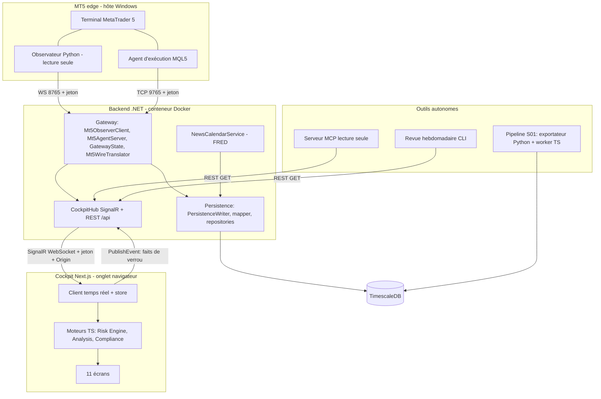

### 6.2 Runtime Architecture

Processus nécessaires à une session « réelle » telle que `scripts/start-live.ps1` les démarre (tous à la main ; aucun superviseur).

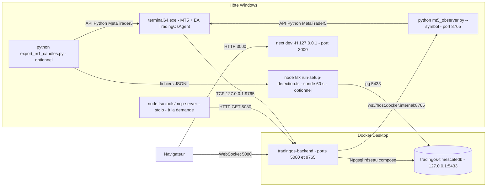

### 6.3 Deployment Architecture

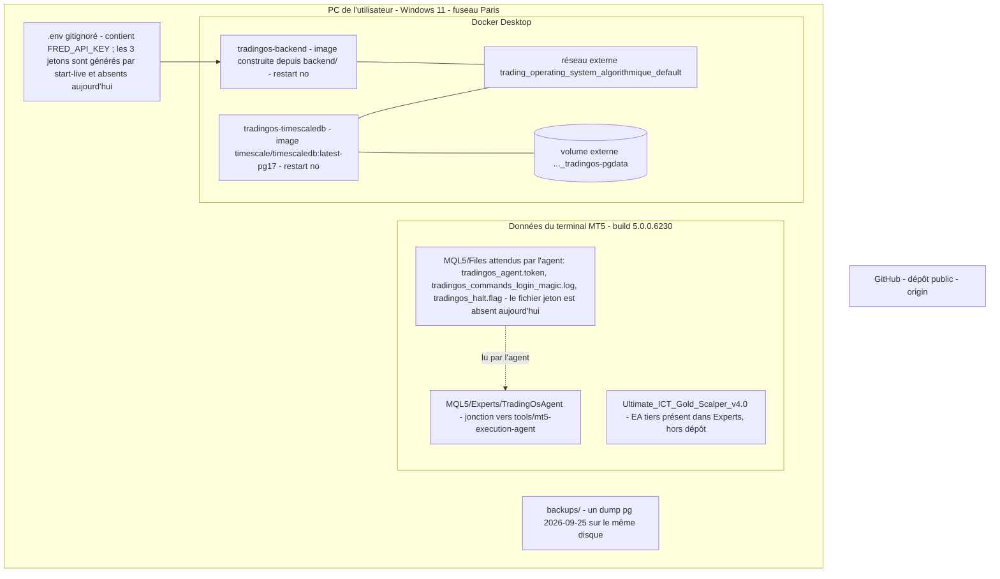

Faits de déploiement vérifiés [mesuré le 2026-10-05, sauf mention] : les deux conteneurs `tradingos-*` sont en `Exited (255)` depuis 7 jours (heure de sortie relevée le 2026-10-03 : 2026-09-28 08:44 UTC) ; `docker-compose.yml` ne déclare aucune clé `restart` ; `e-commerce-db-1` (autre projet) écoute sur `127.0.0.1:55432` ; le terminal MT5 et tous les processus Python du projet sont arrêtés ; aucune tâche planifiée ne concerne le projet [mesuré le 2026-10-03] ; la machine a redémarré le 2026-10-03 à 11:51 [mesuré le 2026-10-03]. Le dossier `MQL5\Files` du terminal ne contient pas `tradingos_agent.token` : l'agent, s'il était chargé, ne pourrait pas s'authentifier.

### 6.4 Data Flow

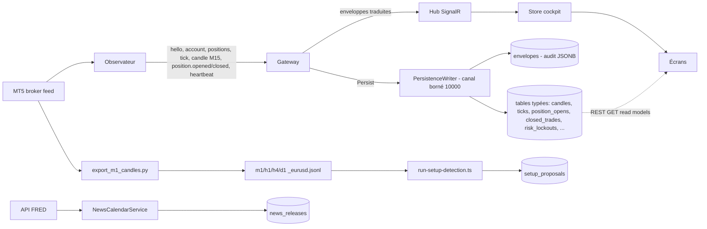

### 6.5 Trading Flow

**Tel qu'implémenté aujourd'hui** (le trading est manuel ; le système observe et contraint par alerte) :

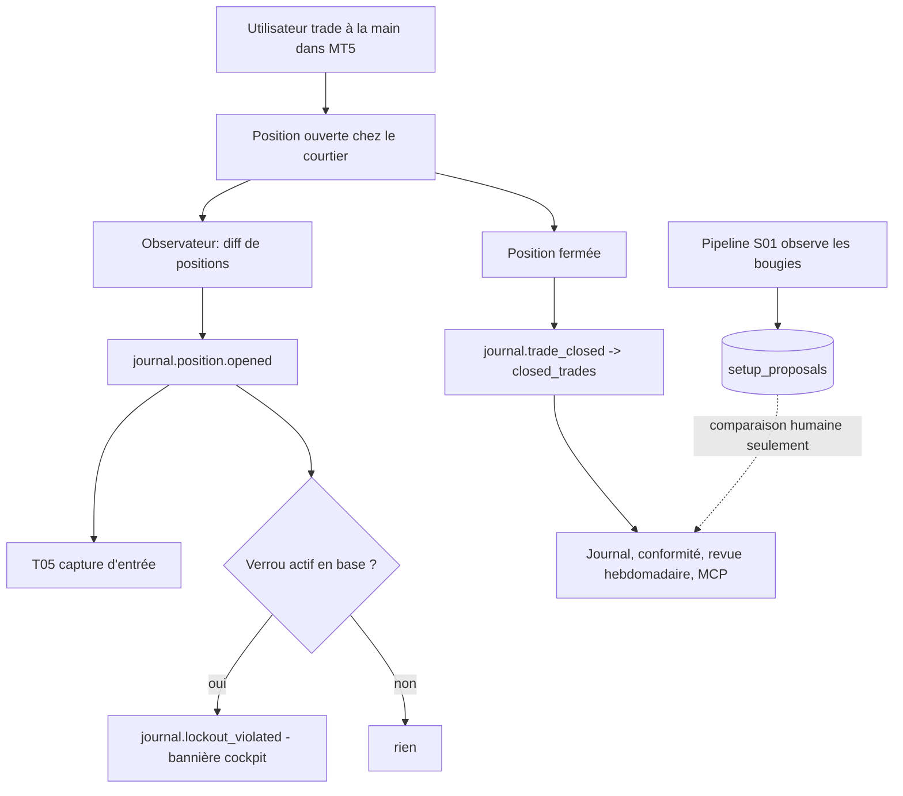

**Tel que conçu** (ADR 0015 + étude du 2026-09-25 — **PLANNED / NOT IMPLEMENTED**) :

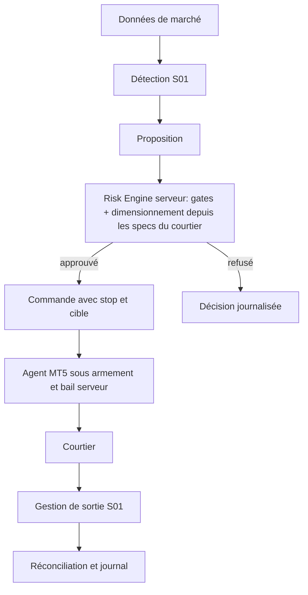

### 6.6 Execution Flow

Chemin **réellement atteignable** : une commande injectée par le harnais de développement. Aucun écran du cockpit n'envoie de commande.

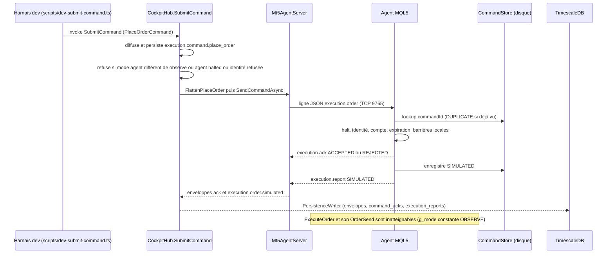

### 6.7 Risk Flow

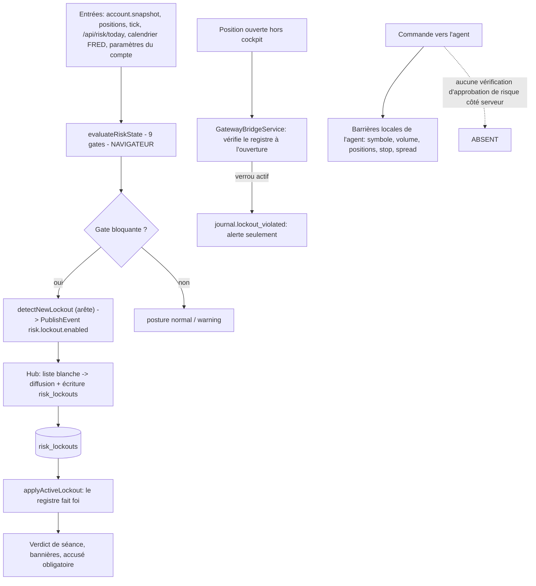

### 6.8 Event Flow

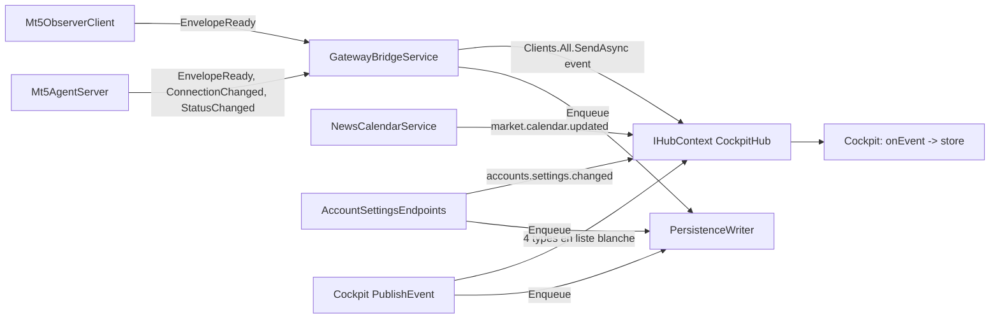

Tous les clients du hub reçoivent tous les événements (`Clients.All`) : il n'y a ni groupe, ni abonnement par sujet ; les types `dashboard.subscribe/unsubscribe/snapshot.requested` sont déclarés mais jamais utilisés.

### 6.9 AI/MCP Flow

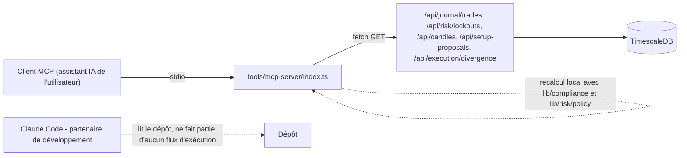

Aucun modèle de langage n'est invoqué par le runtime du produit ; l'IA n'entre que par le serveur MCP (lecture) et comme outil de développement.

---

## 7. Complete Technology Stack

Versions : « installée » = lue dans `node_modules/<pkg>/package.json`, le projet `.csproj` ou l'environnement local le 2026-10-05 ; « non vérifiable » = floue (tag flottant) ou non lisible (conteneur arrêté).

### Frontend

| Layer | Technology | Version | Usage | Evidence | Status |
|---|---|---|---|---|---|
| Framework | Next.js (App Router, Turbopack) | 16.2.10 | Cockpit, route `/api/cockpit-token`, `proxy.ts` (équivalent du middleware) | `package.json`, `next build` [mesuré] | IMPLEMENTED |
| UI | React | 19.2.4 | Composants client/serveur | `package.json` | IMPLEMENTED |
| Langage | TypeScript (strict) | 5.9.3 | Tout le code TS | `tsconfig.json`, `tsc` [mesuré] | IMPLEMENTED |
| Styles | Tailwind CSS + `@tailwindcss/postcss` | 4.3.2 | Thème sombre unique, jetons shadcn | `app/globals.css`, `postcss.config.mjs` | IMPLEMENTED |
| Composants | shadcn/ui (style « new-york »), copiés dans `components/ui/` | version de la CLI non tracée | Sidebar, cartes, menus… | `components.json`, ADR 0012 | IMPLEMENTED |
| Primitives | `radix-ui` | 1.6.7 | Accessibilité des composants | `package.json` | IMPLEMENTED |
| Icônes | `lucide-react` | 1.48.0 | Navigation | `package.json` | IMPLEMENTED |
| Utilitaires | `class-variance-authority` 0.7.1, `cn` 0.4.0, `tw-animate-css` 1.4.0 | — | Variantes, fusion de classes, animations | `package.json` | IMPLEMENTED |
| Polices | Geist, Geist Mono via `next/font/google` | — | Typographie (requiert le réseau au build) | `app/layout.tsx` | IMPLEMENTED |
| Graphiques | Aucune bibliothèque ; SVG écrit à la main | — | Graphique de capture | `components/journal/trade-chart.tsx:56` | IMPLEMENTED |
| État | Store maison (`CockpitStore`, `useSyncExternalStore`) | — | État temps réel | `lib/realtime/store.ts`, `provider.tsx` | IMPLEMENTED |
| Temps réel client | `@microsoft/signalr` | 10.0.0 | Connexion au hub (WebSockets seuls) | `signalr-client.ts` | IMPLEMENTED |
| Validation | `zod` | 4.4.3 | Schémas d'entrée du serveur MCP uniquement | `tools/mcp-server/index.ts:18` | IMPLEMENTED (usage restreint) |

### Backend

| Layer | Technology | Version | Usage | Evidence | Status |
|---|---|---|---|---|---|
| Runtime | .NET / C# (`net10.0`, nullable activé) | SDK local 10.0.302 ; images Docker `sdk:10.0` / `aspnet:10.0` (tags flottants) | Host, Gateway, Persistence, Contracts | `*.csproj`, `Dockerfile` | IMPLEMENTED |
| API | ASP.NET Core minimal API | framework .NET 10 | `/health`, 10 routes `/api`, 3 routes de paramètres | `Program.cs` | IMPLEMENTED |
| Temps réel serveur | ASP.NET Core SignalR | framework .NET 10 | Hub `/hub/cockpit`, WebSockets seuls | `Program.cs:316` | IMPLEMENTED |
| Services | `BackgroundService` ×2 | — | `GatewayBridgeService`, `NewsCalendarService` | `Program.cs:83-84` | IMPLEMENTED |
| Accès données | Npgsql 10.0.3 + Dapper 2.1.79 (pas d'ORM) | installées | SQL direct dans les dépôts | `TradingOs.Persistence.csproj` | IMPLEMENTED |
| Journalisation | Console avec formateur masquant les jetons | — | `RedactingConsoleFormatter` | `Program.cs:13` | IMPLEMENTED |

### Trading

| Layer | Technology | Version | Usage | Evidence | Status |
|---|---|---|---|---|---|
| Plateforme | MetaTrader 5 | 5.0.0.6230 (`terminal64.exe`) | Terminal du compte | fichier local [mesuré] | IMPLEMENTED (externe) |
| Agent | MQL5 EA `TradingOsAgent` | 1.10 (`AGENT_VERSION`, `TradingOsAgent.mq5:55`) | Exécutant, 1 458 lignes + 451 d'includes | `tools/mt5-execution-agent/` ; `compile.log` : 0 erreur, 0 avertissement | PARTIAL |
| Observateur | Python | 3.14.5 | Télémétrie lecture seule | `mt5_observer.py` | IMPLEMENTED |
| API MT5 Python | `MetaTrader5` | 5.0.5735 (exigé ≥ 5.0.45) | Lecture compte, positions, historique | `requirements.txt` | IMPLEMENTED |
| WebSocket Python | `websockets` | 16.0 (exigé ≥ 12.0) | Serveur de l'observateur | `requirements.txt` | IMPLEMENTED |

### Data

| Layer | Technology | Version | Usage | Evidence | Status |
|---|---|---|---|---|---|
| Base | PostgreSQL + TimescaleDB | image `timescale/timescaledb:latest-pg17` (version exacte non vérifiable : conteneur arrêté) | 17 tables, 2 hypertables | `docker-compose.yml`, `schema.sql` | IMPLEMENTED |
| Schéma | `schema.sql` idempotent embarqué, appliqué au démarrage du Host | — | Pas d'outil de migration | `PersistenceWriter.EnsureSchemaAsync` | PARTIAL |
| Scripts Node | `pg` | 8.22.0 | Worker S01 et import de bougies | `scripts/*.ts` | IMPLEMENTED |
| ORM | Aucun ORM : SQL direct avec Dapper (micro-mapper) | — | Requêtes écrites à la main dans chaque dépôt | `backend/src/TradingOs.Persistence/*Repository.cs` | IMPLEMENTED |
| Cache | Aucun (pas de Redis) | — | — | `docker-compose.yml` | — |

### AI

| Layer | Technology | Version | Usage | Evidence | Status |
|---|---|---|---|---|---|
| MCP | `@modelcontextprotocol/sdk` | 1.30.0 | Serveur stdio « trading-os » 1.0.0 | `tools/mcp-server/index.ts` | IMPLEMENTED |
| LLM / RAG / agents IA | Aucun dans le runtime | — | T19 prévu | `context/product/backlog.md` | PLANNED |

### Infrastructure

| Layer | Technology | Version | Usage | Evidence | Status |
|---|---|---|---|---|---|
| Conteneurs | Docker Desktop / Compose | Docker 29.4.3 | 2 services | `docker-compose.yml` | IMPLEMENTED (arrêtés) |
| Démarrage | PowerShell `scripts/start-live.ps1` | — | Jetons, base, backend, sonde MT5, observateur, cockpit | `scripts/start-live.ps1` | IMPLEMENTED (manuel) |
| Superviseur de processus | Aucun | — | — | recherche de tâches planifiées [mesuré] | — |
| Reverse proxy, VPS, Cloudflare, Redis, RabbitMQ, Seq, Prometheus, Grafana, Traefik | Cités par `context/infrastructure/infrastructure_plan.md` | — | — | Absents du dépôt | DESIGNED |

### Testing

| Layer | Technology | Version | Usage | Evidence | Status |
|---|---|---|---|---|---|
| Unitaires TS | Vitest | 4.1.10 (env `node`, `lib/**/*.test.ts` seulement) | 332 tests | `vitest.config.ts` | IMPLEMENTED |
| Unitaires C# | xUnit 2.9.3 (+ Test SDK 17.14.1, runner 3.1.4, coverlet 6.0.4) | installées | 116 cas | `TradingOs.Gateway.Tests.csproj` | IMPLEMENTED |
| Python | `unittest` (stdlib) | — | 34 tests | `test_mt5_observer.py`, `test_probe_terminal.py` | IMPLEMENTED |
| E2E / UI / replay / simulation MQL5 | Aucun | — | — | recherche de fichiers [mesuré] | — |

### Development

| Layer | Technology | Version | Usage | Evidence | Status |
|---|---|---|---|---|---|
| Gestionnaire de paquets | npm | 11.14.1 (Node v24.15.0) | `package-lock.json` | local | IMPLEMENTED |
| Système de build | `next build` (Turbopack) ; `dotnet publish` (Release) et Docker multi-étapes `sdk:10.0` → `aspnet:10.0` ; MetaEditor pour le MQL5 | — | Un build par langage, sans orchestrateur commun | `package.json`, `backend/src/TradingOs.Host/Dockerfile`, `compile.log` | IMPLEMENTED (manuel) |
| Exécution de scripts | `tsx` | 4.23.0 | MCP, revue hebdomadaire, worker | `package.json` | IMPLEMENTED |
| Lint | ESLint 9.39.4 + `eslint-config-next` 16.2.10 | installées | `npm run lint` propre [mesuré] | `eslint.config.mjs` | IMPLEMENTED |
| Formatage | Aucun (ni Prettier ni EditorConfig) | — | — | recherche [mesuré] | — |
| CI/CD | Aucun (`.github/` absent) | — | Gates exécutées à la main | `context/governance/quality_gates.md` | — |
| Compilation MQL5 | MetaEditor en ligne de commande | build non vérifié | Gate manuelle | `quality_gates.md` | IMPLEMENTED (manuel) |
| Commandes de workflow | `/outil-start`, `/outil-close` | — | Cycle d'un outil | `.claude/commands/` | IMPLEMENTED (processus) |

---

## 8. Repository Structure

Racine du dépôt git = `04_code/` (`git rev-parse --show-toplevel`). Tailles : lignes de code source **hors tests**, mesurées le 2026-10-05 (`wc -l`, fichiers `.ts/.tsx/.cs/.py/.mq5/.mqh` ; commentaires et lignes vides inclus).

### 8.1 Dossiers de code

```text
app/                    Pages Next.js — 11 écrans, 1 page de détail, 1 route API (1 816 lignes)
components/             Composants du cockpit et primitives shadcn (5 713 lignes)
hooks/                  Un hook (use-mobile, 24 lignes)
lib/                    Domaine et moteurs purs, contrats, client temps réel (9 740 lignes ; 13 728 avec les tests)
backend/                Solution .NET : src/{Contracts,Gateway,Host,Persistence} (4 858 lignes) ; tests/Gateway.Tests (1 770 lignes)
tools/                  mt5-observer (Python, 1 981 lignes dont 428 de tests), mt5-execution-agent (MQL5, 1 458 + 451 lignes),
                        mcp-server, weekly-review, shared (TypeScript : 1 195 lignes avec scripts/)
scripts/                start-live.ps1, run-setup-detection.ts, import-candles.ts, dev-submit-command.ts
context/                « Cerveau du projet » : 84 documents (ADR, fiches, spécifications, journal)
docs/                   (nouveau) ce document
proxy.ts                Garde Host du cockpit
.claude/                Instructions de l'assistant (CLAUDE.md), commandes de workflow
```

### 8.2 Fiches par dossier important

| Dossier | Purpose | Responsibilities | Important files | Dependencies | Consumers | Status |
|---|---|---|---|---|---|---|
| `lib/domain/` | Modèle de domaine canonique, portable | Types d'entités, machine à états des commandes | `execution.ts`, `risk.ts`, `setup.ts`, `execution-state.ts`, `market.ts` | Aucune | Tout `lib/`, MCP | IMPLEMENTED |
| `lib/contracts/` | Couche wire et read models | Enveloppe, événements, wire MT5, snapshots, projections | `envelope.ts`, `events.ts`, `mt5-wire.ts`, `snapshots.ts`, `projections.ts` | `lib/domain` | Client temps réel, mock | IMPLEMENTED (miroir C# manuel) |
| `lib/risk/` | Risk Engine pur | Gates, évaluation, verrous, sizing, calendrier | `gates.ts`, `evaluate.ts`, `lockout.ts`, `sizing.ts`, `policy.ts`, `open-risk.ts` | `lib/domain`, `lib/accounts` (policy) | `signalr-client.ts`, worker S01, MCP | PARTIAL (client-side) |
| `lib/analysis/` | Moteur de contexte ICT/SMC | Swings, structure, liquidité, FVG/OB, sessions, ATR, score, agrégation | `market-context.ts`, `swings.ts`, `structure.ts`, `pd-arrays.ts`, `aggregate.ts` | `lib/domain` | `lib/setup`, cockpit, captures | IMPLEMENTED |
| `lib/setup/` | Détection S01 | 9 étapes + préconditions + rapprochement | `proposal.ts`, `gates.ts`, `preconditions.ts`, `reconciliation.ts` | `lib/analysis`, `lib/domain` | `scripts/run-setup-detection.ts`, `/setups` | IMPLEMENTED (sans exits) |
| `lib/accounts/` | Profils et réglages de compte | Détection du courtier, politiques FTMO/Exness, ledger de paramètres | `active-profile.ts`, `registry.ts`, `ftmo.ts`, `real.ts`, `settings.ts` | `lib/risk` types | Client temps réel, écrans Account/Settings | PARTIAL (registre vide) |
| `lib/compliance/` | Violations après coup | 3 détecteurs + taux | `violations.ts`, `evaluate.ts` | `lib/analysis/sessions.ts`, registre de symboles | `/journal`, MCP, revue | IMPLEMENTED |
| `lib/realtime/` | Transport et store du cockpit | SignalR, hydratation, moteurs côté client, mock | `signalr-client.ts`, `store.ts`, `mock-client.ts`, `mt5-translate.ts` | `lib/risk`, `lib/analysis`, `lib/accounts` | Tout l'UI | IMPLEMENTED (client sans test) |
| `lib/execution/` | Constructeur de commande | `buildPlaceOrderCommand` | `command-builder.ts` | `lib/domain` | **Tests seulement** | DESIGNED |
| `lib/market/symbols/` | Registre canonique ↔ courtier | EURUSD, GBPUSD, XAUUSD (suffixe `m` Exness) | `registry.ts` | `lib/domain` | Compliance, MCP, connexion | IMPLEMENTED |
| `lib/security/` | Jeton du cockpit et garde loopback | `cockpit-token.ts`, `loopback-host.ts` | idem | — | `proxy.ts`, `app/api/cockpit-token` | IMPLEMENTED |
| `lib/account-analysis/`, `lib/journal/`, `lib/cockpit/`, `lib/mock/` | Analyse de compte, aides du journal, verdict de séance, données de démonstration | — | `breakdowns.ts`, `chart-scale.ts`, `verdict.ts`, `initial-snapshot.ts` | — | Écrans | IMPLEMENTED |
| `backend/src/TradingOs.Contracts/` | Miroirs C# des contrats | Enveloppe, wire, read models, exécution | `Envelope.cs`, `Mt5Wire.cs`, `Execution.cs`, `ReadModels.cs` | — | Gateway, Host, Persistence | IMPLEMENTED |
| `backend/src/TradingOs.Gateway/` | Passerelle MT5 | Client observateur, serveur d'agents, état, traduction, FRED, ancre de jour | `Mt5AgentServer.cs`, `Mt5ObserverClient.cs`, `GatewayState.cs`, `Mt5WireTranslator.cs` | Contracts | Host | IMPLEMENTED |
| `backend/src/TradingOs.Host/` | Hôte ASP.NET | Hub, REST, gardes, services de fond | `Program.cs`, `CockpitHub.cs`, `GatewayBridgeService.cs`, `LocalAccessGuard.cs` | Gateway, Persistence | Cockpit, outils | IMPLEMENTED (hub sans test) |
| `backend/src/TradingOs.Persistence/` | Persistance | Écrivain asynchrone, mapper, 10 classes de dépôt (`*Repository.cs`), garde et validation des réglages, `schema.sql` | `PersistenceWriter.cs`, `PersistenceMapper.cs`, `schema.sql` | Npgsql, Dapper | Host | IMPLEMENTED (writer perdant) |
| `tools/mt5-observer/` | Télémétrie MT5 lecture seule et outils de mesure | Observateur WS, export de bougies, sonde de terminal, mesure de spread | `mt5_observer.py`, `export_m1_candles.py`, `probe_terminal.py`, `spread_history.py` | MetaTrader5, websockets | Gateway, worker S01, `start-live` | IMPLEMENTED (+ scripts jetables) |
| `tools/mt5-execution-agent/` | Agent MQL5 | Barrières, accusés, rapports, réconciliation, halt | `TradingOsAgent.mq5`, `tools/mt5-execution-agent/Include/CommandStore.mqh`, `tools/mt5-execution-agent/Include/JsonLite.mqh` | Gateway TCP 9765 | Terminal MT5 (jonction) | PARTIAL |
| `tools/mcp-server/`, `tools/weekly-review/`, `tools/shared/` | Lecture IA, revue hebdomadaire, client HTTP | 6 outils MCP ; rapport Markdown | `index.ts`, `stats.ts`, `render.ts`, `backend-client.ts` | REST du Host | Assistant IA, utilisateur | IMPLEMENTED |
| `scripts/` | Exploitation et mesure | Démarrage, détection S01, import, harnais de commande | `start-live.ps1`, `run-setup-detection.ts`, `dev-submit-command.ts` | Docker, MT5, pg | Utilisateur | IMPLEMENTED (manuel) |
| `context/` | Mémoire du projet | ADR (15), fiches d'outil, journal de session, spécifications | `project/state.md`, `project/session-log.md`, `adr/`, `product/tools/` | — | Humains et agents | IMPLEMENTED (volumineux, dérive) |

### 8.3 Hors dépôt git (voisins)

`01_Recherche/` (audit du 2026-09-03, catalogue, proposition EA), `02_Plan_Projet/` (étude I0-I8, analyse des règles, bilan), `03_Suivi_Projet/Suivi.md` (miroir), `05_screenchot/` (références visuelles, exports FTMO), `backups/` (un dump), `_archive/`. Ces dossiers ne sont sous aucun contrôle de version (`git rev-parse` échoue à la racine parente [mesuré]).


---

## 9. Core Components

Chaque fiche porte les treize champs demandés. « Status » suit les quatre catégories ; la maturité (PROTOTYPE → PRODUCTION-GRADE) est celle de l'échelle du § 5.5. Les composants que le mandat attend mais que le dépôt ne contient pas (Trading Core, Monitoring, composant IA) ont une fiche **NOT PRESENT** qui dit ce qui existe à la place.

### 9.1 Component: Cockpit — application Next.js

| Field | Content |
|---|---|
| **Purpose** | Interface unique de l'utilisateur : observer compte, risque, journal et réglages. Aucune règle de trading n'y est décidée (ADR 0007). |
| **Responsibilities** | Afficher l'état temps réel (compte, positions, risque, contexte de marché, agents), le pré-vol, le journal et la conformité, les propositions S01, les réglages de compte ; poser un verrou « arrêt d'urgence » ; accuser réception d'un verrou. |
| **Inputs** | Snapshot du store (SignalR) ; lectures REST `/api/risk/today`, `/api/calendar/upcoming`, `/api/account-settings`, `/api/journal/trades`, `/api/risk/lockouts`, `/api/setup-proposals`, `/api/candles`, `/api/captures/{id}`, `/api/execution/divergence`. |
| **Outputs** | `PublishEvent` (4 types de verrou/ancre) ; `POST /api/account-settings` et `…/{versionId}/cancel`. **Aucun ordre** : aucun écran n'appelle `SubmitCommand` (recherche dans `app/`, `components/`, `lib/` : seul `scripts/dev-submit-command.ts` l'appelle). |
| **Dependencies** | Next.js 16.2.10, React 19.2.4, shadcn/ui, `@microsoft/signalr`, `lib/*`. |
| **Consumers** | L'utilisateur seul, sur loopback. |
| **Data** | Aucune persistance côté navigateur (aucun `localStorage`/`sessionStorage` dans `app/`, `components/`, `lib/`, `hooks/`) [mesuré] ; état en mémoire ; **source mock par défaut** (`lib/realtime/provider.tsx`). |
| **APIs** | 11 écrans (`/`, `/preflight`, `/market-context`, `/positions`, `/risk`, `/journal`, `/analyse`, `/setups`, `/account`, `/agents`, `/settings`) + `/journal/[brokerPositionId]` ; `GET /api/cockpit-token` (`app/api/cockpit-token/route.ts`) ; `proxy.ts` (contrôle Host loopback). |
| **Events** | Consomme les événements du § 20 ; publie `risk.day_anchor.equity_observed`, `risk.lockout.enabled`, `risk.lockout.cleared`, `risk.lockout.acknowledged`. |
| **Failure Modes** | Hub injoignable → état déconnecté (watchdog 2 s, donnée périmée après 8 s sans heartbeat) ; onglet fermé → plus aucune évaluation de risque ni nouveau verrou ; mode mock → données fictives étiquetées « mock ». |
| **Current Status** | IMPLEMENTED — FUNCTIONAL. |
| **Known Limitations** | 0 test de composant ou E2E ; l'environnement affiché est codé en dur `"demo"` en mode backend (`lib/realtime/signalr-client.ts:159`) pendant que le type réel du compte (démo/réel) est affiché à part (`lib/accounts/agent-view.ts:50-51`) ; l'arrêt d'urgence ne ferme aucune position et ne met pas l'agent en halte. |
| **Future Direction** | DESIGNED : écran de connexion (ADR 0013), armement (ADR 0014), échelle de risque. PLANNED : brief pré-séance (T10), alertes en lecture seule (T14). |

### 9.2 Component: Client temps réel et store — `lib/realtime`

| Field | Content |
|---|---|
| **Purpose** | Transport temps réel et état local du cockpit ; exécute **dans le navigateur** les moteurs TypeScript (analyse de contexte, Risk Engine, détection de verrou). |
| **Responsibilities** | Connexion SignalR (WebSockets seuls, `skipNegotiation`, jeton récupéré à chaque tentative) ; hydratation (`GetSnapshot` + trois lectures REST) ; réducteur d'événements ; recalcul du contexte de marché (anti-rebond 200 ms) et du risque ; publication des verrous ; watchdog. |
| **Inputs** | Événements `event` du hub ; réponses REST ; variable `NEXT_PUBLIC_REALTIME_SOURCE`. |
| **Outputs** | `CockpitSnapshot` (connexion, compte, positions, risque, contexte, agents, rapports d'exécution, calendrier, alertes, verrou actif, violations, réglages…) ; appels `PublishEvent`. |
| **Dependencies** | `@microsoft/signalr` 10.0.0, `lib/risk`, `lib/analysis`, `lib/accounts`, `lib/contracts`. |
| **Consumers** | Tous les écrans via `useCockpit()`. |
| **Data** | Mémoire seulement ; 300 bougies maximum (`MAX_CANDLES`). |
| **APIs** | Méthodes de hub `GetSnapshot`, `PublishEvent` (la méthode `SubmitCommand` n'est pas appelée). |
| **Events** | Reçoit `agent.*`, `market.*`, `journal.*`, `execution.*`, `risk.*`, `market.calendar.updated`, `accounts.settings.changed`. |
| **Failure Modes** | Reconnexion automatique du client SignalR ; en cas de coupure, le risque affiché cesse d'être recalculé ; un verrou n'est publié que par un onglet ouvert. |
| **Current Status** | IMPLEMENTED — FUNCTIONAL. `signalr-client.ts` (699 lignes) n'a **aucun test** ; `store.ts` et `mt5-translate.ts` en ont (13 tests). |
| **Known Limitations** | Spread converti en « points » avec le facteur 0,01 de l'or (`signalr-client.ts:523-525`) donc faux pour le forex ; `initialBalance` retombe sur la balance de base si aucun capital de référence n'est configuré (`signalr-client.ts:548`) ; le comportement avec plusieurs onglets ouverts en même temps n'est ni testé ni documenté. |
| **Future Direction** | Déplacer l'évaluation côté serveur (ADR 0015, incrément I6) — DESIGNED, non construit. |

### 9.3 Component: Hôte .NET — `TradingOs.Host`

| Field | Content |
|---|---|
| **Purpose** | Racine de composition du backend : héberge le hub, l'API REST et deux services de fond. |
| **Responsibilities** | Enregistrer les singletons ; appliquer le schéma SQL au démarrage (boucle de réessai) ; CORS ; gardes locales ; `/health` ; lectures REST ; endpoints de réglages ; journalisation avec masquage des jetons. |
| **Inputs** | Configuration `Cockpit__*`, `ConnectionStrings__TradingOs`, `Fred__ApiKey` (variables d'environnement / `docker-compose.yml`) ; requêtes HTTP et SignalR ; flux de l'observateur (WebSocket) et de l'agent (TCP). |
| **Outputs** | JSON REST, messages SignalR, écritures SQL, journaux console masqués. |
| **Dependencies** | `TradingOs.Gateway`, `TradingOs.Persistence`, `TradingOs.Contracts`, ASP.NET Core 10, Npgsql 10.0.3, Dapper 2.1.79. |
| **Consumers** | Cockpit, serveur MCP, revue hebdomadaire, scripts de développement. |
| **Data** | Lit toutes les tables ; écrit via le `PersistenceWriter` et les dépôts. |
| **APIs** | `GET /health` ; 10 `GET /api/*` (`audit/recent`, `risk/today`, `calendar/upcoming`, `captures/{id}`, `candles`, `setup-proposals`, `trades/closed`, `journal/trades`, `risk/lockouts`, `execution/divergence`) ; `GET`/`POST /api/account-settings` et `POST /api/account-settings/{versionId}/cancel` ; hub `/hub/cockpit` (`Program.cs:114-316`, `AccountSettingsEndpoints.cs:30-87`). |
| **Events** | Diffuse les événements du § 20. |
| **Failure Modes** | Jetons absents → hub et écritures `/api` refusés (fail closed) ; base arrêtée → l'écrivain abandonne les événements et réessaie toutes les 5 s (`/health` : `db = "down"`) ; arrêt de la machine → conteneur « Exited (255) » sans redémarrage (`restart` absent). |
| **Current Status** | IMPLEMENTED — FUNCTIONAL (arrêté depuis 2026-09-28). |
| **Known Limitations** | Les lectures `GET /api/*` et `/health` ne sont pas gardées (publication loopback seulement) ; `CockpitHub`, `GatewayBridgeService`, `PersistenceWriter`, `NewsCalendarService` et `AccountSettingsEndpoints` n'ont aucun test dédié. |
| **Future Direction** | DESIGNED : superviseur de connexion (ADR 0013), service de décision serveur (ADR 0015). |

### 9.4 Component: `CockpitHub` — hub SignalR

| Field | Content |
|---|---|
| **Purpose** | Point d'entrée temps réel du cockpit. |
| **Responsibilities** | Envoyer le snapshot à la connexion ; accepter `PublishEvent` pour quatre types (liste blanche) ; accepter `SubmitCommand` (voie de développement) ; diffuser et persister. |
| **Inputs** | Invocations client ; `GatewayState`. |
| **Outputs** | Messages `event` (à tous les clients), enveloppes persistées. |
| **Dependencies** | `GatewayState`, `Mt5AgentServer`, `PersistenceWriter`, `IHubContext`. |
| **Consumers** | Client temps réel du cockpit ; `scripts/dev-submit-command.ts`. |
| **Data** | `envelopes`, `execution_commands`, `risk_lockouts`, `kill_switch_acks`, `trading_day_anchors`. |
| **APIs** | `GetSnapshot`, `PublishEvent` (`CockpitHub.cs:45`), `SubmitCommand` (`CockpitHub.cs:87`). |
| **Events** | Liste blanche : `risk.day_anchor.equity_observed`, `risk.lockout.enabled`, `risk.lockout.cleared`, `risk.lockout.acknowledged` (`CockpitHub.cs:27-33`). |
| **Failure Modes** | Connexion sans jeton ou sans Origin autorisé → refus 403 (garde) ; `SubmitCommand` refuse si l'agent n'est pas en mode `observe`, s'il est en halte ou si l'identité est refusée. |
| **Current Status** | IMPLEMENTED — FUNCTIONAL, **0 test**. |
| **Known Limitations** | `SubmitCommand` ne vérifie ni `riskApprovalId`, ni verrou, ni ancre de jour ; tout porteur du jeton peut publier `risk.lockout.cleared` et `risk.lockout.acknowledged` (constat F06 du bilan du 2026-10-03) ; diffusion `Clients.All` sans groupe. |
| **Future Direction** | DESIGNED : approbation de risque obligatoire côté serveur avant toute commande (ADR 0015, I6). |

### 9.5 Component: `GatewayBridgeService`

| Field | Content |
|---|---|
| **Purpose** | Relier les adaptateurs MT5 à la diffusion et à la persistance. |
| **Responsibilities** | Pour chaque enveloppe venant de l'observateur ou de l'agent : diffuser (`Clients.All.SendAsync("event")`) et mettre en file d'écriture ; résoudre l'ancre de jour (revérifiée toutes les 5 min) ; produire les faits de capture T05 à l'ouverture et à la clôture d'une position ; détecter une ouverture de position pendant un verrou actif (T02c) et émettre `journal.lockout_violated`. |
| **Inputs** | `EnvelopeReady`, `ConnectionChanged`, `StatusChanged` des adaptateurs ; `RiskTodayRepository.GetActiveLockoutAsync`. |
| **Outputs** | Événements diffusés, lignes persistées. |
| **Dependencies** | `Mt5ObserverClient`, `Mt5AgentServer`, `GatewayState`, `PersistenceWriter`, `RiskTodayRepository`. |
| **Consumers** | Hub et base. |
| **Data** | `trading_day_anchors`, `position_opens`, `closed_trades`, `trade_captures`, `envelopes`. |
| **APIs** | Aucune (service de fond). |
| **Events** | `risk.day_anchor.resolved`, `journal.lockout_violated`, `execution.agent.connection`, `execution.agent.status` + relais de tous les événements MT5. |
| **Failure Modes** | Un échec de lecture du registre de verrous empêche la détection de violation (alerte non émise) ; la file de persistance perdante (§ 19) peut perdre un événement. |
| **Current Status** | IMPLEMENTED — FUNCTIONAL, **0 test** ; la détection de violation n'a « jamais été exercée en réel » [docs]. |
| **Known Limitations** | Alerte seulement : une position ouverte sous verrou n'est ni fermée ni bloquée (aucun exécutant de fermeture n'existe). |
| **Future Direction** | DESIGNED : fermeture automatique des positions ouvertes sous verrou (EA-08, accord à obtenir pour ce périmètre précis). |

### 9.6 Component: Adaptateurs Gateway — `TradingOs.Gateway`

| Field | Content |
|---|---|
| **Purpose** | Parler au monde MT5 et traduire ses messages en enveloppes. |
| **Responsibilities** | `Mt5ObserverClient` : client WebSocket vers l'observateur Python (Bearer, reconnexion 3 s). `Mt5AgentServer` : serveur TCP :9765 pour l'agent MQL5 (JSON par ligne, UTF-8 sans BOM), registre par compte, refus d'un `hello` en double sauf si l'existant est silencieux depuis plus de 30 s, watchdog, `control.ping` toutes les 5 s, comparaison du jeton en temps constant. `GatewayState` : instantané mono-compte. `Mt5WireTranslator` : traduction wire → enveloppes. |
| **Inputs** | WebSocket de l'observateur ; TCP de l'agent ; commandes du hub. |
| **Outputs** | Enveloppes `Envelope<T>` ; messages `execution.order`, `control.ping`, `control.halt` vers l'agent. |
| **Dependencies** | `TradingOs.Contracts`. |
| **Consumers** | `GatewayBridgeService`, `CockpitHub`. |
| **Data** | `GatewayState` en mémoire (compte, positions, ≤ 300 bougies, agent, dernier bid/ask, décalage serveur). |
| **APIs** | Port TCP 9765 ; client WS vers `ws://host.docker.internal:8765`. |
| **Events** | Voir § 20. |
| **Failure Modes** | Agent muet > 30 s → connexion fermée par le watchdog ; jeton invalide → `AgentRefused` ; second agent pour le même compte → `DuplicateAgentRefused`. |
| **Current Status** | IMPLEMENTED — FUNCTIONAL (tests : `Mt5AgentServerTests`, `Mt5ObserverClientTests`, `Mt5WireI1Tests`, `Mt5WireI2Tests`, `Mt5WireTranslatorTests`, `ExecutionTranslationTests`, `TradingDayAnchorTests`). |
| **Known Limitations** | `Mt5ObserverClient.SendCommandAsync` n'a aucun appelant (code mort, commentaire « seul chemin sortant » périmé) ; `Mt5AgentServer.SendHaltAsync` n'a aucun appelant de production (seulement des tests) : `control.halt` n'est atteignable depuis ni le hub ni le cockpit ; `GatewayState` n'est alimenté que par l'observateur. |
| **Future Direction** | DESIGNED : `control.set_mode`, `control.resync`, armement sous bail (ADR 0014). |

### 9.7 Component: Persistance et base — `TradingOs.Persistence` + TimescaleDB

| Field | Content |
|---|---|
| **Purpose** | Conserver le journal d'audit complet et les entités typées. |
| **Responsibilities** | `PersistenceWriter` : canal borné (10 000) en mode `DropWrite`, écriture de l'enveloppe JSONB puis de la ligne typée (`PersistenceMapper`), nouvelle tentative toutes les 5 s si la base est tombée ; application idempotente de `schema.sql` au démarrage ; 10 classes de dépôt de lecture/écriture. |
| **Inputs** | Enveloppes en file ; appels des dépôts. |
| **Outputs** | Lignes SQL ; modèles de lecture. |
| **Dependencies** | Npgsql 10.0.3, Dapper 2.1.79, image `timescale/timescaledb:latest-pg17`. |
| **Consumers** | Host (REST), `GatewayBridgeService`, worker S01 (écriture directe), serveur MCP (via REST). |
| **Data** | 17 tables dont 2 hypertables (§ 19). |
| **APIs** | SQL ; classes `*Repository`. |
| **Events** | Aucun (consommateur). |
| **Failure Modes** | Base arrêtée → événements abandonnés (`dropped`), jamais rejoués ; erreur de mapping → `unmapped` ; canal plein → l'événement le plus récent est perdu. |
| **Current Status** | IMPLEMENTED — FUNCTIONAL. |
| **Known Limitations** | Pas d'outil de migration ; aucune rétention ni compression sur `ticks` et `candles` ; la table `ticks` horodate avec l'heure de réception (`UtcNow`), pas l'heure du tick ; aucune clé étrangère sauf `kill_switch_acks → risk_lockouts` ; une seule sauvegarde manuelle (2026-09-25, même disque) ; le test d'intégration de `AuditRepository` passe à vide quand la base est arrêtée. |
| **Future Direction** | Non planifié : migrations, rétention, sauvegarde planifiée (voir § 32). |

### 9.8 Component: Observateur MT5 — `tools/mt5-observer`

| Field | Content |
|---|---|
| **Purpose** | Télémétrie MT5 **en lecture seule** : l'API Python ne contient aucun `order_send`. |
| **Responsibilities** | Serveur WebSocket `127.0.0.1:8765` (jeton Bearer, refus de toute requête portant un `Origin`) ; un symbole par processus (`--symbol`, défaut `XAUUSDm`) ; tick ≈ 1 Hz, compte et positions toutes les 2 s, heartbeat 3 s, bougies M15 rafraîchies toutes les 15 s (120 en backfill) ; détection d'ouverture/clôture de position ; sortie code 3 si le login change. |
| **Inputs** | API Python `MetaTrader5` (compte, positions, historique des deals, ticks, rates). |
| **Outputs** | Messages `agent.hello`, `agent.heartbeat`, `account.snapshot`, `positions.snapshot`, `position.opened`, `position.closed`, `market.tick`, `market.candle`. |
| **Dependencies** | MetaTrader5 5.0.5735, websockets 16.0, terminal MT5 ouvert et connecté (`mt5.initialize()` sans identifiants). |
| **Consumers** | `Mt5ObserverClient` (backend). |
| **Data** | Aucune ; lit `TRADINGOS_OBSERVER_TOKEN` dans l'environnement ou `04_code/.env`. |
| **APIs** | WebSocket 8765 ; options `--symbol`, `--host`, `--port`, `--candles`. |
| **Events** | Voir ci-dessus. |
| **Failure Modes** | Terminal fermé → `mt5.initialize()` échoue, le processus s'arrête avec un message ; jeton absent → arrêt ; perte du client → attente d'une nouvelle connexion. |
| **Current Status** | IMPLEMENTED — VALIDATED en démo (34 tests Python au total) ; **non lancé aujourd'hui**. |
| **Known Limitations** | Un seul symbole à la fois ; un gestionnaire historique de commandes (Phase 09) subsiste, jamais appelé depuis I1 ; aucune supervision de processus. |
| **Future Direction** | DESIGNED : superviseur de connexion (ADR 0013, `tools/mt5-supervisor/` n'existe pas). |

### 9.9 Component: Agent d'exécution MT5 — `tools/mt5-execution-agent/TradingOsAgent.mq5`

| Field | Content |
|---|---|
| **Purpose** | Exécutant local : reçoit une commande, applique ses barrières, accuse réception, rapporte. N'est pas le cerveau (ADR 0010). |
| **Responsibilities** | Connexion TCP au Gateway (jeton lu dans `MQL5\Files\tradingos_agent.token`) ; identité par `ACCOUNT_LOGIN` ; instance unique ; halte locale (bouton, fichiers `tradingos_halt*.flag`, `control.halt`) ; pipeline de commande : idempotence → halte → identité → compte → expiration → validation locale → ACK → simulation ; journal disque de commandes par login et magic (`UNKNOWN` écrit avant tout appel courtier) ; réconciliation par l'historique ; scan des positions à chaque heartbeat. |
| **Inputs** | Lignes JSON `execution.order`, `control.ping`, `control.halt`, `control.set_mode`, `control.resync` ; paramètres `Inp*` ; état du terminal. |
| **Outputs** | `agent.hello`, `agent.heartbeat`, `execution.ack`, `execution.report`, `execution.reconciled`, `execution.position.scan`. |
| **Dependencies** | `Include/CommandStore.mqh`, `Include/JsonLite.mqh`, terminal MT5 5.0.0.6230. |
| **Consumers** | `Mt5AgentServer`. |
| **Data** | `MQL5\Files\tradingos_commands_<login>_<magic>.log`, `tradingos_halt.flag`, `tradingos_halt_<login>.flag`. |
| **APIs** | Protocole TCP du § 14 ; paramètres : `InpGatewayHost`/`Port`, `InpAccountId`, `InpMagicNumber` (requis > 0), `InpTradableLogins`, `InpClosableLogins`, `InpHeartbeatSeconds` 5, `InpMaxVolumePerOrder` 1,0, `InpMaxOpenPositions` 3, `InpMaxSpreadCsv`, `InpAllowedSymbolsCsv` `XAUUSDm,EURUSDm`, `InpMaxSlippagePoints` 10, `InpReconciliationLookbackDays` 7, `InpReportReplayMinutes` 60. |
| **Events** | Voir § 20. |
| **Failure Modes** | Jeton ou magic absents → refus de démarrer ; spread sans entrée → ordre refusé (fail closed) ; coupure du Gateway → l'agent continue seul, rejoue ses rapports récents à la reconnexion. |
| **Current Status** | PARTIAL — PROTOTYPE. Version 1.10 compilée sans erreur ni avertissement ; **aucun test automatique** ; l'unique `OrderSend` (`TradingOsAgent.mq5:1052`) est inatteignable : `g_mode` et `g_mode_ceiling` sont des constantes `MODE_OBSERVE` (lignes 92 et 98) et `ExecuteOrder` sort à sa première instruction (ligne 1012) si le mode n'est pas `CONFIRM`. |
| **Known Limitations** | `control.set_mode` et `control.resync` sont journalisés et ignorés (`:815-822`) ; le `hello` ne publie que les spécifications du premier symbole autorisé et aucune valeur de tick (`:657-694`) ; barrière de volume en lots (pas en risque monétaire) ; sens du stop non vérifié ; pas d'`OrderCheck` ; les codes retour 10011/10012/10031 sont classés `FAILED` alors qu'ils devraient rester incertains (`:1055-1068`) ; réconciliation `not_found` rejouée à l'infini sans échéance. |
| **Future Direction** | DESIGNED : CONFIRM (EA-07), fermeture globale (EA-08), armement sous bail et plafond de mode compilé (ADR 0014), mode AUTO (ADR 0015). |

### 9.10 Component: Risk Engine — `lib/risk`

| Field | Content |
|---|---|
| **Purpose** | Point de contrôle unique des règles de risque (ADR 0007). |
| **Responsibilities** | Évaluer neuf gates (perte quotidienne, drawdown total, risque ouvert, trades du jour, pertes consécutives, connexion, spread, session, actualité) ; en déduire le mode `normal`/`warning`/`locked` ; détecter un nouveau verrou (déclenchement sur front), la pause de 30 min après pertes consécutives, appliquer le verrou actif du registre ; calculer la taille d'un trade (`evaluateSignalRisk`). |
| **Inputs** | `RiskPolicy` (8 champs), compte, positions, tick, `/api/risk/today`, calendrier FRED, verrou actif. |
| **Outputs** | `RiskState` (mode, pourcentages utilisés, gates, verrou) ; `RiskDecision` (jamais produite en production). |
| **Dependencies** | `lib/domain`, `lib/accounts` (politique). |
| **Consumers** | Client temps réel (navigateur : `evaluateRiskState`, verrous) ; worker S01 (`isNewsBlackout`, `defaultRiskPolicy`) ; serveur MCP et revue hebdomadaire (`defaultRiskPolicy`). `evaluateRiskState` n'a aucun autre appelant de production. |
| **Data** | Aucune (fonctions pures) ; verrous dans `risk_lockouts`. |
| **APIs** | `evaluateRiskState`, `detectNewLockout`, `applyActiveLockout`, `evaluateSignalRisk`… |
| **Events** | Produit (via le client) `risk.lockout.*` ; consomme `account.snapshot`, `positions.snapshot`, `journal.*`. |
| **Failure Modes** | Gate d'actualité : échec fermé (calendrier jamais synchronisé → bloqué) ; données de trades absentes → `tradesToday`/`consecutiveLosses` nuls ; capital de référence absent → repli sur la balance de base. |
| **Current Status** | PARTIAL — FUNCTIONAL : 51 tests sur les fonctions pures ; **évalué uniquement dans le navigateur** (`lib/realtime/signalr-client.ts:538`). |
| **Known Limitations** | Dimensionnement et risque ouvert codent le facteur de l'or (×100) en dur (`lib/risk/sizing.ts:44-47`, `lib/risk/open-risk.ts:15,24`) : environ 1000× d'erreur hors XAUUSD ; plancher de 0,01 lot ; `evaluateSignalRisk` n'est branché à aucun ordre ; aucune application côté serveur. |
| **Future Direction** | DESIGNED : Risk Engine côté serveur, dimensionnement à partir des spécifications du courtier (ADR 0015, I6). |

### 9.11 Component: Moteur d'analyse — `lib/analysis`

| Field | Content |
|---|---|
| **Purpose** | Fournir du contexte de marché (pas des signaux) : « `lib/analysis/` fournit du contexte, pas des signaux » (`.claude/CLAUDE.md`). |
| **Responsibilities** | Swings, structure (BOS/CHoCH), liquidité, FVG et order blocks, sessions (fenêtres UTC), ATR, biais, score de confluence, agrégation M1 → H1/H4/D1, `analyzeMarketContext`. |
| **Inputs** | Bougies. |
| **Outputs** | `MarketContext`. |
| **Dependencies** | `lib/domain`. |
| **Consumers** | Cockpit (contexte de marché, vue de capture), `lib/setup` (S01), mock. |
| **Data** | Aucune. |
| **APIs** | Fonctions pures, `lib/analysis/index.ts`. |
| **Events** | Aucun événement `analysis.*` n'est produit en live (déclarés, sans producteur). |
| **Failure Modes** | Données insuffisantes → contexte partiel. |
| **Current Status** | IMPLEMENTED — FUNCTIONAL : 29 tests (+ 29 `account-analysis`) ; aucun oracle externe. |
| **Known Limitations** | Fenêtres de session en UTC, insensibles à l'heure d'été ; pertinence non mesurée. |
| **Future Direction** | Non planifié au-delà des tâches T10/T16 du backlog. |

### 9.12 Component: Stratégie S01 — détecteur, worker, exportateur

| Field | Content |
|---|---|
| **Purpose** | Détecter, sans jamais agir, les situations de la stratégie « sweep aligné » configurée par l'utilisateur (fiche S01). Mesure ADR 0011 : le détecteur sert d'instrument. |
| **Responsibilities** | `lib/setup/*` (11 modules) : biais H4 et D1, zone de valeur 1H, piscine de liquidité, balayage de la même bougie, déplacement ≥ 1,5 × ATR avec FVG non comblé, POI (FVG au CE sinon order block), stop au-delà de la mèche ± tampon, porte de coût (c ≤ 0,25 et R:R ≥ 3), préconditions (killzones Londres 02:00-05:00 et New York AM 07:00-10:00 heure de New York ; pause du déjeuner), rapprochement propositions/trades. `scripts/run-setup-detection.ts` : sonde toutes les 60 s (`INTERVAL_MS`, `:36`) sur des fichiers JSONL et écrit `setup_proposals`. `tools/mt5-observer/export_m1_candles.py` : exporte M1/H1/H4/D1 (EURUSD). |
| **Inputs** | Fichiers `m1_eurusd.jsonl`, `h1_…`, `h4_…`, `d1_…` ; spread et commission du profil ; fenêtre FRED ; `TRADINGOS_ACCOUNT_ID`. |
| **Outputs** | Lignes `setup_proposals` (`proposed`/`blocked` avec étape et détail). |
| **Dependencies** | `lib/analysis`, `lib/risk` (préconditions), `pg` 8.22.0, MetaTrader5. |
| **Consumers** | Écran `/setups`, `/journal`, serveur MCP (`get_setup_proposals`). |
| **Data** | `setup_proposals` ; JSONL non versionnés (ignorés par git). |
| **APIs** | `evaluateSetup`, `proposeSetup` ; `GET /api/setup-proposals`. |
| **Events** | Aucun événement : écriture SQL directe hors du `PersistenceWriter`. |
| **Failure Modes** | Exportateur arrêté → données périmées (les fichiers JSONL présents datent du 2026-09-18 21:08 [mesuré]) ; base arrêtée → le worker échoue à sa connexion ; jours sans marché non filtrés (aucun contrôle de jour de semaine : `lib/setup/preconditions.ts:40-43`). |
| **Current Status** | IMPLEMENTED (détection) — **PARTIAL** pour la stratégie : 54 tests géométriques ; **0 proposition** produite en observation (595 évaluations au 2026-09-15 [docs]) ; aucune gestion de sortie. |
| **Known Limitations** | Pas de sorties (partiel, break-even, sortie forcée), `isInvalidatedByCe` jamais appelé ; l'entrée est un ordre limite au CE alors que le protocole ne sait envoyer que `MARKET` ; EURUSD seulement dans le pipeline ; aucun lien proposition → commande. |
| **Future Direction** | DESIGNED : sorties planifiées dans la commande, banc de rejeu « événements seulement » (ADR 0011). |

### 9.13 Component: Trading Core / orchestration d'exécution — **NOT PRESENT**

Le mandat attend un composant qui relie proposition, décision de risque, commande et suivi. **Il n'existe pas.** Il n'y a ni service qui transforme une proposition S01 en `RiskDecision`, ni service qui construit la commande, ni service qui l'émet. Seuls existent des fragments : `lib/execution/command-builder.ts::buildPlaceOrderCommand` (aucun appelant hors tests, alors que sa documentation affirme « the ONLY way a command comes to exist »), `lib/domain/execution-state.ts::transition` (machine à 13 états, tests seulement), `lib/contracts/execution/idempotency.ts::recordOrReplay` (tests seulement), `CockpitHub.SubmitCommand` (reçoit n'importe quelle commande et la transmet à l'agent) et `scripts/dev-submit-command.ts` (harnais de développement). Status : **DESIGNED** (ADR 0010, ADR 0015 — « Decision Service » du bilan du 2026-10-03, non adopté).

### 9.14 Component: Données de marché

| Field | Content |
|---|---|
| **Purpose** | Alimenter l'analyse, le journal et la détection. |
| **Responsibilities** | Flux live d'un symbole (observateur) ; stockage `candles` (M15 live) et `ticks` ; export historique M1/H1/H4/D1 ; import (`scripts/import-candles.ts`) ; registre des symboles (`lib/market/symbols/registry.ts` : EURUSD, GBPUSD, XAUUSD, suffixe courtier `m`). |
| **Inputs** | Terminal MT5. |
| **Outputs** | `market.tick`, `market.candle`, tables `ticks`/`candles`, JSONL. |
| **Dependencies** | MetaTrader5, observateur, Gateway. |
| **Consumers** | Cockpit, analyse, S01, `/api/candles`. |
| **Data** | `ticks` (hypertable, sans rétention), `candles` (hypertable). |
| **APIs** | `GET /api/candles`. |
| **Events** | `market.tick`, `market.candle.closed`. Déclarés sans producteur : `market.candle.opened`, `market.spread.updated`, `market.symbol.metadata`. |
| **Failure Modes** | Observateur arrêté → pas de flux ; second symbole impossible sans second processus. |
| **Current Status** | IMPLEMENTED (périmètre étroit) — FUNCTIONAL/VALIDATED en démo. |
| **Known Limitations** | Un symbole par observateur ; pas de calendrier de marché ; pas de profondeur de marché ; croissance sans borne de `ticks`. |
| **Future Direction** | Mesure de spread par historique (`tools/mt5-observer/spread_history.py`, non suivi). |

### 9.15 Component: Journal et conformité

| Field | Content |
|---|---|
| **Purpose** | Mesurer le *process* de l'utilisateur sans saisie manuelle (ADR 0001). |
| **Responsibilities** | Trades clos (`closed_trades`) ; captures d'entrée/sortie immuables rendues à la demande (ADR 0009) ; détection de violations après coup (verrou actif, hors fenêtre de session, taille hors règle) ; taux de conformité ; analyse de compte ; revue hebdomadaire. |
| **Inputs** | `journal.position.opened`, `journal.trade_closed`, registre des verrous, bougies. |
| **Outputs** | Écrans `/journal`, `/journal/[id]`, `/analyse`, `/account`, badge de conformité ; Markdown de revue. |
| **Dependencies** | `lib/compliance`, `lib/account-analysis`, `lib/journal`, `lib/analysis`. |
| **Consumers** | Utilisateur ; serveur MCP (`get_compliance_violations`). |
| **Data** | `closed_trades`, `trade_captures`, `position_opens`, `risk_lockouts`. |
| **APIs** | `GET /api/journal/trades`, `/api/trades/closed`, `/api/captures/{id}`, `/api/risk/lockouts`. |
| **Events** | `journal.position.opened`, `journal.trade_closed`, `journal.lockout_violated`. |
| **Failure Modes** | Événement perdu par l'écrivain → trade absent du journal. |
| **Current Status** | IMPLEMENTED — VALIDATED sur des trades réels des 2026-09-14 et 2026-09-16 [docs] ; 22 tests de conformité. |
| **Known Limitations** | Trois détecteurs seulement (`LOCKOUT_ACTIVE`, `SESSION_WINDOW`, `SIZE_POLICY`) ; « stop déplacé » n'est pas détectable ; le détecteur de taille est inactif sans solde connu (cas du serveur MCP) ; le commentaire d'en-tête de `violations.ts` annonce encore deux types (dérive mineure). |
| **Future Direction** | PLANNED : brief pré-séance, simulateur de règles (T13). |

### 9.16 Component: Comptes et réglages — `lib/accounts`, `AccountSettings*`

| Field | Content |
|---|---|
| **Purpose** | Adapter la politique de risque au compte (FTMO ou réel Exness) sans condition en dur. |
| **Responsibilities** | Détection de la firme par sous-chaîne du nom du courtier ; politiques FTMO et Exness ; modèle de coût ; objectifs du défi ; registre append-only de réglages avec règle anti-tilt (un changement en séance est différé au prochain jour de trading). |
| **Inputs** | `account.broker`, réglages saisis dans `/settings`. |
| **Outputs** | Politique active, version de réglages (`account_settings`). |
| **Dependencies** | `lib/risk` (types), `AccountSettingsGuard`, `AccountSettingsRepository`. |
| **Consumers** | Client temps réel, écrans Account et Settings. |
| **Data** | `account_settings` (ledger). |
| **APIs** | `GET`/`POST /api/account-settings`, `POST …/{versionId}/cancel`. |
| **Events** | `accounts.settings.changed`. |
| **Failure Modes** | Aucune firme reconnue → politique par défaut ; différé si compte absent, position ouverte, trade du jour ou verrou actif. |
| **Current Status** | PARTIAL — `ACCOUNT_PROFILES` est vide : le profil par compte n'est pas utilisé ; la firme est déduite du nom du courtier ; le capital de référence du compte réel est absent (`EXNESS_REFERENCE_BALANCE = null`). |
| **Known Limitations** | Aucune chaîne `company` FTMO réelle n'a jamais été observée ; `TradingAccount` (domaine) n'est utilisé par aucun code d'exécution ; un identifiant de compte FTMO figure en commentaire de `lib/accounts/ftmo.ts` dans un dépôt public. |
| **Future Direction** | DESIGNED : capital de référence et paliers de risque (ADR 0015) ; PLANNED : multi-compte natif (T11). |

### 9.17 Component: Calendrier économique — `NewsCalendarService`

| Field | Content |
|---|---|
| **Purpose** | Alimenter la gate d'actualité du Risk Engine. |
| **Responsibilities** | Interroger FRED (`fred/release/dates`) toutes les 6 h pour cinq publications (CPI id 10, NFP 50, PCE 54, ventes au détail 9, FOMC 101) à heures fixes (8h30 ou 14h00 ET), garder trois dates par publication, réchauffer le cache depuis la base, diffuser `market.calendar.updated`. |
| **Inputs** | Clé `Fred__ApiKey` ; réseau. |
| **Outputs** | `news_releases`, événement diffusé (non persisté par l'écrivain). |
| **Dependencies** | `FredReleaseSchedule`, `NewsCalendarRepository`. |
| **Consumers** | Gate d'actualité, `/preflight`. |
| **Data** | `news_releases`. |
| **APIs** | `GET /api/calendar/upcoming`. |
| **Events** | `market.calendar.updated`. |
| **Failure Modes** | Calendrier jamais synchronisé → gate bloquée (fail closed) ; sans clé FRED, la table reste vide et le gate bloque toute évaluation qui l'atteint. |
| **Current Status** | IMPLEMENTED — FUNCTIONAL (`FredReleaseScheduleTests`) ; `.env` contient la clé FRED. |
| **Known Limitations** | Cinq publications seulement ; heures fixes (non lues dans la source) ; service sans test. |
| **Future Direction** | Non planifié. |

### 9.18 Component: Serveur MCP et revue hebdomadaire — `tools/mcp-server`, `tools/weekly-review`

| Field | Content |
|---|---|
| **Purpose** | Donner à un assistant IA un accès **en lecture** au journal (ADR 0005). |
| **Responsibilities** | Serveur MCP « trading-os » 1.0.0 (stdio) exposant six outils ; CLI de revue hebdomadaire qui écrit `weekly-reviews/<date>.md` à la demande. |
| **Inputs** | Appels d'outils ; variable `TRADING_OS_ACCOUNT_ID`. |
| **Outputs** | Réponses JSON ; fichier Markdown. |
| **Dependencies** | `@modelcontextprotocol/sdk` 1.30.0, `zod` 4.4.3, REST du Host, `lib/compliance`, `lib/risk/policy`. |
| **Consumers** | Assistant IA de l'utilisateur ; utilisateur. |
| **Data** | Aucune ; lit via REST. |
| **APIs** | Outils : voir § 18. Script `npm run mcp`. |
| **Events** | Aucun. |
| **Failure Modes** | Backend arrêté → erreurs HTTP ; compte non configuré → refus explicite. |
| **Current Status** | IMPLEMENTED — VALIDATED (poignée de main réelle [docs]) ; aucun outil d'écriture. |
| **Known Limitations** | Aucun test automatique du serveur ; compte unique par environnement. |
| **Future Direction** | PLANNED : analyste IA RAG (T19). |

### 9.19 Component: Exploitation — scripts, Docker

| Field | Content |
|---|---|
| **Purpose** | Démarrer l'environnement de travail à la main. |
| **Responsibilities** | `scripts/start-live.ps1` : génère les trois jetons dans `.env` (une fois), démarre la base puis le backend (`-Build` pour reconstruire), vérifie le terminal MT5, ouvre l'observateur et le cockpit, éventuellement l'exportateur et le worker S01. `docker-compose.yml` : deux services. `backend/src/TradingOs.Host/Dockerfile` : build multi-étapes `sdk:10.0` → `aspnet:10.0`. |
| **Inputs** | `.env`, terminal MT5. |
| **Outputs** | Processus et fenêtres PowerShell. |
| **Dependencies** | Docker Desktop, PowerShell, Python, Node. |
| **Consumers** | Utilisateur. |
| **Data** | `.env` (gitignoré), volume Docker externe. |
| **APIs** | Ligne de commande. |
| **Events** | Aucun. |
| **Failure Modes** | Aucun superviseur ni redémarrage automatique : à l'arrêt de la machine tout reste arrêté ; collision de port 5433 résolue le 2026-10-03 (l'autre base écoute sur 55432). |
| **Current Status** | IMPLEMENTED — manuel. |
| **Known Limitations** | Réseau et volume Docker déclarés `external` avec des noms hérités ; tags d'image flottants ; mot de passe de base de développement en clair dans `docker-compose.yml` et dans la chaîne par défaut du worker (`scripts/run-setup-detection.ts:33`). |
| **Future Direction** | DESIGNED seulement : VPS, proxy inverse, supervision (`context/infrastructure/infrastructure_plan.md`). |

### 9.20 Component: Monitoring — **NOT PRESENT** comme composant

Il n'existe ni agrégateur de métriques, ni journalisation centralisée, ni alerting. Ce qui existe : `GET /health` (champs `status`, `observer`, `agentPort`, `agentConnected`, `db`, `persisted`, `dropped`, `queued`, `dbError`, `unmapped`, `mappingError`, `access`), les heartbeats de l'observateur (3 s) et de l'agent (5 s), l'écran `/agents`, l'indicateur de persistance (`lib/realtime/use-persistence-health.ts`) et les journaux console masqués. Détail au § 21. Status : **PARTIAL** pour l'observabilité, **PLANNED/DESIGNED** pour tout le reste.

### 9.21 Component: Composant IA — **NOT PRESENT** dans le runtime

Aucun modèle de langage, classifieur, RAG ni agent IA ne s'exécute dans le produit. La seule interface IA est le serveur MCP en lecture seule (§ 9.18) ; Claude Code est un outil de développement externe. Détail au § 17. Status : **PLANNED** (T19).


---

## 10. Domain Model

Le modèle de domaine canonique est écrit en TypeScript (`lib/domain/*`, ADR 0004), recopié à la main en C# (`backend/src/TradingOs.Contracts/`) et traduit en SQL (`schema.sql`). Il n'y a **aucune génération de code** entre ces trois représentations : la cohérence repose sur des tests de traduction et sur la discipline (voir § 33, dérives constatées).

### 10.1 Entités

| Entité | Définition (TS / C# / SQL) | Usage réel à l'exécution | Status |
|---|---|---|---|
| Account (résumé observé) | `lib/contracts/snapshots.ts::AccountSummary` ; `Contracts/ReadModels.cs` | Alimenté par `account.snapshot`, en mémoire | IMPLEMENTED |
| TradingAccount (agrégat plateforme) | `lib/domain/account.ts:22` | Aucun usage (cité en commentaire de `lib/accounts/index.ts` seulement) | DESIGNED |
| AccountKind (`prop_challenge`, `prop_funded`, `demo`, `live`, `paper`) | `lib/domain/account.ts:9` | Seulement via `lib/accounts/types.ts` (profils) ; registre `ACCOUNT_PROFILES` vide | DESIGNED |
| Position | `lib/contracts/snapshots.ts::Position` **et** `lib/domain/execution.ts::Position` (deux types homonymes) ; SQL `position_opens`, `position_scans` | Snapshots live et lignes SQL | IMPLEMENTED |
| Trade clos | `lib/domain/execution.ts::Trade` ; SQL `closed_trades` | Via `journal.trade_closed` | IMPLEMENTED |
| Order / OrderStatus | `lib/domain/execution.ts` | Aucun usage (aucun ordre n'existe) | DESIGNED |
| ExecutionCommand (`place_order`, `modify_position`, `close_position`, `close_all`, `cancel_order`) | `lib/domain/execution.ts` ; `Contracts/Execution.cs::PlaceOrderCommand` ; SQL `execution_commands` | Seul `place_order` est transportable (hub → agent) ; origine : harnais de développement | PARTIAL |
| CommandAck, ExecutionReport | `lib/domain/execution.ts` ; SQL `command_acks`, `execution_reports` | ACK `ACCEPTED`/`REJECTED`/`DUPLICATE`/`EXPIRED` ; rapports `SIMULATED` | PARTIAL |
| Réconciliation de commande | `lib/contracts/mt5-wire.ts` (`execution.reconciled`) ; SQL `command_reconciliations` | Émise par l'agent ; jamais exercée avec un ordre réel | PARTIAL |
| CommandLifecycleState (13 états) | `lib/domain/execution-state.ts` | **Aucun appelant de production** ; l'agent MQL5 utilise ses propres statuts | DESIGNED (code testé, non branché) |
| ExecutionAgent / statut d'agent | `lib/domain/execution.ts` ; `Contracts/Mt5AgentStatus.cs` | Registre en mémoire du Gateway | IMPLEMENTED |
| StrategySignal (+ 9 `SignalStatus`) | `lib/domain/strategy.ts` | Aucun producteur ; référencé seulement par `command-builder.ts` | DESIGNED |
| SetupProposal, SetupOutcome, SetupStage (15 valeurs) | `lib/domain/setup.ts` ; SQL `setup_proposals` | Produit par le worker S01 | IMPLEMENTED |
| RiskPolicy, RiskState (`normal`/`warning`/`locked`), RiskGateResult | `lib/domain/risk.ts` | Évalués dans le navigateur | IMPLEMENTED |
| RiskDecision | `lib/domain/risk.ts` | Jamais produit en production | DESIGNED |
| Verrou (lockout) et accusé | `lib/risk/lockout.ts` ; SQL `risk_lockouts`, `kill_switch_acks` | Registre persistant, lu à chaque évaluation | IMPLEMENTED |
| Ancre de jour de trading | `Gateway/TradingDayAnchor.cs` ; SQL `trading_day_anchors` | Résolue depuis le décalage serveur MT5 | IMPLEMENTED |
| TradeCapture (entrée/sortie) | SQL `trade_captures` | Faits immuables, rendu à la demande | IMPLEMENTED |
| MarketContext, liquidité, FVG, OB, rupture de structure | `lib/domain/analysis.ts` | Calculé à la volée, non persisté | IMPLEMENTED |
| Candle, Tick | `lib/domain/market.ts` ; SQL `candles`, `ticks` | Flux live | IMPLEMENTED |
| SymbolMetadata, SessionWindow | `lib/domain/market.ts` | Via `lib/market/symbols/registry.ts` et `lib/analysis/config.ts` | IMPLEMENTED |
| SpreadSample | `lib/domain/market.ts` | Déclaré ; payload d'un événement sans producteur | DESIGNED |
| Publication économique (`UpcomingRelease`) | `lib/domain/risk.ts` ; SQL `news_releases` | Cache FRED | IMPLEMENTED |
| Version de réglages de compte | `lib/accounts/settings.ts` ; `Contracts/AccountSettings.cs` ; SQL `account_settings` | Registre append-only | IMPLEMENTED |
| Enveloppe d'événement | `lib/contracts/envelope.ts` ; `Contracts/Envelope.cs` ; SQL `envelopes` | Tout événement | IMPLEMENTED |
| Stratégie (entité configurable, registre) | — | S01 est du code et une fiche, pas une entité | **NOT PRESENT** |
| Note de journal libre | — | Le « journal » = `closed_trades` + captures | **NOT PRESENT** |
| Incident | — | Aucun registre d'incidents | **NOT PRESENT** |
| État d'autonomie / armement / bail | — (ADR 0014) | — | **DESIGNED** |
| Requête IA | — | — | **NOT PRESENT** |

### 10.2 Modèle persisté — diagramme entité-relation

Seule la relation `kill_switch_acks → risk_lockouts` est une clé étrangère SQL. Les autres liens sont **logiques** (même clé, aucune contrainte).

```mermaid
erDiagram
  envelopes {
    string message_id PK
    string correlation_id
    string type
    datetime sent_at
    json payload
  }
  execution_commands {
    string command_id PK
    string account_id
    string risk_approval_id
    string symbol
    float volume
    float stop_loss
    datetime expires_at
  }
  command_acks {
    int id PK
    string command_id
    string status
  }
  execution_reports {
    string report_id PK
    string command_id
    string status
  }
  command_reconciliations {
    string command_id PK
    string outcome
    int attempts
  }
  position_opens {
    string account_id PK
    string broker_position_id PK
    datetime opened_at
  }
  closed_trades {
    string account_id PK
    string broker_position_id PK
    float realized_pnl
    datetime closed_at
  }
  trade_captures {
    string account_id PK
    string broker_position_id PK
    string kind PK
    datetime window_start_utc
  }
  position_scans {
    string account_id PK
    string broker_position_id PK
    bool is_external
  }
  risk_lockouts {
    string lockout_id PK
    string account_id
    string reason
    datetime since
    datetime until
    datetime cleared_at
  }
  kill_switch_acks {
    string account_id PK
    string lockout_id PK
    datetime acknowledged_at
  }
  trading_day_anchors {
    string account_id PK
    datetime starts_at_utc PK
    float day_start_equity
  }
  setup_proposals {
    string symbol PK
    datetime event_at PK
    string status
    string stage
  }
  account_settings {
    string version_id PK
    string firm
    json settings
    bool deferred
  }
  news_releases {
    int release_id PK
    datetime scheduled_at PK
    string label
  }
  candles {
    string symbol PK
    string timeframe PK
    datetime open_time PK
  }
  ticks {
    string symbol
    datetime ts
    float bid
    float ask
  }
  execution_commands ||--o{ command_acks : "command_id (logique)"
  execution_commands ||--o{ execution_reports : "command_id (logique)"
  execution_commands ||--o| command_reconciliations : "command_id (logique)"
  position_opens ||--o| closed_trades : "account_id + broker_position_id (logique)"
  position_opens ||--o{ trade_captures : "idem, kind entry ou exit (logique)"
  position_opens ||--o| position_scans : "idem (logique)"
  risk_lockouts ||--o{ kill_switch_acks : "lockout_id (clé étrangère)"
```

Tables sans relation (séries temporelles ou caches) : `envelopes` (relié aux autres par `correlation_id` dans le JSON seulement), `trading_day_anchors`, `setup_proposals` (**aucun lien vers `execution_commands`** : une proposition n'est jamais reliée à une commande), `account_settings`, `news_releases`, `candles`, `ticks`.

### 10.3 Fiches d'entités

Les seize entités demandées. « Source » = fichier de définition donné au § 10.1.

| Entité | Définition et rôle | Champs importants | Relations | Persistance | Cycle de vie |
|---|---|---|---|---|---|
| **Account** | Compte MT5 observé (`AccountSummary`). Le projet n'a pas d'agrégat de compte actif : `TradingAccount` est inutilisé. | `accountId` (login MT5 en chaîne), `broker`, `currency`, `balance`, `equity`, `dailyPnl` (= équité − solde), `server`, `tradeMode`, `leverage`, `marginMode`, `fifoClose`, `tradeAllowed`. Les pourcentages de drawdown et de risque ouvert sont mis à 0 par le traducteur (calculés ailleurs par le Risk Engine). | 1 compte → n positions ; `account_id` est la clé de jointure de toutes les tables | Aucune table : enveloppe `agent.snapshot.account` dans `envelopes` ; équité de départ de journée dans `trading_day_anchors` | Créé au `hello` de l'observateur ; rafraîchi toutes les 2 s ; réinitialisé si le login change |
| **Position** | Exposition ouverte au marché. Deux types homonymes : lecture (`snapshots.ts`) et domaine (`execution.ts`). | `positionId`, `symbol`, `side`, `volume`, `entryPrice`, `currentPrice`, `stopLoss`, `takeProfit`, `unrealizedPnl`, `rMultiple`, `openedAt` ; domaine : `brokerPositionId`, `signalId`, `strategyId`, `agentId` | → 0..1 trade clos ; → 0..2 captures | `position_opens` (première apparition), `position_scans` (état courant, upsert) | Détectée par différence de snapshots → ouverte → fermée (historique de deals) |
| **Order** | Instruction envoyée à un lieu d'exécution (`Order`, `OrderStatus` à 7 valeurs). | `orderId`, `commandId`, `orderType`, `volume`, `limitPrice`, `stopLoss`, `takeProfit`, `status`, `brokerOrderId`, `filledVolume`, `averageFillPrice` | → 1 commande | **Aucune** : aucun ordre n'existe ; le courtier ne reçoit rien | Déclaré seulement (DESIGNED) |
| **Trade** | Position close avec résultat. | Table : `broker_position_id`, `symbol`, `side`, `volume`, `realized_pnl`, `exit_price`, `closed_at` ; domaine : `tradeId`, `entryPrice`, `rMultiple`, `signalId`, `strategyId`, `openedAt` | ← 1 position ; → 0..2 captures | `closed_trades` (clé `account_id`, `broker_position_id`) | Créé à `journal.trade_closed`, jamais modifié |
| **Signal** | Setup émis par un moteur de stratégie après revue de risque (`StrategySignal`, 9 statuts : `detected` → … → `reported`). | `signalId`, `strategyId`, `status`, `entryPrice`, `stopLoss`, `takeProfit`, `score`, `marketContext`, `riskApprovalId`, `expiresAt` | → 0..1 décision de risque → 0..1 commande | **Aucune** ; aucun producteur | Types seulement (hérités de la série 1) |
| **Setup** | Proposition S01 (`SetupProposal`) ou refus (`SetupOutcome` `blocked` avec étape). Ce n'est pas un signal : aucune décision n'y est prise. | `symbol`, `side`, `sweptLevelKind/Price`, `entryPrice`, `stopLoss`, `takeProfit`, `costRatio`, `riskRewardRatio`, `detectedAt` ; refus : `stage`, `detail` | Aucun lien vers commande ou trade (rapprochement par `lib/setup/reconciliation.ts`) | `setup_proposals` (clé `symbol`, `event_at`) | Évalué à chaque cycle de 60 s ; `proposed` indexé sur la bougie de déplacement (upsert idempotent), `blocked` sur la bougie évaluée |
| **RiskDecision** | Verdict du Risk Engine sur un signal, avant commande. | `approvalId`, `signalId`, `approved`, `approvedVolume`, `gates`, `reason`, `decidedAt` | → 1 commande (`riskApprovalId`) | **Aucune** ; jamais produite | Déclarée seulement. Existent en revanche `RiskState` (calculé dans le navigateur) et `risk_lockouts` |
| **ExecutionCommand** | Instruction à l'agent ; cinq variantes déclarées, une seule transportée (`PlaceOrderCommand`). | `commandId`, `accountId`, `agentId`, `protocolVersion` 1, `riskApprovalId`, `expiresAt`, `symbol`, `side`, `orderType`, `volume`, `stopLoss`, `takeProfit` | → n accusés, n rapports, 0..1 réconciliation | `execution_commands` | Émise par le hub (harnais) → acceptée ou refusée → `SIMULATED` ; machine à 13 états non branchée |
| **ExecutionReport** | Résultat côté agent ou courtier. | `reportId` (= commande:statut:heure), `status` (10 valeurs), `brokerOrderId`, `brokerPositionId`, `filledVolume`, `averagePrice`, `brokerRetcode`, `detail` | ← 1 commande | `execution_reports` (clé `report_id`, idempotent) ; état courant des `UNKNOWN` : `command_reconciliations` | Rapport final unique par commande ; rejeu possible à la reconnexion |
| **MarketContext** | État d'analyse agrégé d'un symbole (`MarketContextState`). | `bias`, `session`, `lastStructureShift`, `activeLiquidityLevels`, `activeFairValueGaps`, `activeOrderBlocks`, `score`, `scoreBreakdown`, `computedAt` | Alimente S01 et les captures | **Non persisté** : recalculé à la demande depuis les bougies (ADR 0009) | Recalculé à chaque bougie (anti-rebond 200 ms) |
| **NewsEvent** | Publication économique de la liste blanche FRED (`UpcomingRelease`). | `releaseId`, `label`, `scheduledAt` | Lue par la gate d'actualité | `news_releases` (clé `release_id`, `scheduled_at`) | Rafraîchie toutes les 6 h ; trois dates conservées par publication |
| **Session** | Fenêtre de trading : énumération `TradingSession` (`asia`, `london`, `new_york_am`, `new_york_pm`, `off_session`) et `SessionWindow` UTC ; killzones de S01 en heure de New York ; **jour de trading** matérialisé par l'ancre de jour. | `session`, `startUtc`, `endUtc`, `tradingEnabled` ; ancre : `starts_at_utc`, `day_start_equity` | Alimente la gate de session et la conformité | Ancre : `trading_day_anchors` ; fenêtres : constantes de code | Ancre résolue depuis le décalage UTC du serveur MT5 ; fenêtres fixes |
| **JournalEntry** | **Pas d'entité propre** : depuis le retrait de T04, il n'existe aucune saisie d'intention. Le journal est une vue sur les faits (`JournalTrade`). | `brokerPositionId`, `symbol`, `side`, `volume`, `entryPrice`, `exitPrice`, `realizedPnl`, `stopLoss`, `openedAt`, `closedAt`, `hasCapture` | Jointure `closed_trades` ⨝ `position_opens` ⨝ `trade_captures` | Aucune table dédiée | Calculée à chaque lecture |
| **TradeCapture** | Faits immuables de l'entrée et de la sortie, rendus à la demande (ADR 0009). | `kind` (`entry`/`exit`), `window_start_utc`, `window_end_utc`, `entry_price`, `stop_loss`, `take_profit`, `exit_price`, `captured_at` | ← 1 position | `trade_captures` (clé `account_id`, `broker_position_id`, `kind`) | Écrite une fois à l'ouverture et une fois à la clôture, jamais modifiée |
| **Incident** | — | — | — | **NOT PRESENT** | Aucun registre d'incidents |
| **AutonomyState** | État d'autonomie : désarmé, armé, suspendu, bail. | — | — | **NOT PRESENT** ; décrit par les ADR 0014 et 0015 | DESIGNED |

---

## 11. Trading Lifecycle

Deux cycles coexistent dans le dépôt et ne doivent pas être confondus : le cycle **réellement exécuté** (trading manuel, observé et contraint par alerte) et le cycle **conçu** (ADR 0010 et ADR 0015), dont la partie « décision → ordre » n'est pas reliée.

### 11.1 Cycle réellement exécuté aujourd'hui

Le trading est **manuel** : l'utilisateur ouvre et ferme ses positions dans MT5 ; le système observe, mesure et alerte.

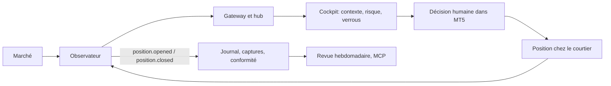

| # | Étape | Composant responsable | Input | Output | Événement | État | Persistance | Failure mode |
|---|---|---|---|---|---|---|---|---|
| 1 | Données de marché | Observateur Python | Ticks et bougies de l'API MT5 | Messages `market.tick`, `market.candle` | `market.tick`, `market.candle.closed` | Dernier bid/ask, ≤ 300 bougies (`GatewayState`) | `ticks`, `candles`, `envelopes` | Terminal fermé : plus de flux ; **gel du flux courtier avec terminal vivant non détecté** (aucune lecture de `TERMINAL_CONNECTED`, fraîcheur du tick non surveillée) |
| 2 | Observation du compte | Observateur | `account_info`, `positions_get` (toutes les 2 s) | `account.snapshot`, `positions.snapshot` | `agent.snapshot.account`, `agent.snapshot.positions` | Compte et positions en mémoire | `envelopes` | Observateur arrêté ; changement de login → sortie code 3 |
| 3 | Analyse et contexte | `lib/analysis` dans le navigateur | Bougies | `MarketContextState` | (mise à jour du store) | `store.marketContext` | Aucune | Données insuffisantes : contexte partiel |
| 4 | Évaluation du risque (consultative) | Risk Engine dans le navigateur | Compte, positions, tick, `/api/risk/today`, calendrier | `RiskState`, publication de verrous | `risk.lockout.enabled` | `store.risk`, registre des verrous | `risk_lockouts` | Onglet fermé : aucune évaluation ni verrou |
| 5 | Détection de setup (parallèle, hors ligne) | Worker S01 | Fichiers JSONL M1/H1/H4/D1 | Ligne `proposed` ou `blocked` + étape | Aucun | Table | `setup_proposals` | Exportateur ou worker arrêtés ; données périmées |
| 6 | Décision et saisie d'ordre | **L'utilisateur, dans MT5** (hors système) | Jugement humain | Ordre chez le courtier | Aucun | Courtier | Courtier | **Le système ne peut pas l'empêcher** |
| 7 | Position ouverte | Courtier ; observateur (différence de positions) ; `GatewayBridgeService` | `positions.snapshot` | Capture d'entrée ; contrôle de verrou (T02c) | `journal.position.opened`, `journal.lockout_violated` | `position_opens`, état de scan | `position_opens`, `trade_captures`, `position_scans` | Événement perdu (écrivain perdant) : trade absent du journal ; course T02c : alerte manquée |
| 8 | Suivi | Observateur ; agent (scan à chaque heartbeat) | Snapshots, scan | Positions affichées ; positions externes attribuées | `execution.position.scan` | `position_scans` (courant) | `position_scans` | Agent non connecté : pas de scan |
| 9 | Sortie | Utilisateur ou stop/cible chez le courtier | Deals de clôture | Trade clos, capture de sortie | `journal.trade_closed` | `closed_trades` | `closed_trades`, `trade_captures` | Idem étape 7 ; **un stop déplacé n'est pas détectable** |
| 10 | Réconciliation | Agent (`ReconcileUnknownCommands`) ; écran `/positions` | Historique MT5 | `execution.reconciled` | `execution.reconciled` | `command_reconciliations` | `command_reconciliations` | Sans objet pour un trade manuel ; jamais exercée avec un ordre réel |
| 11 | Journal et conformité | `lib/compliance`, `lib/journal` | Trades, verrous, fenêtres de session | Violations, taux de conformité | (lecture REST) | Calculé à chaque lecture | Aucune (recalcul) | Données manquantes → taux faux |
| 12 | Revue | `tools/weekly-review`, serveur MCP | REST du Host | Markdown, réponses MCP | Aucun | Fichier `weekly-reviews/<date>.md` | Fichier | Backend arrêté : indisponible |

### 11.2 Cycle conçu (ADR 0010 + ADR 0015) et son état réel

| # | Étape | Composant responsable (cible) | Entrée → sortie | Status | Preuve / écart |
|---|---|---|---|---|---|
| 1 | Données de marché | Observateur → Gateway | ticks, bougies → enveloppes | IMPLEMENTED | `mt5_observer.py` |
| 2 | Contexte d'analyse | `lib/analysis` | bougies → `MarketContextState` | IMPLEMENTED | 29 tests |
| 3 | Détection de setup | S01 (`lib/setup`, worker) | bougies → `SetupOutcome` | IMPLEMENTED | 0 proposition en observation [docs] |
| 4 | Enregistrement | `setup_proposals` | proposition → ligne | IMPLEMENTED | écriture directe, sans lien vers une commande |
| 5 | Décision du Risk Engine (taille, approbation) | `evaluateSignalRisk` → `RiskDecision` | signal → décision | DESIGNED | fonction pure non branchée ; facteur XAU en dur |
| 6 | Construction de la commande | `buildPlaceOrderCommand` | décision approuvée → `PlaceOrderCommand` | DESIGNED | aucun appelant hors tests |
| 7 | Émission | `CockpitHub.SubmitCommand` → `Mt5AgentServer` | commande → `execution.order` | PARTIAL | harnais de développement seulement |
| 8 | Barrières de l'agent | `ValidateOrderCommand` | commande → accepté/refusé | IMPLEMENTED | non éprouvé en réel |
| 9 | Accusé | EA → `execution.ack` | — | IMPLEMENTED | — |
| 10 | Envoi au courtier | `ExecuteOrder` → `OrderSend` | commande → ordre | DESIGNED | code présent, inatteignable (§ 13) |
| 11 | Rapport d'exécution | EA → `execution.report` | — | PARTIAL | seul `SIMULATED` s'exécute |
| 12 | Suivi de position | snapshots + scan de l'agent | — | IMPLEMENTED | — |
| 13 | Gestion de sortie | Fiche S01 (partiel, break-even, sortie forcée) | — | DESIGNED | non codée |
| 14 | Clôture et réconciliation | `position.closed` ; EA-06 | deals → trade clos ; historique → `RECONCILED` | IMPLEMENTED / PARTIAL | réconciliation jamais exercée en réel |
| 15 | Journal, conformité, revue | `lib/compliance`, `tools/weekly-review` | — | IMPLEMENTED | validé sur trades réels [docs] |

**Les étapes 5 à 7 et 10 à 13 forment le trou entre « détecter » et « exécuter » : aucune n'est reliée à la suivante.**

### 11.3 Machine à états d'une commande (code TypeScript non branché)

`lib/domain/execution-state.ts` encode treize états (la documentation du fichier annonce « douze » : écart consigné au § 33). `UNKNOWN` n'a qu'une sortie légale, `RECONCILED`.

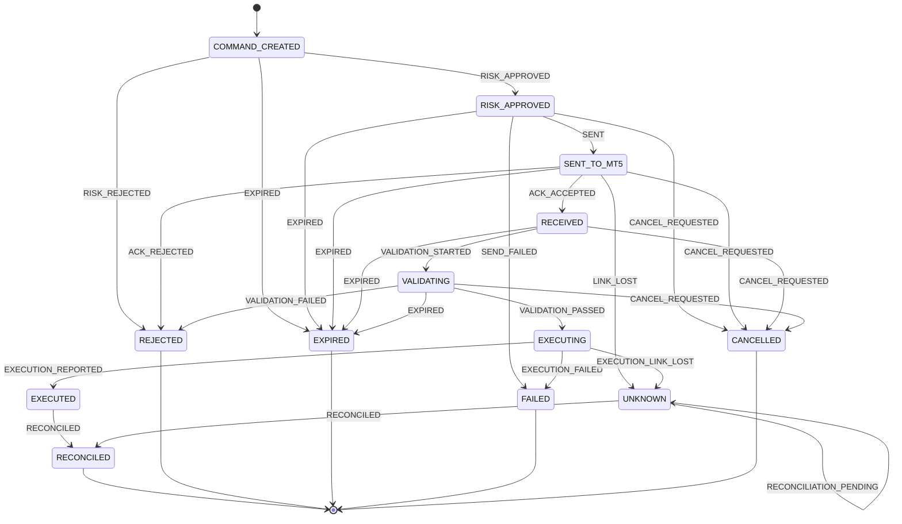

Statuts réellement écrits par l'agent MQL5 dans son journal de commandes : `UNKNOWN` (avant l'appel courtier), `REJECTED`, `EXPIRED`, `SIMULATED`, `FILLED`, `PARTIALLY_FILLED`, `FAILED` (`TradingOsAgent.mq5:1020-1087, 1171, 1208`). Les deux vocabulaires ne sont pas reliés par du code.

---

## 12. Risk Architecture

### 12.1 Où chaque règle est-elle appliquée ?

Légende : **Navigateur** = évaluée dans l'onglet du cockpit (`lib/realtime/signalr-client.ts`) ; **Serveur** = exécutée dans le backend .NET ; **MT5** = barrière dans l'agent MQL5 ; **UI seule** = présente à l'écran sans effet sur un ordre.

| Règle | Définition | Évaluée | Effet réel |
|---|---|---|---|
| Perte quotidienne | `RiskPolicy.dailyLossLimitPercent` ; gate `gate-daily-loss` | Navigateur | Mode `locked` et verrou persistant ; ne bloque aucun ordre |
| Drawdown total | gate `gate-total-dd` | Navigateur | idem |
| Nombre de trades du jour | gate `gate-max-trades` ; `position_opens` | Navigateur (comptage via `/api/risk/today`) | idem |
| Pertes consécutives | gate `gate-consec-loss` ; pause de 30 min | Navigateur | Mode `locked`, verrou temporisé |
| Risque ouvert cumulé | gate `gate-open-risk` (`lib/risk/open-risk.ts`) | Navigateur | Avertissement à 60 % de la limite ; pas de verrou ; **valeur fausse hors XAUUSD** (facteur ×100) |
| Connexion | gate `gate-connection` | Navigateur | État de gate (nouvelles entrées) ; pas de verrou |
| Spread | gate `gate-spread` | Navigateur — conversion « points » à 0,01 | État de gate ; **faux hors or** |
| Session | gate `gate-session` | Navigateur | État de gate |
| Actualité (échec fermé) | gate `gate-news` ; `news_releases` | Navigateur ; worker S01 (`isNewsBlackout`) | État de gate ; bloque l'évaluation S01 (`precondition_calendar`) |
| Risque par trade (taille) | `maxRiskPerTradePercent` ; `evaluateSignalRisk` | **Nulle part** | Aucun : fonction non branchée |
| Verrou actif pendant une ouverture | T02c, `GatewayBridgeService.CheckLockoutViolationAsync` | **Serveur** | Alerte `journal.lockout_violated` seulement |
| Anti-tilt des réglages | `AccountSettingsGuard` | **Serveur** | Différé au prochain jour de trading |
| Arrêt d'urgence | `triggerKillSwitch` | Navigateur / **UI seule** | Pose un verrou ; ne ferme rien, ne met pas l'agent en halte |
| Symbole autorisé, ordre au marché, volume ≤ 1,0 lot, stop > 0, positions < 3, spread par symbole | `ValidateOrderCommand` | **MT5** | Refus de l'ordre ; ne s'applique qu'à un chemin de commande **simulé** |
| Halte locale | fichier `tradingos_halt*.flag`, bouton, `control.halt` | **MT5** | Refus de tout ordre |
| Mode observe-only | constante de compilation `g_mode` | **MT5** | Aucun ordre ne peut partir |
| Commande acceptée uniquement si l'agent est en mode `observe` | `CockpitHub.SubmitCommand` | **Serveur** | Refuse tout autre mode |
| `riskApprovalId` obligatoire | champ de `PlaceOrderCommand` | **Nulle part** (transporté et stocké, jamais vérifié ni lu par l'agent) | Aucun |
| `RISK_NOT_APPROVED` | `Contracts/Execution.cs:63`, `lib/contracts/execution/reject-reason.ts:21` | **Nulle part** (déclaré, jamais utilisé) | Aucun |
| Nombre maximal de positions ouvertes | Aucun champ dans `RiskPolicy` ; `InpMaxOpenPositions` (3) dans l'agent | **MT5** | Refus de l'ordre (chemin simulé) ; compte aussi les positions manuelles |
| Restrictions de symbole | `InpAllowedSymbolsCsv` (`XAUUSDm,EURUSDm`) ; registre `lib/market/symbols/registry.ts` ; S01 limité à EURUSD dans le worker | **MT5** et worker | Refus de l'ordre (chemin simulé) ; aucune restriction côté Risk Engine |
| Corrélation entre positions | — | **Absente** (T16 « corrélations glissantes » est PLANNED, lecture seule) | Aucun |
| Règles de compte (FTMO, Exness réel) | `lib/accounts/ftmo.ts`, `real.ts` ; réglages `account_settings` | Navigateur (politique active) ; **serveur** pour la règle anti-tilt | Paramètrent les gates ; profil par compte non utilisé (registre vide) |

### 12.2 Réponses structurées

| Question | Réponse |
|---|---|
| Le Risk Engine est-il appliqué côté serveur ? | **NO.** Il tourne dans le navigateur ; seuls T02c (alerte) et l'anti-tilt des réglages sont côté serveur. |
| Existe-t-il une barrière côté MT5 ? | **PARTIAL.** Barrières statiques dans l'agent (symbole, volume, positions, stop, spread), non éprouvées en réel et sur un chemin simulé. |
| Une règle peut-elle empêcher un ordre manuel ? | **NO.** Le système n'envoie ni ne bloque d'ordre : l'utilisateur trade dans MT5 hors de son contrôle. |
| Le kill switch ferme-t-il quelque chose ? | **NO.** Il pose un verrou et affiche une bannière. |
| Les limites validées par l'utilisateur sont-elles configurées ? | **NO.** Elles figurent dans `context/project/session-log.md` ; l'incrément I7 (configuration de l'autonomie) n'est pas construit. |

### 12.3 Limites : défaut du code, valeur validée, agent

| Limite | Défaut du code (`lib/risk/policy.ts`, `lib/accounts/real.ts`) | Valeur retenue [docs] | Agent MQL5 |
|---|---|---|---|
| Perte du jour | 5 % | 5 % | — |
| Perte totale | 10 % (capital de référence : `null` pour le compte réel) | 10 % | — |
| Risque par trade | 1 % | **0,1 %** | barrière 1,0 lot (≈ 0,1 % d'un compte de 40 000 $ sur EURUSD) |
| Risque ouvert cumulé | 2 % | non précisé | — |
| Trades par jour | 6 | **4** (2026-09-26, « je valide tes décisions ») | — |
| Positions ouvertes | — | **2** | 3 (`InpMaxOpenPositions`) ; 2 dans le préset gitignoré `ea1.set` [docs ; fichier non lu] |
| Pertes consécutives | 3 → pause 30 min | 2 pertes de suite = fin de journée | — |
| Spread | 40 points (échelle or) | **aucun plafond fixe** : la porte de coût de S01 suffit (ADR 0015, amendement) | `InpMaxSpreadCsv` vide = refus de tout ordre |
| Fenêtres | sessions UTC | killzones Londres et New York AM | — |
| Arrêts de stratégie | — | 20 R de drawdown ; revue à 50 trades (< 20 gagnants → coupé) | — |

Les valeurs 0,1 %, 5 %, 10 % et les fenêtres de trading sont les mots de l'utilisateur (`context/project/session-log.md`, 2026-09-26). Les valeurs 4 trades, 2 positions, 2 pertes de suite, 20 R et 50 trades sont des propositions de l'analyse `02_Plan_Projet/regles-deduites-scalp-marco-2026-09-26.md`, retenues par « je valide tes decisions » (lecture de Claude notée dans le même journal).

**Constat.** Les valeurs retenues et les valeurs du code divergent (risque par trade 0,1 % contre 1 % ; 4 trades contre 6) ; aucune ligne de code ne lit les premières (§ 33).

### 12.4 Chemins de contournement connus

1. **Commande directe par le hub** : un client portant le jeton peut appeler `SubmitCommand` avec un `riskApprovalId` arbitraire (le harnais utilise `"dev-harness"`, `scripts/dev-submit-command.ts:124`) ; seul le mode `observe` de l'agent l'empêche d'aboutir à un ordre.
2. **Onglet fermé** : plus aucune évaluation, plus aucun nouveau verrou.
3. **Verrou levé par un porteur de jeton** : `risk.lockout.cleared` et `risk.lockout.acknowledged` sont publiables sans preuve d'un humain.
4. **Trade manuel hors système** : non empêchable ; détecté a posteriori.
5. **Stop déplacé** : non détectable.

### 12.5 Règles qui n'existent que dans l'interface ou dans une couche non fiable

Une couche est « non fiable » ici si elle peut être absente (onglet fermé), contournée (trading manuel) ou modifiée par un porteur du jeton.

| Règle ou protection | Où elle existe réellement | Pourquoi elle n'est pas fiable |
|---|---|---|
| Les neuf gates du Risk Engine | Onglet du navigateur | Aucune évaluation si aucun onglet n'est ouvert ; aucune application côté serveur ni dans MT5 |
| Mode `locked` et verrous | Calcul dans le navigateur, publication vers le registre | Un verrou n'existe que si un onglet l'a publié ; il alerte, il ne bloque ni ne ferme rien |
| Arrêt d'urgence (kill switch) | Bouton du cockpit | Pose un verrou ; ne ferme aucune position, ne met pas l'agent en halte |
| Verdict de pré-vol « Armé / Pas armé » | Écran `/preflight` | Verdict d'affichage : aucun ordre n'est conditionné par lui |
| Gate de connexion | Lit l'état TCP de l'agent (`Mt5AgentServer.IsConnected`) | Informative ; ne bloque pas le trading manuel |
| Gate de spread et gate de session | Navigateur | Conversion « points » de l'or et fenêtres UTC fixes (TD-16, TD-17) |
| Levée d'un verrou « avec accusé » | Registre persistant + cockpit | Publiable par tout porteur du jeton (TD-06) |
| Conformité (taux, violations) | Calcul après coup | Mesure et ne prévient pas |
| Interdiction d'un ordre non approuvé | Documentation (`safety.md`) | Aucun code ne la vérifie (C-01) |

**Seules protections qui ne dépendent ni du navigateur ni de l'utilisateur** : la constante de compilation `MODE_OBSERVE` de l'agent, ses barrières locales sur une commande, le refus de tout hub ou écriture sans jeton ni `Origin` autorisé, et la règle anti-tilt des réglages de compte (côté serveur).


---

## 13. Execution Architecture

**Position.** L'exécution est *conçue et en grande partie codée* (ADR 0010, fiches EA-01 à EA-06, incréments I0 à I2), mais **bloquée par construction** : l'agent est compilé « observe-only » et aucun composant ne produit de commande de production.

### 13.1 Composants du chemin d'exécution

| Composant | Rôle | Status | Preuve |
|---|---|---|---|
| Contrat `PlaceOrderCommand` | Identité de commande, compte, agent, `protocolVersion` 1, `riskApprovalId`, `expiresAt`, symbole, sens, type, volume, limite, stop, cible | IMPLEMENTED | `lib/domain/execution.ts:123`, `Contracts/Execution.cs` |
| Producteur de commandes | Transformer une proposition approuvée en commande | **DESIGNED** | `buildPlaceOrderCommand` : aucun appelant hors tests ; harnais `scripts/dev-submit-command.ts` pour le développement |
| Entrée serveur `SubmitCommand` | Recevoir et transmettre une commande | PARTIAL | `CockpitHub.cs:87` : accepte si l'agent est en mode `observe`, pas en halte, identité valide ; **aucune vérification d'approbation de risque** |
| Envoi vers l'agent | `Mt5AgentServer.SendCommandAsync`, `Mt5WireTranslator.FlattenPlaceOrder` | IMPLEMENTED | `Mt5AgentServerTests`, `ExecutionTranslationTests` |
| Pipeline de l'agent | Idempotence → halte → identité → compte → expiration → validation locale → ACK | IMPLEMENTED | `TradingOsAgent.mq5:1095-1209` ; non testé automatiquement |
| Chemin simulé | Rapport `SIMULATED` | IMPLEMENTED | `:1206-1208` |
| `ExecuteOrder` / `OrderSend` | Ordre au marché chez le courtier | **DESIGNED** (code présent) | `:1009-1087` ; garde `:1012` ; `OrderSend` `:1052` ; inatteignable (`g_mode` constante `MODE_OBSERVE`, `:92`) |
| Réconciliation d'`UNKNOWN` | Retrouver le sort d'une commande par l'historique (magic + commentaire) | PARTIAL | `ReconcileUnknownCommands` (`:1331`) ; jamais exercée avec un ordre réel |
| Scan des positions | Une ligne `execution.position.scan` par position à chaque heartbeat | IMPLEMENTED | `ScanOpenPositions` (`:1422`) |
| Rejeu des rapports | Renvoyer les rapports finaux récents après reconnexion (`InpReportReplayMinutes` 60) | IMPLEMENTED | `TradingOsAgent.mq5` (I1) |
| Modification, clôture, annulation, fermeture globale | `modify_position`, `close_position`, `cancel_order`, `close_all` | **DESIGNED** | Types dans `lib/domain/execution.ts` et messages `execution.modify/close/close_all/cancel` dans `lib/contracts/mt5-wire.ts` ; l'agent n'a **aucun gestionnaire** (« unhandled message type — ignored », `:823-826`) |
| Échelle de mode | `observe` → `paper` → `confirm` | PARTIAL | `MODE_PAPER` n'est qu'une valeur d'énumération sans comportement propre ; `control.set_mode` ignoré (`:815-818`) ; le type TS interdit `"auto"` (`lib/accounts/types.ts`) |

### 13.2 Séquence complète telle que codée

La branche `CONFIRM` est **présente dans le code mais inatteignable** dans le build actuel.

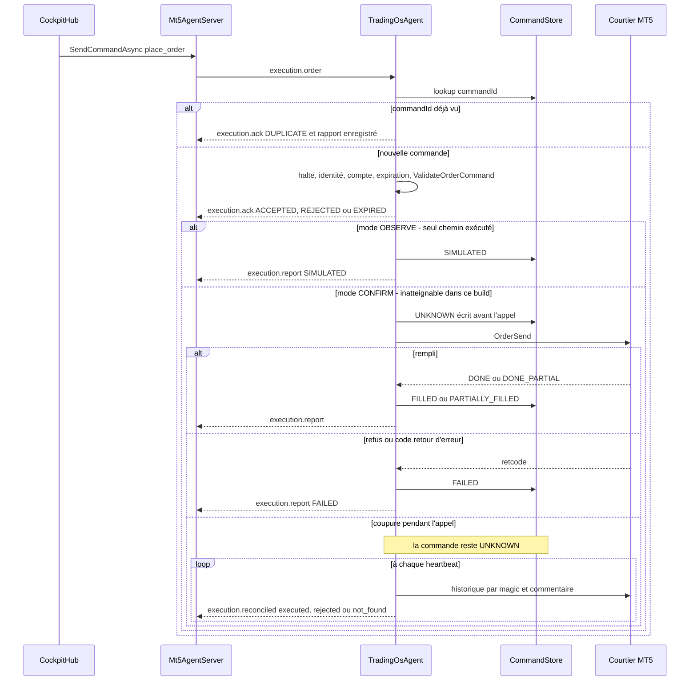

### 13.3 Garanties et lacunes de conception (vérifiées dans le code)

| Sujet | Garantie codée | Lacune |
|---|---|---|
| Idempotence | Le journal disque par login et magic est consulté **avant tout autre contrôle** ; un `commandId` rejoué renvoie `DUPLICATE` sans ré-exécuter | Jamais exercée avec un ordre réel ; aucune logique de ré-émission n'a été trouvée dans le Gateway (une commande est émise une seule fois par `SubmitCommand`) |
| Pas de double ordre | La ligne `UNKNOWN` est écrite **avant** l'appel courtier ; si elle ne peut pas l'être, l'ordre n'est pas envoyé (`STORE_UNWRITABLE`) | Une écriture réussie suivie d'un crash laisse `UNKNOWN` jusqu'à la réconciliation |
| Expiration | Une commande reçue après `expiresAt` est refusée (`EXPIRED`) ; le constructeur fixe 60 s (`COMMAND_TTL_MS`) | L'expiration n'est vérifiée qu'à la réception (`TradingOsAgent.mq5:1168`) |
| Identité de compte | Comparaison avec `ACCOUNT_LOGIN` réel ; `ACCOUNT_MISMATCH` | — |
| Classement des retours courtier | `DONE`/`DONE_PARTIAL` → rempli ; tout autre code → `FAILED` définitif | Des codes ambigus (10011 erreur de traitement, 10012 délai dépassé, 10031 pas de connexion) devraient rester `UNKNOWN` (constat F03) |
| Contrôle préalable | Barrières locales statiques | Pas d'`OrderCheck` ; sens du stop non vérifié ; barrière de volume en lots |
| Glissement (`deviation`) | `InpMaxSlippagePoints` = 10 passé dans la requête | Sans effet en exécution au marché selon la documentation MQL5 (constat F04) |
| Approbation de risque | Champ `riskApprovalId` transporté et stocké | Ni le hub ni l'agent ne le vérifient ; l'agent ne le lit pas |
| Fermeture | — | Aucun exécutant de fermeture n'existe ; EA-08 non construit |
| Réessais (retries) | Aucune ré-émission automatique d'une commande ; l'agent ne réessaie jamais un `OrderSend` ; la réconciliation d'une commande `UNKNOWN` est rejouée à chaque heartbeat (lecture de l'historique seulement) | Aucune borne ni escalade pour `not_found` |
| Délais (timeouts) | TTL de commande de 60 s, vérifié **à la réception** ; ping Gateway 5 s ; watchdog 30 s ; `InpReconciliationLookbackDays` 7 | Aucun délai sur le résultat d'un `OrderSend` ; aucune échéance de réconciliation |
| Prévention des doublons | `commandId` unique (journal disque) ; rapports à identifiant déterministe (`report_id`, `ON CONFLICT DO NOTHING`) | Un rapport rejoué crée une nouvelle enveloppe d'audit (nouveau `messageId`) mais une seule ligne `execution_reports` |
| Gestion des échecs | Refus typés (`HALTED`, `IDENTITY_REFUSED`, `ACCOUNT_MISMATCH`, `SYMBOL_UNAVAILABLE`, `SPREAD_LIMIT_MISSING`, `STORE_UNWRITABLE`…) ; chaque refus est journalisé sur disque et rapporté (l'expiration n'émet qu'un accusé) | Pas d'alerte sortante ; les refus du hub (`RejectAsync`) sont en texte libre : les codes `ACCOUNT_MISMATCH`, `MODE_NOT_OBSERVE`, `AGENT_UNREACHABLE`, `RISK_NOT_APPROVED` sont déclarés mais le hub n'utilise pas ses constantes |

### 13.4 Réponses structurées

| Question | Réponse |
|---|---|
| Le système peut-il envoyer un ordre au courtier aujourd'hui ? | **NO — BLOCKED** par la constante de compilation `MODE_OBSERVE`. |
| Peut-il modifier un stop ou fermer une position ? | **NO** : aucun message ni gestionnaire. |
| L'unique `OrderSend` est-il protégé ? | **YES** : garde de mode, garde d'identité/halte, écriture préalable d'`UNKNOWN`. Non éprouvé en réel. |
| Une commande de développement peut-elle atteindre l'agent ? | **YES** (si l'agent est en `observe`), et elle y finit en `SIMULATED`. |

---

## 14. MT5 Architecture

### 14.1 Composants

| Composant | Rôle | Emplacement | Status |
|---|---|---|---|
| Terminal MetaTrader 5 | Plateforme du compte, build 5.0.0.6230 | `C:\Program Files\MetaTrader 5` | IMPLEMENTED (externe) |
| Observateur Python | Lecture seule via l'API Python officielle | `tools/mt5-observer/mt5_observer.py` | IMPLEMENTED |
| Agent MQL5 `TradingOsAgent` | Exécutant local, v1.10, 1 458 lignes | `tools/mt5-execution-agent/TradingOsAgent.mq5` (+ `Include/`) | PARTIAL |
| Jonction | Le dossier d'experts du terminal pointe vers le dépôt | `MQL5\Experts\TradingOsAgent` → `tools/mt5-execution-agent` (créée le 2026-09-23) | IMPLEMENTED (poste de l'utilisateur) |
| Binaire compilé | `TradingOsAgent.ex5` (107 426 octets), `compile.log` : 0 erreur, 0 avertissement | `tools/mt5-execution-agent/` (non versionné) | IMPLEMENTED |
| Fichiers de l'agent | Jeton `tradingos_agent.token` (écrit par `start-live`), journal `tradingos_commands_<login>_<magic>.log`, drapeaux `tradingos_halt*.flag` | `MQL5\Files` du terminal | Jeton **absent** aujourd'hui |
| Préset | `ea1.set` (gitignoré, UTF-16) | `tools/mt5-execution-agent/` | Existe ; **non lu** par cet audit |
| EA tiers | `Ultimate_ICT_Gold_Scalper_v4.0` présent dans `MQL5\Experts` | Terminal | Hors dépôt ; l'agent publie la liste des autres experts attachés (`attachedExperts`) car « Algo Trading les arme tous » |

### 14.2 Deux processus, deux responsabilités

| Aspect | Observateur | Agent |
|---|---|---|
| Direction | Serveur WebSocket (le Gateway s'y connecte) | Client TCP (il se connecte au Gateway) |
| Capacité d'ordre | **Aucune** (aucun `order_send`) | Une, inatteignable |
| Symboles | Un par processus | Liste blanche `InpAllowedSymbolsCsv` (`XAUUSDm,EURUSDm`) |
| Authentification | Jeton Bearer + refus de tout `Origin` | Jeton dans `hello` comparé en temps constant |
| Cadence | tick 1 Hz, compte 2 s, heartbeat 3 s | `OnTimer` 1 s, heartbeat 5 s |
| Mort | Sortie code 3 si le login change | Refus de tout ordre si l'identité diverge ; instance unique |

### 14.3 Protocole

Messages JSON, un par ligne, UTF-8 sans BOM, `version`, `type`, `accountId`, `time` (ms UTC) sur chaque message (`lib/contracts/mt5-wire.ts:62`).

| Sens | Types |
|---|---|
| Observateur → Gateway | `agent.hello`, `agent.heartbeat`, `account.snapshot`, `positions.snapshot`, `position.opened`, `position.closed`, `market.tick`, `market.candle`, `execution.ack`, `execution.report` (hérités) |
| Agent → Gateway | `agent.hello`, `agent.heartbeat`, `execution.ack`, `execution.report`, `execution.reconciled`, `execution.position.scan` |
| Gateway → Agent | `execution.order`, `control.ping`, `control.halt` ; **ignorés** par l'agent : `control.set_mode`, `control.resync` |
| Déclarés sans émetteur ni gestionnaire | `execution.modify`, `execution.close`, `execution.close_all`, `execution.cancel`, `agent.error` |

Le `hello` de l'agent annonce notamment : mode effectif et plafond de mode, identité (`ok`/`mismatch`/`no_account`), type de compte (`demo`/`contest`/`real`), mode de marge, levier, quatre permissions de trading du terminal, `tradable`, `closable`, `halted`, décalage UTC du serveur, spécifications du **premier** symbole autorisé (volumes, niveau de stop, mode de remplissage) et autres experts attachés.

### 14.4 Identité, isolation, symboles

- **Identité** : l'agent lit `ACCOUNT_LOGIN` ; `InpAccountId` (facultatif) est le login attendu ; une divergence refuse toute commande.
- **Isolation** (ADR 0010) : un terminal, une instance d'agent (verrou par variable globale), un `InpMagicNumber` obligatoire (> 0).
- **Listes de logins** : `InpTradableLogins` et `InpClosableLogins` — vides par défaut, c'est-à-dire qu'**aucun** login n'est autorisé à recevoir un ordre ou une clôture.
- **Symboles** : registre canonique ↔ courtier (`lib/market/symbols/registry.ts`) : EURUSD → `EURUSDm`, GBPUSD → `GBPUSDm`, XAUUSD → `XAUUSDm` (le contrat `XAUUSD247m` n'est pas enregistré).
- **Prérequis terminal** [docs] : `127.0.0.1` dans la liste d'adresses autorisées du terminal ; symboles visibles dans la Market Watch.

### 14.5 Limites constatées

1. Un compte par terminal, un symbole par observateur ; Windows uniquement (API Python MT5).
2. Le `hello` ne publie ni valeur de tick ni spécifications des symboles autres que le premier.
3. Première connexion de l'agent au Gateway le 2026-09-24 sur une version antérieure, après correction d'un défaut de framing présent depuis le premier commit [docs] ; la procédure de vérification du README (six étapes) n'a passé que la première [docs].
4. Aucun test automatique de l'agent MQL5 ; aucune simulation de coupure réseau ni de crash.


### 14.6 Qui possède quoi

| Responsabilité | Propriétaire réel | Détail | Preuve |
|---|---|---|---|
| **Observation** | Observateur Python | Compte, positions, ticks, bougies, historique des deals ; aucun ordre. L'agent MQL5 observe ses propres positions (scan) uniquement pour la réconciliation. | `mt5_observer.py` ; `ScanOpenPositions` |
| **Execution** | Agent MQL5, commandé par le Gateway | Le Gateway émet, l'agent valide et exécute, le courtier remplit ; **chemin inatteignable** dans le build actuel. | `ExecuteOrder`, `Mt5AgentServer` |
| **Safety** | **Répartie, sans propriétaire unique** | Agent : barrières statiques, halte, identité. Gateway : jetons, refus d'identité, mode `observe`. Navigateur : Risk Engine consultatif. Utilisateur : halte sur le graphique. L'autorité de risque n'est pas côté serveur. | § 12, § 23 |
| **Strategy** | Worker TypeScript S01 hors terminal (détection seulement) | **L'EA ne possède aucune stratégie** (ADR 0010) ; MT5 ne contient ni analyse ni règle de risque. | `scripts/run-setup-detection.ts` |

### 14.7 Télémétrie MT5 effectivement collectée

| Donnée | Source | Cadence | Remarque |
|---|---|---|---|
| Positions | Observateur (`positions_get`) ; agent (`PositionsTotal`, scan) | 2 s ; 5 s | Détection d'ouverture et de clôture par différence |
| Ordres en attente | **Non observés** | — | Aucun appel `orders_get` ; seuls les positions et les deals de l'historique sont lus |
| État du compte | Observateur (`account_info`) | 2 s | Solde, équité, marge, type de compte, levier, mode de marge, permissions |
| Informations de symbole | Observateur (`symbol_info`) ; `hello` de l'agent | À la connexion | Volumes min/max/pas, niveau de stop, mode de remplissage ; **pas de valeur ni taille de tick**, premier symbole seulement pour l'agent |
| Heartbeat | Observateur ; agent | 3 s ; 5 s | `control.ping` du Gateway toutes les 5 s ; l'agent mesure `gatewaySilentMs` |
| Connexion au serveur de trading | **Non lue** | — | Aucun `terminal_info` ni `TERMINAL_CONNECTED` |
| Réconciliation | Agent seulement | À chaque heartbeat tant qu'une commande est `UNKNOWN` | Historique par magic et commentaire |
| Sûreté de l'agent | `hello` / heartbeat | À la connexion et à chaque changement | `identity`, `halted`, `attachedExperts`, quatre permissions de trading, mode et plafond de mode |

---

## 15. Account Architecture

### 15.1 Comptes en jeu

| Compte | Rôle | Vu par le système | Exécution | Source |
|---|---|---|---|---|
| Démo Exness | Validation de la chaîne ; flux à spread fixe | Oui (observateur) | Aucune | docs, `state.md` |
| Réel Exness | Cible de l'autonomie dès l'incrément I5 (ADR 0015) ; limites données le 2026-09-26 | Observable par le même mécanisme ; capital de référence **absent** | Aucune | `session-log.md`, `lib/accounts/real.ts` |
| FTMO 2-Step 10 k$ | Challenge échoué ; référence historique (objectifs, profil) | **Jamais connecté** : « No FTMO terminal has ever been connected » (`lib/accounts/firm.ts`) | Aucune | code, docs |

Aucun numéro de compte n'est reproduit dans ce document. Précision de sécurité : deux numéros de compte figurent dans 24 fichiers suivis par git d'un dépôt **public** [mesuré le 2026-10-03] ; ils ne sont pas répétés ici.

### 15.2 Modèle

- **Identifiant** : `accountId` = login MT5 sous forme de chaîne, porté par chaque enveloppe, commande et table (`account_id`).
- **Type de compte** : `tradeMode` (`demo`/`contest`/`real`) lu dans MT5 ; affiché « RÉEL » avec un ton d'avertissement (`lib/accounts/agent-view.ts:50-51`). Le champ d'environnement du store est, lui, codé en dur `"demo"` en mode backend (`lib/realtime/signalr-client.ts:159`) ; les valeurs `"live"` et `"paper"` ne sont jamais affectées.
- **Agrégat de plateforme** `TradingAccount` (`lib/domain/account.ts:22`) : déclaré, **non utilisé**.
- **Firme** : déduite par sous-chaîne du nom du courtier (`ftmo`, `exness`), modifiable dans Settings ; si aucune ne correspond, politique par défaut.
- **Profils** : `ftmoProfile` (politique 5/10/1/2/6/3/40/30, objectifs du challenge sourcés MetriX, commission 5 $/lot) et `exnessProfile` (`realRiskPolicy`, commission 0, seuil de coût 0,25) ; `ACCOUNT_PROFILES` (profil par compte) est **vide** (`lib/accounts/registry.ts`).
- **Réglages** : registre append-only `account_settings` (challenge FTMO, capital de référence Exness, texte de reconnaissance du courtier) ; règle anti-tilt `AccountSettingsGuard` : un changement est différé s'il n'y a pas de compte vivant, s'il y a une position ouverte, un trade depuis l'ancre du jour, ou un verrou actif.
- **Capital de référence** du compte réel : `EXNESS_REFERENCE_BALANCE = null` ; les 10 % se mesurent alors depuis le solde à la connexion du cockpit, un plancher qui glisse (limite documentée).

### 15.3 Multi-compte

| Capacité | Status |
|---|---|
| Colonnes `account_id` partout, registre d'agents par compte, détection de doublon | IMPLEMENTED |
| Observation simultanée de plusieurs comptes | **NO** : un observateur, un symbole, un compte |
| Profil de risque par compte | DESIGNED (registre vide) |
| Multi-compte natif (T11) | PLANNED |
| Connexion à un compte depuis l'application | DESIGNED (ADR 0013, accepté, non construit) |
| Identifiants de compte stockés | **NON** par règle (`.claude/CLAUDE.md`) ; l'ADR 0013 prévoit un mot de passe transmis sans conservation |


### 15.4 Capacités demandées, une par une

| Capacité | Status | Preuve |
|---|---|---|
| Compte unique | IMPLEMENTED | Un observateur, un compte ; `accountId` partout |
| Multi-compte | **PARTIAL (non opérationnel)** | Colonnes `account_id`, registre d'agents par compte ; un seul compte observé à la fois ; T11 PLANNED |
| FTMO | PARTIAL | `ftmoProfile`, objectifs du challenge ; aucun terminal FTMO jamais connecté ; règles hors 2-Step non sourcées (`TODO(FTMO-rules)`) |
| Compte réel | PARTIAL | `exnessProfile`/`realRiskPolicy` ; capital de référence `null` ; aucune exécution |
| Broker | PARTIAL | Détection par sous-chaîne du nom du courtier ; suffixe de symbole `m` (Exness) dans le registre |
| Terminal | IMPLEMENTED | Un terminal par agent ; isolation par login, magic et instance unique |
| Environment | PARTIAL | Champ `environment` du store : `"mock"` ou `"demo"` ; `tradeMode` réel lu séparément |
| Account profile | PARTIAL | `ACCOUNT_PROFILES` vide ; profil résolu par firme |
| Risk profile | PARTIAL | `RiskPolicy` par firme ; valeurs du code ≠ décisions de l'utilisateur |
| Execution profile | DESIGNED | `ExecutionProfile` (type) inutilisé ; l'équivalent réel = paramètres `Inp*` de l'agent et préset `ea1.set` |
| Symbol mapping | IMPLEMENTED | `lib/market/symbols/registry.ts` (EURUSD, GBPUSD, XAUUSD) |

---

## 16. Strategy Architecture

### 16.1 Réponses structurées

```text
Is there currently an autonomous strategy?

PARTIAL

Evidence:
- Détection S01 complète jusqu'à la proposition : lib/setup/proposal.ts::evaluateSetup (54 tests)
- Worker de mesure : scripts/run-setup-detection.ts -> table setup_proposals
- Aucune proposition produite en observation (595 évaluations au 2026-09-15 [docs])
- Aucune gestion d'entrée à l'ordre, de position ni de sortie ; aucun lien proposition -> commande

Can it currently trade autonomously?

BLOCKED

Why?
- Agent compilé observe-only (g_mode constante MODE_OBSERVE, TradingOsAgent.mq5:92) ; control.set_mode ignoré
- Aucun producteur de commande en production (buildPlaceOrderCommand : tests seulement)
- Risk Engine sans autorité serveur ; dimensionnement faux hors XAUUSD et non branché
- Aucune sortie de position (ni modify, ni close) ; aucune fermeture globale
- Aucune supervision ni homme mort effectif
```


| Question | Réponse |
|---|---|
| Existe-t-il une stratégie autonome ? | **PARTIAL** — S01 est détectée (jamais exécutée) ; aucune logique d'entrée, de gestion ou de sortie automatique n'existe côté exécution. |
| Peut-elle trader en autonomie ? | **NO — BLOCKED** : agent observe-only, aucun producteur de commande, aucun Risk Engine serveur, dimensionnement défectueux et non branché, aucune gestion de sortie. |
| Qui décide des entrées ? | L'utilisateur seul aujourd'hui ; S01 « décide » dans l'ADR 0015 (jamais une IA, jamais une optimisation). |
| Y a-t-il plusieurs stratégies ? | **NO** : une seule (S01) ; aucun registre de stratégies. |
| La recherche d'avantage est-elle active ? | **NO** : close le 2026-09-04 (ADR 0002) ; aucun backtester dans l'arbre actuel. |

### 16.2 Entonnoir de S01

Quinze valeurs de `SetupStage` : cinq préconditions évaluées par le worker avant le pipeline pur, dix étapes du pipeline. La fiche S01 compte neuf étapes de séquence ; `range_location` et `precondition_*` sont des découpages d'implémentation.

| Groupe | Stage | Logique (code) | Status |
|---|---|---|---|
| Préconditions (worker) | `precondition_session_window` | Killzone Londres 02:00-05:00 ou New York AM 07:00-10:00, heure de New York (`Intl`) | IMPLEMENTED |
| | `precondition_ny_lunch` | Pas de nouvelle recherche après 12:00 NY | IMPLEMENTED |
| | `precondition_calendar` | Calendrier jamais synchronisé → bloqué ; blackout ± 30 min autour d'une publication FRED | IMPLEMENTED |
| | `precondition_lockout` | Verrou actif en base | IMPLEMENTED |
| | `precondition_trades_limit` | Trades du jour ≥ limite de la politique | IMPLEMENTED |
| Pipeline pur | `bias` | Biais H4 et D1 concordants (`structuralBias`) | IMPLEMENTED |
| | `dealing_range` | Dernière jambe impulsive 1H ; moitié stricte | IMPLEMENTED |
| | `range_location` | Dernier prix 1H en *discount* de la zone pour un achat, en *premium* pour une vente | IMPLEMENTED |
| | `liquidity` | Niveau déclencheur côté balayage et cible non balayée du côté opposé | IMPLEMENTED |
| | `sweep` | Balayage et reprise **dans la même bougie** ; une cassure annule | IMPLEMENTED |
| | `opposite_swing` | Dernier swing opposé que le déplacement doit casser (MSS) | IMPLEMENTED |
| | `displacement` | Corps ≥ 1,5 × ATR au-delà du swing opposé, avec FVG non comblé | IMPLEMENTED |
| | `poi` | FVG au CE, sinon order block (Breaker hors v1) | IMPLEMENTED |
| | `stop` | Mèche extrême ± tampon de spread ; refus si la distance dépasse le plafond calibré du symbole (quand il est fourni) | IMPLEMENTED |
| | `gates` | Coût `c = (spread + commission) / distance du stop ≤ 0,25` et R:R net ≥ 3 | IMPLEMENTED |
| Après la proposition | Entrée, taille, ordre, gestion, sortie | Entrée = ordre **limite** au CE (le protocole ne sait envoyer que du `MARKET`) ; sorties absentes ; `isInvalidatedByCe` jamais appelé | **DESIGNED / absent** |

### 16.3 Configuration et pilotage

- Paramètres FX provisoires **posés, non dérivés** : `swingLookback` 2, tolérance d'égalité 3 pips, FVG minimal 1 pip, ATR 14, corps ≥ 1,5 ATR, tampon 1 pip, R:R minimal 3 (`scripts/run-setup-detection.ts:46-54`).
- Symboles évalués : EURUSD seulement (GBPUSD mis de côté le 2026-09-25 ; XAUUSD exclu tant que les seuils ne sont pas relatifs à l'ATR).
- Cadence : toutes les 60 s sur des fichiers JSONL exportés à part ; **aucun orchestrateur** relie l'exportateur, le worker et la base (lancement manuel par `start-live.ps1`).
- Cycle de vie (activer/désactiver, versionner une stratégie) : **absent**.

### 16.4 Mesure

- 595 évaluations au 2026-09-15, **aucune proposition**, entonnoir bloqué à l'étape 4 sur 9 [docs, ADR 0015].
- Aucun backtest (ADR 0002) : rien ne démontre que S01 soit rentable ; l'ADR 0015 l'écrit lui-même (« Rien ne dit que cette stratégie est rentable »).
- Le banc de rejeu « événements seulement » (ADR 0011) n'est pas construit : la fréquence de déclenchement de S01 sur historique est inconnue.

### 16.5 État par élément de stratégie

| Élément | Status | Détail |
|---|---|---|
| Stratégies existantes | PARTIAL | Une seule, S01 (« sweep aligné »), formalisée dans une fiche ; aucune autre |
| Détecteurs de setup | IMPLEMENTED | `lib/setup/*` ; `lib/analysis` (structure, liquidité, FVG/OB) fournit du contexte, pas des signaux |
| Règles | IMPLEMENTED (détection) | Transcription de règles de formation ; posées par l'utilisateur, jamais optimisées (ADR 0002, 0011) |
| Signaux | **NOT PRESENT** | Le type `StrategySignal` n'a aucun producteur ; S01 produit des *propositions* (`SetupProposal`) |
| Entrée (entry) | PARTIAL | Prix = CE du POI ; ordre **limite** conçu, protocole `MARKET` seulement |
| Stop | IMPLEMENTED (calcul) | Mèche extrême ± tampon ; plafond de distance par symbole |
| Cible (target) | IMPLEMENTED (calcul) | Liquidité externe opposée non balayée |
| Sortie (exit) | **DESIGNED** | Régime hybride décrit (partiel, break-even, sortie forcée avant 12:00 New York), non codé |
| Gestion de position | **DESIGNED** | Aucun message `modify`/`close` ; `isInvalidatedByCe` jamais appelé |
| Validation | PARTIAL | Tests de géométrie (54) ; aucun oracle externe ; aucune preuve de pertinence |
| Backtest | **ABANDONED / interdit** | ADR 0002 ; code supprimé le 2026-09-04 |
| Replay | **DESIGNED** | ADR 0011 ; banc non construit |
| Optimisation | **Interdite** | ADR 0002 : aucun optimiseur, aucun balayage de paramètres |


---

## 17. AI Architecture

**Règle.** ADR 0005 (accepté le 2026-09-04) : tout composant IA est **en lecture**. L'ADR 0015 le répète pour l'autonomie : les entrées sont décidées par la stratégie configurée, « jamais une IA ».

### 17.1 AI used for

| Usage | Source | Status |
|---|---|---|
| Classer, résumer, retrouver par RAG, expliquer un régime *a posteriori*, répondre à une question sur le journal | ADR 0005 (usages autorisés) | Documenté ; **réalisé seulement par le serveur MCP** (accès en lecture d'un assistant externe, § 18) |
| Assistance au développement (lecture et écriture du dépôt à la demande de l'utilisateur) | `.claude/CLAUDE.md` | Processus de développement, hors produit |
| Analyste IA avec RAG sur le journal et les actualités | T19, `roadmap.md` (Vague 4) | **PLANNED** |
| Détection d'anomalies, classification de régime, assistant de recherche, génération de rapports | `context/ai/ai_future.md` (usages candidats) | **PLANNED**, non décidé ; la génération de rapports existe déjà sans IA (`tools/weekly-review`) |
| Diagnostic, journal, analyse automatisés par un modèle | — | **NOT PRESENT** |

### 17.2 AI NOT allowed to

Ces restrictions **existent réellement** dans le projet ; leur nature (contrainte technique ou règle de processus) est indiquée.

| Interdit | Source | Nature de l'application |
|---|---|---|
| Produire un signal, décider un trade | ADR 0005 ; ADR 0001 ; ADR 0015 (« jamais une IA ») | Technique : aucun appel de modèle dans le runtime ; aucun outil MCP n'écrit |
| Pondérer une décision ; « l'IA propose, l'humain valide » | ADR 0005 (refus explicite) | Règle de conception |
| Contourner ou modifier un paramètre de risque | ADR 0005 | Technique pour le MCP (lecture seule) ; **règle de processus** pour un assistant de développement |
| Déclencher ou annuler un ordre ; exécuter | ADR 0005 ; `.claude/CLAUDE.md` | Technique côté produit (aucun chemin d'ordre) ; processus pour l'assistant : aucun clic sur Démarrer, Armer, Valider, Fermer tout, Arrêt d'urgence ; aucune commande envoyée à un agent en live |
| Déclencher l'autonomie | `.claude/CLAUDE.md` : « Claude ne déclenche jamais lui-même […] l'autonomie » | Règle de processus |

### 17.3 Inventaire

| Élément | Rôle | Status | Preuve |
|---|---|---|---|
| Appel de modèle de langage depuis le produit | — | **NOT PRESENT** | Aucune dépendance LLM dans `package.json`, `*.csproj`, `requirements.txt` ; aucune occurrence de SDK de modèle dans `lib/`, `app/`, `components/`, `tools/`, `scripts/`, `backend/src/` [recherche mesurée] |
| Serveur MCP en lecture seule | Interface d'accès d'un assistant IA externe aux données du journal | IMPLEMENTED | `tools/mcp-server/index.ts` (§ 18) |
| Moteur d'analyse `lib/analysis` | Règles déterministes ICT/SMC — ce n'est **pas** de l'IA | IMPLEMENTED | § 9.11 |
| Revue hebdomadaire | Statistiques et Markdown déterministes — pas de LLM | IMPLEMENTED | `tools/weekly-review/` |
| Agents IA, RAG, embeddings | — | **PLANNED** (T19) ; aucun code | `context/product/backlog.md` |

### 17.4 Réponses structurées

| Question | Réponse |
|---|---|
| Une IA peut-elle placer ou influencer un ordre ? | **NO** — par ADR, et aucun chemin de code n'existe. |
| Y a-t-il de l'IA dans le runtime du produit ? | **NO.** |
| Une clé ou un secret de modèle est-il présent dans le dépôt ? | **Aucun trouvé** (recherche par motifs de noms de fournisseurs). |
| La documentation est-elle cohérente avec l'ADR ? | **PARTIAL** : `context/ai/ai_future.md` (22 lignes) liste « trade ranking » et « parameter optimization » comme usages candidats et dit que l'IA « should assist decisions before it automates decisions », ce que l'ADR 0005 et l'ADR 0002 interdisent (§ 33, C-04). |

---

## 18. MCP Architecture

Un seul serveur MCP, `trading-os` version 1.0.0 (`@modelcontextprotocol/sdk` 1.30.0), transport **stdio**, lancé par `npm run mcp` (`tools/mcp-server/index.ts`). Chaque outil est une transmission vers une route `GET` du Host ou une recombinaison de deux de ces routes avec les fonctions pures de `lib/compliance`. L'identifiant de compte vient de la variable d'environnement `TRADING_OS_ACCOUNT_ID`, jamais d'un paramètre d'outil (`tools/shared/backend-client.ts:57`).

| Tool | Purpose | Read/Write | Risk | Current Status | Entrées / appel / preuve |
|---|---|---|---|---|---|
| `get_trades` | Trades clos d'une plage de dates, P&L réalisé, prix d'entrée et de sortie, disponibilité de la capture ; faits seulement, sans espérance ni taux de réussite | Read | Faible : données de trading personnelles lisibles par tout client MCP local | IMPLEMENTED | `from`, `to`, `symbol?` → `GET /api/journal/trades` (`index.ts:93`) |
| `get_lockouts` | Historique des fenêtres de verrou (kill switch, perte quotidienne, pause après pertes consécutives) | Read | Faible | IMPLEMENTED | `to` → `GET /api/risk/lockouts` (`:115`) |
| `get_candles` | Bougies OHLC stockées pour un symbole, une période, une plage | Read | Faible | IMPLEMENTED | `symbol`, `timeframe`, `from`, `to` → `GET /api/candles` (`:131`) |
| `get_setup_proposals` | Évaluations S01 depuis un instant (`proposed` et `blocked`) : instrument de mesure, jamais un signal | Read | Faible : une proposition affichée à l'assistant pourrait être lue comme un signal (ADR 0005) | IMPLEMENTED | `since` → `GET /api/setup-proposals` (`:149`) |
| `get_execution_divergence` | Positions à magic étranger (`EXTERNAL_POSITION`) et commandes résolues après coup | Read | Faible | IMPLEMENTED | aucune → `GET /api/execution/divergence` (`:166`) |
| `get_compliance_violations` | Violations par trade et taux de conformité, recalculés à chaque appel ; la règle de taille est ignorée faute de solde | Read | Faible | IMPLEMENTED | `from`, `to` → `GET /api/journal/trades` + `GET /api/risk/lockouts`, puis `evaluateTrade` local (`:182`) |

| Aspect | Constat |
|---|---|
| Resources | **Aucune** |
| Prompts | **Aucun** |
| Outils en écriture (mutating tools) | **Aucun** — ADR 0005 appliqué à la lettre ; aucun outil n'appelle `POST` ni ne touche MT5 |
| Permissions | Aucune : transport local, les routes `GET` ne sont pas gardées ; tout processus local peut lancer le serveur et lire le journal |
| Gouvernance | ADR 0005 ; fiche `T15-serveur-mcp.md` ; référence de protocole `ariadng/metatrader-mcp-server` dont la partie exécution n'est jamais branchée |
| Sûreté | Lecture seule ; aucune donnée d'identification ; compte fixé par l'environnement |
| Dépendances | Backend et base démarrés (indisponible tant que le Host est arrêté) |
| Test | Aucun test automatique ; poignée de main réelle validée [docs] |
| Statut | IMPLEMENTED — VALIDATED |

---

## 19. Persistence & Database

### 19.1 Technologie et déploiement

PostgreSQL avec l'extension TimescaleDB, image `timescale/timescaledb:latest-pg17` (tag flottant ; version exacte non vérifiable, conteneur arrêté), base `tradingos`, accès Npgsql/Dapper (sans ORM), volume Docker externe `trading_operating_system_algorithmique_tradingos-pgdata`, port hôte `127.0.0.1:5433`. Le schéma est le fichier `schema.sql` (306 lignes : 17 tables, 14 index secondaires, 2 hypertables) embarqué dans l'assembly et appliqué de façon idempotente à chaque démarrage du Host (`CREATE … IF NOT EXISTS`, boucle de réessai). **Il n'y a pas d'outil de migration** : toute évolution d'une table existante exige une intervention manuelle.

Stratégie de persistance : (1) tout événement qui traverse le backend est écrit tel quel dans `envelopes` (audit complet, JSONB) ; (2) les entités à valeur d'audit ont une table typée alimentée par `PersistenceMapper` ; (3) plusieurs sources écrivent hors du `PersistenceWriter` : le cache FRED, les faits de capture (sans réessai, erreur simplement journalisée), le registre de réglages, le worker S01 et l'import de bougies ; (4) les séries temporelles sont des hypertables ; (5) le registre des verrous et le registre des réglages sont en ajout seul.

### 19.2 Tables

| Table | Rôle | Écrite par | Clé primaire / index | Croissance |
|---|---|---|---|---|
| `envelopes` | Piste d'audit JSONB de toute enveloppe | `PersistenceWriter` | PK `message_id` ; index (`type`, `sent_at` desc) et `correlation_id` | Non bornée (≈ 1 ligne/s pour le tick seul) |
| `candles` (hypertable) | Bougies live M15 et import historique | Writer ; `scripts/import-candles.ts` | PK (`symbol`, `timeframe`, `open_time`) | Non bornée |
| `ticks` (hypertable) | Historique de ticks (horodaté à la réception) | Writer | **Pas de PK** ; index (`symbol`, `ts` desc) | Non bornée |
| `execution_commands` | Commandes émises par le hub | Writer | PK `command_id` | Faible |
| `command_acks` | Accusés de réception | Writer | PK identité ; index `command_id` | Faible |
| `execution_reports` | Rapports d'exécution | Writer | PK `report_id` (déterministe) ; index `command_id` | Faible |
| `command_reconciliations` | État courant des `UNKNOWN` résolus | Writer (upsert) | PK `command_id` ; index (`account_id`, `reconciled_at`) | Faible |
| `position_scans` | État courant des positions ouvertes | Writer (upsert) | PK (`account_id`, `broker_position_id`) ; index partiel sur les positions externes | Faible |
| `trading_day_anchors` | Ancre du jour de trading par compte | Writer | PK (`account_id`, `starts_at_utc`) ; index | 1 ligne/jour/compte |
| `position_opens` | Une ligne par position ouverte | Writer | PK (`account_id`, `broker_position_id`) ; index (`account_id`, `opened_at`) | Faible |
| `closed_trades` | Une ligne par position fermée | Writer | PK (`account_id`, `broker_position_id`) ; index (`account_id`, `closed_at`) | Faible |
| `trade_captures` | Faits d'entrée et de sortie immuables | `TradeCaptureRepository` (hors writer, sans attente) | PK (`account_id`, `broker_position_id`, `kind`) | Faible |
| `risk_lockouts` | Registre des verrous | Writer, via `PublishEvent` | PK `lockout_id` ; index (`account_id`, `since`) | Faible |
| `kill_switch_acks` | Accusés de verrou | Writer | PK (`account_id`, `lockout_id`) ; **FK** vers `risk_lockouts` | Faible |
| `news_releases` | Cache FRED | `NewsCalendarRepository` (hors writer) | PK (`release_id`, `scheduled_at`) ; index `scheduled_at` | Bornée |
| `setup_proposals` | Évaluations S01 | Worker TS (SQL direct) | PK (`symbol`, `event_at`) ; index | ≈ 1 ligne/minute évaluée |
| `account_settings` | Registre de réglages (ajout seul) | `AccountSettingsRepository` | PK `version_id` ; index (`firm`, `requested_at`) | Faible |

### 19.3 Données critiques

| Donnée | Où elle est persistée | Durabilité | Écart |
|---|---|---|---|
| Market Data | `candles` (M15 live), `ticks`, fichiers JSONL du pipeline S01 | Perdante (file bornée) ; aucune rétention | Un symbole seulement ; JSONL du 2026-09-18 |
| Account State | **Aucune table** : enveloppes `agent.snapshot.account` dans `envelopes` ; équité de départ dans `trading_day_anchors` | Perdante | Pas d'historique d'équité structuré |
| Orders | **Aucune table d'ordres** : aucun ordre n'existe ; identifiants courtier dans `command_reconciliations` | — | — |
| Positions | `position_opens`, `position_scans` (état courant), `closed_trades` | Perdante pour le writer | Pas d'historique des modifications de stop |
| Trades | `closed_trades`, `trade_captures` | Perdante pour `closed_trades` ; capture sans attente et sans réessai | Un trade peut manquer au journal |
| Risk Decisions | **Aucune** : `RiskDecision` n'est jamais produite ; l'état de risque est calculé dans le navigateur ; seuls les verrous sont persistés | — | Aucune trace des évaluations de gates |
| Execution Commands | `execution_commands`, `command_acks`, `execution_reports`, `command_reconciliations` | Perdante (même writer) | Défaut TD-07 |
| Events | `envelopes` | Perdante | Rejeu impossible |
| Journal | `closed_trades` ⨝ `trade_captures` ⨝ `position_opens` ; revues dans `weekly-reviews/` | Perdante | Aucune saisie d'intention |
| Audit | `envelopes` (append-only), registres de verrous et de réglages | Perdante pour `envelopes` | Aucune signature, aucune immutabilité imposée par la base |

### 19.4 Garanties et lacunes

| Sujet | Constat | Preuve |
|---|---|---|
| Écriture | Canal borné de 10 000 en mode `DropWrite` ; une erreur de base abandonne l'événement et attend 5 s ; **jamais de rejeu** | `PersistenceWriter.cs:42-148` |
| Diffusion avant écriture | `PublishEvent` diffuse à tous les clients **avant** la mise en file : un fait peut être confirmé à l'écran sans jamais atteindre la base ; seul le compteur `dropped` de `/health` le révèle | commentaire de `lib/realtime/use-persistence-health.ts` |
| Rétention, compression | **Aucune** (`create_hypertable` seulement) | `schema.sql` |
| Clés étrangères | Une seule (`kill_switch_acks → risk_lockouts`) | `schema.sql:115-120` |
| Horodatage des ticks | Heure de réception du backend, pas heure du tick | `PersistenceMapper.MapTick` |
| `ticks` sans clé primaire | Doublons possibles | `schema.sql:34-41` |
| Sauvegarde | Un `pg_dump` manuel du 2026-09-25 (28,9 Mo) dans `backups/`, sur le même disque, hors dépôt ; aucune sauvegarde planifiée | `backups/tradingos-2026-09-25-pre-rebind.dump` |
| Contenu actuel | **Non lisible** : la base est arrêtée ; aucun comptage de lignes n'a pu être fait | [mesuré] |
| Test d'intégration | `AuditRepositoryIntegrationTests` réussit à vide quand la base est arrêtée | `AuditRepositoryIntegrationTests.cs:37` |

---

## 20. Event Architecture

### 20.1 Ce que le projet utilise réellement

| Mécanisme | Présent ? | Détail |
|---|---|---|
| Événements | **YES** | Toute donnée en mouvement circule dans une enveloppe `{messageId, correlationId, causationId, type, schemaVersion = 1, source, target = "dashboard", sentAt, payload}` (`lib/contracts/envelope.ts`, `Contracts/Envelope.cs`) |
| Bus d'événements (event bus) | **NO** | Les adaptateurs notifient `GatewayBridgeService` par événements C# en processus (`EnvelopeReady`, `ConnectionChanged`, `StatusChanged`) ; aucun courtier de messages |
| Publication/abonnement (pub/sub) | **PARTIAL** | SignalR diffuse à **tous** les clients (`Clients.All`, message `event`) ; aucun groupe ni abonnement ; `dashboard.subscribe`/`unsubscribe` déclarés, jamais utilisés |
| SignalR | **YES** | Hub `/hub/cockpit`, WebSockets seuls, jeton et `Origin` obligatoires |
| Files (queues) | **PARTIAL** | Un canal borné en processus pour la persistance (10 000, `DropWrite`) ; aucune file externe |
| Workers | **YES** | Deux `BackgroundService` (`GatewayBridgeService`, `NewsCalendarService`) ; hors processus : worker S01 (Node), exportateur (Python) |
| Persistance des événements | **YES, perdante** | `envelopes` (§ 19) |

### 20.2 Table des événements

Légende — **Transport** : `WS` observateur → Gateway (WebSocket loopback) ; `TCP` agent → Gateway ; `Hub` SignalR vers le cockpit ; `SQL` écriture directe. **Retry** : `R0` aucun rejeu ; `R1` rejeu des rapports finaux récents (60 min) à la reconnexion de l'agent ; `R2` l'écrivain attend 5 s puis abandonne l'événement si la base est indisponible. **Ordering** : `O1` ordre d'arrivée dans une file unique, sans numéro de séquence ni garantie entre sources. **Idempotency** : `I1` `messageId` (GUID créé à chaque traduction, `ON CONFLICT DO NOTHING`) ; `I2` clé naturelle SQL ; `I3` `report_id` déterministe.

| Event | Producer | Consumer | Transport | Persistence | Retry | Ordering | Idempotency |
|---|---|---|---|---|---|---|---|
| `market.tick` | `Mt5ObserverClient` | Store | WS → Hub | `envelopes` + `ticks` | R0, R2 | O1 | I1 (`ticks` sans clé) |
| `market.candle.closed` | `Mt5ObserverClient` | Store, analyse | WS → Hub | `envelopes` + `candles` | R0, R2 | O1 | I1 ; I2 (upsert) |
| `agent.connected`, `agent.heartbeat` | Observateur **et** agent | Store, watchdog | WS ou TCP → Hub | `envelopes` | R0, R2 | O1 | I1 |
| `agent.disconnected` | `Mt5ObserverClient` | Store | WS → Hub | `envelopes` | R0, R2 | O1 | I1 |
| `agent.snapshot.account`, `agent.snapshot.positions` | `Mt5ObserverClient` | Store, Risk Engine | WS → Hub | `envelopes` | R0, R2 | O1 | I1 |
| `risk.day_anchor.resolved` | Observateur (hello), puis `GatewayBridgeService` (toutes les 5 min) | Store | WS → Hub | `trading_day_anchors` | R0, R2 | O1 | I2 |
| `risk.day_anchor.equity_observed` | Cockpit (`PublishEvent`) | Hub | Hub | `trading_day_anchors` | R0, R2 | O1 | I2 |
| `risk.lockout.enabled`, `.cleared`, `.acknowledged` | Cockpit (`PublishEvent`) | Tous les clients | Hub | `risk_lockouts`, `kill_switch_acks` | R0, R2 | O1 | I2 |
| `journal.position.opened` | `Mt5ObserverClient` (différence de positions) | Pont (T05, T02c), store | WS → Hub | `position_opens` ; capture d'entrée en SQL direct, sans réessai | R0, R2 | O1 | I2 |
| `journal.trade_closed` | `Mt5ObserverClient` (historique des deals) | Pont (T05), store | WS → Hub | `closed_trades` ; capture de sortie en SQL direct, sans réessai | R0, R2 | O1 | I2 |
| `journal.lockout_violated` | `GatewayBridgeService` | Store | Hub | `envelopes` | R0, R2 | O1 | I1 |
| `market.calendar.updated` | `NewsCalendarService` | Store | Hub | **Non persisté** | R0 | — | — |
| `accounts.settings.changed` | `AccountSettingsEndpoints` | Store | Hub | `envelopes` | R0, R2 | O1 | I1 |
| `execution.command.place_order` | `CockpitHub.SubmitCommand` | Store | Hub | `execution_commands` | R0, R2 | O1 | I2 (`command_id`) |
| `execution.command.acknowledged`, `.rejected` | `Mt5AgentServer` (accusés) ; hub (refus) | Store | TCP → Hub | `command_acks` | R0, R2 | O1 | I1 — **sans clé naturelle : doublons possibles** |
| `execution.order.simulated`, `.submitted`, `.filled`, `.partially_filled`, `.failed` | `Mt5AgentServer` (rapports) | Store | TCP → Hub | `execution_reports` | R1, R2 | O1 | I3 |
| `execution.reconciled` | `Mt5AgentServer` | Lectures de divergence | TCP → Hub | `command_reconciliations` | Renvoyé à chaque heartbeat tant que la commande reste `UNKNOWN` | O1 | I2 (upsert) |
| `execution.position.scan` | `Mt5AgentServer` | Lectures de divergence | TCP → Hub | `position_scans` | Renvoyé à chaque heartbeat | O1 | I2 (upsert) |
| `execution.agent.connection`, `execution.agent.status` | `GatewayBridgeService` | Store (gate de connexion, écran Agents) | Hub | `envelopes` | R0, R2 | O1 | I1 |

`execution.reconciled` et `execution.position.scan` existent côté C# et dans `lib/contracts/mt5-wire.ts`, mais **sont absents de l'union TypeScript `EventType`** (C-08).

### 20.3 Types déclarés sans producteur

21 des 38 types de l'union TypeScript n'ont **aucun producteur en mode backend** : `market.candle.opened`, `market.spread.updated`, `market.symbol.metadata`, `analysis.*` (5 ; seul le client mock émet `analysis.market_context.updated`), `risk.state.updated`, `execution.command.modify_position`, `.close_position`, `.close_all`, `.cancel_order`, `execution.position.opened`, `.modified`, `.closed` (le store lit `opened` et `closed`), `agent.error`, `dashboard.subscribe`, `.unsubscribe`, `.snapshot.requested`, `.alert.acknowledged`. Les constantes C# couvrent 25 types.

### 20.4 Propriétés d'ensemble

- **Pas de rejeu** : un client déconnecté perd ce qu'il n'a pas reçu ; il se resynchronise par `GetSnapshot` et trois lectures REST.
- **Pas d'ordre garanti entre sources** : l'observateur, l'agent, le hub et les services de fond produisent chacun leurs enveloppes ; l'horloge de `sentAt` est celle du backend.
- **Diffusion avant écriture** (TD-07) : la diffusion à tous les clients précède la mise en file de persistance.

---

## 21. Observability

```text
Can the system know that it is broken?

PARTIAL
- Sait : liaison observateur/agent coupée (watchdog 8 s, 30 s), base indisponible ou événements perdus
  (/health, compteur dropped), identité d'agent divergente, agent en halte.
- Ne sait pas : processus arrêtés (rien ne les surveille), flux de prix figé avec terminal vivant,
  perte de connexion au serveur du courtier, machine éteinte, divergence entre base et courtier.

Can the system explain why?

PARTIAL
- Explique : refus d'une commande (codes typés dans l'agent), refus de gate (texte lisible),
  verrous (raison enregistrée), erreur de base (dbError), refus d'accès (journal masqué).
- N'explique pas : cause d'un arrêt de conteneur (sortie 255 « cause non investiguée » [docs]),
  événements perdus (le compteur ne dit pas lesquels), trajectoire d'une décision (aucune RiskDecision).
```

### 21.1 Détail

| Question | Réponse | Détail |
|---|---|---|
| Journaux (logs) | **YES** (locaux) | Console du Host, de l'observateur ; journal d'experts de MT5 ; le Host masque les jetons (`RedactingConsoleFormatter`) |
| Journalisation centralisée | **NO** | Aucun agrégateur ; journaux non conservés par le projet |
| Métriques | **NO** | Aucun Prometheus, aucune métrique applicative |
| Traces distribuées | **NO** | `correlationId` d'enveloppe seulement |
| Contrôle de santé (health check) | **YES** | `GET /health` : `status`, `observer`, `agentPort`, `agentConnected`, `db`, `persisted`, `dropped`, `queued`, `dbError`, `unmapped`, `mappingError`, `access` (booléens, jamais les valeurs de jeton) |
| Heartbeat | **YES** | Observateur 3 s ; agent 5 s ; `control.ping` du Gateway 5 s ; watchdog du Gateway 30 s ; watchdog du cockpit 2 s, périmé après 8 s |
| Tableaux de bord (dashboards) | **PARTIAL** | Pastille du menu de compte (sonde de `/health` toutes les 15 s ; alerte si `dropped > 0` ou base non « ok »), écran `/agents`, écran `/positions` (divergence) |
| Incidents | **NO** | Aucun registre d'incidents ni procédure |
| Alertes sortantes (notification, courriel, mobile) | **NO** | Bannières dans le cockpit seulement ; T14 PLANNED |
| Piste d'audit | **YES** | `envelopes` (tant que l'écriture n'est pas perdue) |
| Détection de perte d'événements | **PARTIAL** | Compteurs `dropped` et `unmapped` ; aucun rejeu |
| Surveillance de l'agent MT5 | **YES** | Heartbeat, ping, watchdog, identité, halte, experts attachés |
| État « marché fermé » | **NO** | Aucun calendrier de marché ; aucune fraîcheur de tick |

### 21.2 Lacunes

- **Aucune alerte quand tout est arrêté** : les services sont à l'arrêt depuis 7 jours sans que rien ne le signale.
- Le journal d'experts MT5 et les journaux de l'observateur ne sont ni collectés ni conservés.
- `context/monitoring/observability.md` décrit une cible plus riche (C-03).

---

## 22. Recovery & Fault Tolerance

| Failure | Detection | Recovery | Current Status | Gap |
|---|---|---|---|---|
| MT5 disconnect (terminal fermé) | Observateur : échec de `mt5.initialize()` au démarrage ; WebSocket coupé côté Gateway (`agent.disconnected`) ; TCP de l'agent fermé (`execution.agent.connection`) ; cockpit « déconnecté » | Relance manuelle (`start-live.ps1`) | PARTIAL | Pas de relance automatique ; comportement de l'observateur si le terminal se ferme en cours de route : non vérifié |
| Broker disconnect (terminal vivant, serveur de trading coupé) | **Aucune** : ni `TERMINAL_CONNECTED` ni fraîcheur de tick lus ; le heartbeat de l'observateur continue | Reconnexion propre à MT5 | **NO** | Prix périmés non détectés (cf. F07) |
| Gateway crash / backend arrêté | L'agent mesure `gatewaySilentMs` et voit sa socket tomber ; cockpit « déconnecté » | Relance manuelle du conteneur (`restart: no`) ; l'agent continue seul et **rejoue ses rapports finaux** des 60 dernières minutes à la reconnexion | PARTIAL | L'homme mort n'a aucun effet (lié à l'armement, I4) ; pas de redémarrage automatique |
| Observer crash | Boucle de reconnexion du Gateway toutes les 3 s ; cockpit « déconnecté » | Relance manuelle | PARTIAL | Aucune supervision, aucune alerte |
| Database unavailable | `/health` : `db = "down"`, `dbError`, `dropped` ; pastille du cockpit | Réessai d'écriture toutes les 5 s ; le Host survit ; schéma réappliqué au redémarrage | PARTIAL | **Événements perdus, jamais rejoués** (`DropWrite`) ; pas de boîte d'envoi (TD-07) |
| Network unavailable | FRED : échec de lecture journalisé ; tout le reste est en loopback | Cache FRED en base ; gate d'actualité **fermée** si jamais synchronisé | IMPLEMENTED (FRED) | Sans objet pour le reste ; connectivité du courtier = ligne « Broker disconnect » |
| EA crash (agent ou terminal) | Socket TCP fermée ; verrou d'instance (variable globale) | Au redémarrage, l'agent relit son journal disque ; les commandes `UNKNOWN` sont réconciliées par l'historique | PARTIAL | Jamais exercé avec un ordre réel ; aucun test de crash |
| Duplicate command | `commandId` retrouvé dans le journal disque (consulté avant tout autre contrôle) | Accusé `DUPLICATE` + rapport enregistré, jamais de ré-exécution | IMPLEMENTED | Jamais exercée avec un ordre réel |
| Timeout | `expiresAt` (60 s) vérifié **à la réception** ; watchdog 30 s sur un agent muet | Commande refusée `EXPIRED` ; agent muet déconnecté | PARTIAL | Aucun délai sur le résultat d'`OrderSend` ; le hub n'attend aucun accusé et ne réessaie pas |
| UNKNOWN execution | Ligne `UNKNOWN` dans le journal disque, écrite **avant** l'appel courtier | Réconciliation à chaque heartbeat (historique par magic et commentaire) → `execution.reconciled` | PARTIAL | `not_found` n'a ni échéance ni escalade ; retours ambigus classés `FAILED` (TD-03) |
| Restart (redémarrage de la machine) | Aucune | Manuel ; les verrous, réglages et ancres persistent en base | **NO** | Rien ne relance Docker, MT5, l'observateur, le cockpit ni le pipeline S01 |
| Stale heartbeat | Watchdog du cockpit (8 s) ; watchdog du Gateway (30 s) | État « périmé » affiché ; reconnexion automatique des clients | IMPLEMENTED | Aucune action automatique sur un agent périmé |
| Inconsistent state | Position à magic étranger (`EXTERNAL_POSITION`) ; identité d'agent ≠ compte ; ancre de jour revérifiée toutes les 5 min ; écran `/positions` | Résolution manuelle | PARTIAL | Pas de réconciliation automatique base ↔ courtier ; dérive TS/C# sans alerte |

**Constat.** Le système est tolérant aux pannes *de liaison* (reconnexions, idempotence, `UNKNOWN`), pas aux pannes *de processus* ni de *machine* : rien ne relance quoi que ce soit, et plusieurs pannes (courtier, arrêt de conteneur) ne sont pas détectées.

---

## 23. Security & Safety

### 23.1 Sécurité informatique

| Contrôle | Mise en œuvre | Preuve | Status |
|---|---|---|---|
| Secrets (secrets) | Trois jetons (cockpit, observateur, agent) générés par `start-live.ps1` dans `.env` (gitignoré) ; **absents aujourd'hui** (seule la clé FRED est présente) ; jeton de l'agent copié dans `MQL5\Files` (lisible par tout programme MQL5 du terminal, limite documentée) | `docker-compose.yml`, `scripts/start-live.ps1` | IMPLEMENTED (non déployé) |
| Authentification | Jeton partagé par surface : hub et écritures `/api` (jeton `Bearer` ou `access_token` **et** `Origin` autorisé), observateur (`Bearer`, refus de tout `Origin`), agent (jeton dans le `hello`) ; comparaisons en temps constant ; aucun compte utilisateur | `LocalAccessGuard.cs`, `mt5_observer.py:650`, `Mt5AgentServer.cs:446` | IMPLEMENTED |
| Échec fermé | Jeton vide → surface gardée refuse tout (403) | `LocalAccessGuard.cs`, `LocalAccessGuardTests` | IMPLEMENTED |
| Autorisation (command authorization) | **Aucune autorisation fine** : un porteur du jeton cockpit peut publier 4 types d'événements et soumettre une commande ; `riskApprovalId` jamais vérifié ; le contrôle d'`Origin` ne distingue pas deux clients du même navigateur | `CockpitHub.cs:27-33,87-125` | **PARTIAL / faiblesse** |
| Lectures `GET /api/*` et `/health` | **Non gardées** (publication loopback seulement) | `Program.cs` | PARTIAL |
| Isolation de compte (account isolation) | Identité (`ACCOUNT_LOGIN` contre `InpAccountId`), `ACCOUNT_MISMATCH`, magic obligatoire, instance unique, listes de logins vides par défaut, registre d'agents par compte | `TradingOsAgent.mq5`, `Mt5AgentServer.cs:474` | IMPLEMENTED (code, non déployé) |
| Exposition réseau | Tout lié à `127.0.0.1` (base 5433, backend 5080 et 9765, observateur 8765, cockpit `-H 127.0.0.1`) ; la base était publiée sur toutes les interfaces jusqu'au 2026-09-25 | `docker-compose.yml`, `package.json` | IMPLEMENTED |
| Reliure DNS (DNS rebinding) | `proxy.ts` refuse tout `Host` non loopback ; `/api/cockpit-token` exige un contexte de même origine | `lib/security/*`, `proxy.ts` | IMPLEMENTED |
| Masquage dans les journaux | `RedactingConsoleFormatter` | `Program.cs:13` | IMPLEMENTED |
| Opérations dangereuses (dangerous operations) | Ordre : inatteignable (constante de compilation) ; clôture : n'existe pas ; changement de mode : n'existe pas ; halte : locale seulement ; démarrage de l'agent : geste de l'utilisateur | § 13 | IMPLEMENTED (par absence) |
| Mot de passe de base | Valeur de développement triviale **en clair** dans 6 fichiers suivis : `docker-compose.yml`, valeur par défaut de `backend/src/TradingOs.Host/Program.cs`, `scripts/run-setup-detection.ts:33`, `scripts/import-candles.ts`, `AuditRepositoryIntegrationTests.cs`, `context/backend/persistence.md` [mesuré] | fichiers cités | **Faiblesse** (limitée par la liaison loopback) |
| Identifiants de compte dans le dépôt | Deux numéros de compte dans 24 fichiers suivis (fixtures de test, commentaire de `lib/accounts/ftmo.ts`…) ; **dépôt GitHub public** [mesuré le 2026-10-03, non remesuré] ; aucun secret trouvé dans l'historique de 83 révisions | bilan du 2026-10-03 | **Risque ouvert** |
| Dépendances (supply chain) | `package-lock.json` présent ; tags d'images Docker flottants ; aucun audit de dépendances, aucune CI, aucun scan | `quality_gates.md` | **NO** |
| Publication des événements de verrou | Tout porteur du jeton cockpit peut publier `risk.lockout.cleared` / `.acknowledged` | `CockpitHub.cs:27-33` | **Faiblesse** (TD-06) |
| Validation de configuration | Host : tout jeton vide ⇒ refus ; `start-live` lit `/health.access` pour détecter un conteneur sans `.env` ; agent : magic > 0 exigé, spread par symbole exigé ; réglages de compte : `AccountSettingsValidation` ; **aucun schéma pour `.env`** | `Program.cs:114-135`, `TradingOsAgent.mq5`, `AccountSettingsValidation.cs` | PARTIAL |
| Séparation des environnements | `tradeMode` (démo/réel) affiché et transmis ; liste blanche de logins (`InpTradableLogins`) ; **une seule base, un seul backend** pour démo et réel (séparés par `account_id`) ; aucune configuration par environnement | § 15 | PARTIAL |
| Authentification des utilisateurs | Aucune : usage strictement personnel sur loopback | charte | Par conception |

### 23.2 Sûreté du trading

| Garde | Mise en œuvre | Status |
|---|---|---|
| Aucun ordre ne peut partir | Constante de compilation `MODE_OBSERVE` ; `OrderSend` derrière deux gardes | IMPLEMENTED |
| Journal d'idempotence disque avant tout appel courtier | `CommandStore.mqh` | IMPLEMENTED |
| Arrêt local de l'agent (kill switch de l'agent) | Bouton, fichiers `tradingos_halt*.flag`, `control.halt` (levé seulement sur le graphique) | IMPLEMENTED (`SendHaltAsync` sans appelant de production) |
| Kill switch du cockpit | Pose un verrou ; ne ferme rien | PARTIAL (UI seule) |
| Règles imposées à l'assistant de développement | « Claude ne déclenche jamais lui-même un ordre, un armement ou l'autonomie » ; aucun clic sur Démarrer, Armer, Valider, Fermer tout, Arrêt d'urgence ; pas de martingale, de grille ni de moyenne à la baisse | `.claude/CLAUDE.md` |
| Distinction démo/réel | `tradeMode` affiché (« RÉEL » en alerte) ; environnement du store codé « demo » | PARTIAL |
| Autorisation d'élargissement | Chaque élargissement du chemin d'exécution exige un accord nommé de l'utilisateur ; accords I3 à I8 donnés mot pour mot (`session-log.md`) | Processus |

### 23.3 Protections manquantes

1. **Autorité de risque côté serveur** et vérification d'`riskApprovalId` (TD-02).
2. **Contrôle de compatibilité de build** agent/Gateway (TD-10).
3. **Plafond monétaire indépendant** dans l'agent (risque par ordre, risque cumulé) et `OrderCheck` (TD-05).
4. **Alerte hors pile** (notification mobile ou second canal) en cas de halte, de silence du Gateway ou d'`UNKNOWN` non résolu.
5. **Dépôt privé** et remplacement des numéros de compte et du mot de passe de développement par des valeurs générées (TD-15).
6. **Garde d'accès aux lectures** `GET /api/*` si le périmètre loopback devait s'élargir.
7. **Séparation des environnements** : base ou schéma distinct pour le réel, profil d'exécution par compte.
8. **Audit de dépendances** et intégration continue.
9. **Retrait des experts tiers** du terminal d'exécution (TD-11).

---

## 24. Testing Architecture

### 24.1 Inventaire (mesuré le 2026-10-05)

| Couche | Outil | Résultat | Portée |
|---|---|---|---|
| TypeScript | Vitest 4.1.10 (environnement `node`, `lib/**/*.test.ts`) | **332 tests, 51 fichiers, tous réussis** (22 s) | Fonctions pures : domaine, risque, analyse, S01, conformité, comptes, contrats, sécurité, store et traduction du temps réel |
| C# | xUnit 2.9.3 | **116 cas réussis**, 0 échec | Gateway (agent, observateur, traduction, ancre), garde d'accès, mappeur de persistance, garde de réglages, calendrier FRED, formateur de journal |
| Python | `unittest` | **34 tests réussis** | Observateur (fonctions pures, garde d'accès avec poignée de main réelle) et sonde de terminal |
| Compilation MQL5 | MetaEditor | 0 erreur, 0 avertissement (`compile.log`, 2026-09-26) | Syntaxe seulement |
| Types, lint, build | `tsc --noEmit`, `npm run lint`, `next build` | `tsc` et `lint` réussis [mesuré le 2026-10-05] ; `next build` réussi [mesuré le 2026-10-03] | Statique |
| UI / E2E / composants | — | **0** | — |
| MQL5 (agent) | — | **0 test automatique** | — |
| Charge, chaos, coupure réseau, simulation de crash | — | **0** | — |

Répartition TypeScript : `account-analysis` 29 · `accounts` 75 · `analysis` 29 · `cockpit` 8 · `compliance` 22 · `contracts` 8 · `domain` 18 · `execution` 3 · `journal` 6 · `market` 7 · `realtime` 13 · `risk` 51 · `security` 9 · `setup` 54.

### 24.2 Par domaine

| Domaine | Coverage | Existing tests | Missing tests | Critical gaps |
|---|---|---|---|---|
| **Unit** | Élevée pour les fonctions pures (TS : 332) ; faible ailleurs | Vitest (14 familles), xUnit, `unittest` | Composants React, `signalr-client.ts` (699 lignes), serveur MCP, exportateur, worker S01 | Les tests visent surtout des fonctions pures : la **composition** n'est pas testée |
| **Integration** | Partielle | `Mt5AgentServerTests` et `Mt5ObserverClientTests` ouvrent de vrais sockets loopback (TCP, WebSocket) ; `LocalAccessGuardTests` ; poignée de main réelle de l'observateur (`AccessCheckTests`) | `CockpitHub`, `GatewayBridgeService`, `PersistenceWriter`, `NewsCalendarService`, `AccountSettingsEndpoints`, chaîne hub → pont → écrivain → base | Aucune intégration contre une vraie base |
| **E2E** | Nulle | — | Cockpit ↔ backend ↔ observateur ↔ base | Le mode mock vérifie le rendu, pas le câblage (leçon du 2026-09-17 [docs]) |
| **Replay** | Nulle | — | Banc « événements seulement » (ADR 0011) | La fréquence de déclenchement de S01 est inconnue |
| **Execution** | Partielle | Machine à états TS (18 tests `domain`), `command-builder` (3), `ExecutionTranslationTests`, `Mt5AgentServerTests` | Comportement de l'agent MQL5, `ExecuteOrder`, retours courtier ambigus, hedging/netting | **Aucun test du chemin d'ordre** ; aucun harnais MQL5 |
| **Risk** | Bonne pour les fonctions pures (51 tests `lib/risk` + `RiskTodayRepositoryTests` + `AccountSettingsGuardTests`) | Gates, verrous, politique, calendrier | Gates avec symboles forex (le dimensionnement n'a aucun test EURUSD/GBPUSD ; seul `policy.test.ts` cite des paires) ; évaluation côté serveur | Le défaut de dimensionnement (TD-01) n'est détecté par aucun test |
| **Reconciliation** | Faible | `execution-state.test.ts` (transitions vers `RECONCILED`), `Mt5WireI1Tests` ; `lib/setup/reconciliation.test.ts` concerne une **autre** réconciliation (propositions S01 contre trades) | `ReconcileUnknownCommands` (MQL5), `not_found`, crash entre `OrderSend` et rapport | Scénario de mort de l'agent « vérifié par lecture du code, pas par un test exécuté » [docs] |
| **MT5** | Partielle côté Python et wire | 34 tests Python (positions, deals, fenêtre de compte, jeton), `Mt5WireI1Tests`, `Mt5WireI2Tests`, `Mt5WireTranslatorTests` | Agent MQL5 (aucun), terminal réel, coupure de socket | 1 909 lignes de MQL5 sans test ; `SocketCreate` signalé inopérant dans le testeur de stratégie (retours de forum [web], non confirmé par la documentation) |
| **Database** | Faible | `PersistenceMapperTests` (mappage pur), `RiskTodayRepositoryTests` (fonction pure), `AuditRepositoryIntegrationTests` | Écrivain, dépôts SQL, `schema.sql`, migrations (inexistantes), rétention | Le seul test d'intégration SQL **réussit à vide** quand la base est arrêtée (`:37`) |

### 24.3 Zones non testées (vérifié)

`CockpitHub`, `GatewayBridgeService`, `PersistenceWriter`, `NewsCalendarService`, `AccountSettingsEndpoints` ; la plupart des dépôts SQL ; `lib/realtime/signalr-client.ts` ; tous les composants React ; l'agent MQL5 ; le serveur MCP ; l'exportateur et le worker S01.

### 24.4 Constats

1. Les tests vérifient surtout des **fonctions pures** ; la **composition** (hub → bridge → writer → base ; client → store) n'est testée nulle part, alors que c'est là que se trouvent les défauts relevés (diffusion avant écriture, évaluation de risque dans l'onglet).
2. Aucun test ne relie le TypeScript et le C# (pas de vecteurs communs) : les miroirs de contrats dérivent sans alerte (C-08).
3. Aucune mesure de couverture n'est produite (`coverlet.collector` est référencé, aucun rapport).
4. Aucune intégration continue : les portes de qualité (`context/governance/quality_gates.md`) sont exécutées à la main.
5. L'ancienne famille de tests de backtest a disparu avec le pivot (ADR 0002).
6. Règle 2 du mandat : une fonctionnalité qui « semble exister » sans test est notée *Implementation exists — Validation confidence LOW* (voir § 5.1 et § 44).


---

## 25. Current Phase

```text
Official roadmap phase:
Chantier « Connexion, pilotage de l'agent et autonomie », incréments I0 à I8
(context/project/state.md, § Prochaine action ; 02_Plan_Projet/etude-connexion-pilotage-agent-2026-09-25.md,
§ Suivi d'avancement). En parallèle : Vague 1 non close (critère de sortie non rempli), Vague 2 livrée,
Vague 3 commencée (T09 livré, T12 en cours, T10 non commencé), voie EA « en pause » (EA-01 à EA-06
livrés, EA-07 fermé).

Actual technical phase:
I0, I1 et I2 sont codés et commités (2026-09-26) mais ni déployés ni vérifiés en réel ; I3 à I8 n'ont
aucun code ; l'exploitation est interrompue depuis 7 jours. Le produit est un système d'observation et de
discipline validé en démo, avec une couche d'exécution construite mais verrouillée (observe-only) : le
chantier est de fait SUSPENDU entre « code écrit » et « déploiement vérifié ».

Confidence:
HIGH sur la phase ; LOW sur la cause de l'arrêt d'exploitation.
```

### 25.1 Comparaison des sources

| Source | Ce qu'elle dit | Écart avec le réel |
|---|---|---|
| **Roadmap** (`context/project/roadmap.md`) | Quatre vagues d'outils ; Vague 2 livrée le 2026-09-17 ; Vague 3 « commencée » | Ne mentionne ni I0-I8 ni la voie EA en détail ; T12 « à faire » alors que sa fiche le dit « en cours » (C-14) |
| **ADR** | ADR 0015 accepté et amendé ; ADR 0013 et 0014 acceptés (accords nommés), textes soumis à relecture ; ADR 0010 : CONFIRM ouvert seulement par un accord, AUTO par ADR | Décisions acceptées, **aucun code** correspondant (I3 à I8) |
| **State** (`context/project/state.md`, 2026-09-26) | « Prochaine action » = I0 à I8 ; « Ce qui bloque » = Vague 1 ; pipeline S01 « à l'arrêt » ; « base et backend tournent » (au soir du 2026-09-25) | Instantané périmé : plus rien ne tourne (C-24) |
| **Code** | I0 (gardes d'accès), I1 (agent 1.10), I2 (identification du compte) présents ; rien pour I3-I8 | Conforme aux documents |
| **Tests** | 332 TypeScript, 116 C#, 34 Python verts [mesuré] ; aucun test de l'agent, du hub, du pont, de l'écrivain | I0 « vérifié sur une instance isolée » [docs] ; I1/I2 vérifiables seulement en réel |
| **Implémentation réelle (runtime)** | Conteneurs sortis (255) depuis 7 jours ; terminal fermé ; aucun jeton dans `.env` ni dans `MQL5\Files` | Rien n'est déployé : le code d'I0-I2 n'a jamais tourné sous sa forme finale |

**Divergence principale.** Les documents décrivent un chantier « en cours, déploiement en attente d'un geste » ; la réalité est un chantier **interrompu**, sans alerte ni trace de la cause.

---

## 26. Completed Phases

Statuts : **COMPLETE** (livré et présent dans l'arbre actuel) · **PARTIAL** · **BLOCKED** · **ABANDONED** (retiré par décision) · **SUPERSEDED** (remplacé par une autre réalisation). « Expected » = ce que les documents attendaient ; « Actually Implemented » = ce que le code permet d'affirmer.

### 26.1 Série 1 (2026-07-06 → 2026-07-28, archivée dans les tags `archive/*`)

| Phase | Objective | Expected | Actually Implemented | Status |
|---|---|---|---|---|
| 00-01 | Cerveau du projet ; cockpit mock | Documentation par phases ; cockpit opérationnel | Documents recyclés dans `context/` ; cockpit entièrement refondu en septembre (commits `bd3c7f0`, `71bfe45`, `aaace67`) | COMPLETE ; cockpit **SUPERSEDED** |
| 02 | Modèle de domaine portable | Types sans dépendance | `lib/domain/*` conservé | COMPLETE |
| 03 | Spécification de l'agent MT5 | Protocole « lean WSS » | `context/realtime/mt5_wire_protocol.md` ; transport réellement TCP brut | COMPLETE (spécification) ; transport **SUPERSEDED** (C-02) |
| 04 | Moteur d'analyse | Contexte ICT/SMC | `lib/analysis/*` conservé | COMPLETE |
| 05 | Prototype d'observation live | Flux MT5 → cockpit | Remplacé par l'observateur + Gateway | **SUPERSEDED** |
| 06 | Risk Engine style FTMO | Gates pures | `lib/risk/*` conservé (défauts § 30) | COMPLETE |
| 07 | Chaîne signal → revue de risque | Signaux simulés évalués par le Risk Engine | Pipeline de signaux supprimé ; types `StrategySignal` restants sans producteur | **SUPERSEDED / ABANDONED** |
| 08 | Backend ASP.NET + SignalR | Gateway et hub | `backend/*` | COMPLETE |
| 09 | Pont d'exécution observe/SIMULATED | Boucle commande → accusé → rapport sans courtier | Remplacé et étendu par EA-03 à EA-06 | **SUPERSEDED** |
| 10 | Persistance TimescaleDB | Audit complet | `schema.sql` | COMPLETE |
| 11-13 | Backtesting, diagnostics, verrou de holdout et machinerie de verdict | Trouver un avantage statistique | Supprimés le 2026-09-04 (ADR 0002) | **ABANDONED** |

### 26.2 Série 2 (depuis le pivot du 2026-09-05)

| Phase / outil | Objective | Expected | Actually Implemented | Status |
|---|---|---|---|---|
| Pivot | Fin de la recherche d'edge ; « le process est le produit » | Nettoyage et nouvelle racine | ADR 0001, 0002 ; commit `fff9485` | COMPLETE |
| T01, T04 | Calculateur de taille ; ticket pré-trade | Livrés puis retirés | Retirés le 2026-09-14 par décision explicite | **ABANDONED** |
| T02a, T02b | Verrous comportementaux | Kill switch, pauses, registre | Évaluation navigateur, registre persistant ; la pause de 30 min n'a jamais été déclenchée en réel [docs] | COMPLETE (limites § 12) |
| T02c | Alerte de violation ; accusé obligatoire | Détection en direct | `GatewayBridgeService.cs:203` ; jamais exercé en réel [docs] | PARTIAL |
| T03 | Gate calendrier FRED | Échec fermé | `NewsCalendarService.cs` | COMPLETE |
| T05 | Captures automatiques | Faits immuables | `trade_captures` | COMPLETE |
| Vague 1 — critère de sortie | Séance réelle sans règle contournée | Remplir trois conditions | Deux incidents réels de verrou contourné (2026-09-14 et 2026-09-15 [docs]) | **BLOCKED** (vague non close) |
| T06, T07 | Journal sans saisie ; taux de conformité | Quatre violations détectables | Trois détecteurs ; « stop déplacé » non détectable | COMPLETE (réduit) |
| T08, T15 | Revue hebdomadaire ; serveur MCP | Lecture seule | `tools/weekly-review`, `tools/mcp-server` | COMPLETE |
| Vague 2 — critère de sortie | Taux de conformité en tête du cockpit | Affiché | `components/cockpit/compliance-card.tsx` (2026-09-16) | COMPLETE |
| T09 | Pré-vol exécutable | Verdict d'armement | `/preflight` ; verdict d'affichage | COMPLETE (portée réduite [docs]) |
| T12 | Prop Firm Control Center | Registre de comptes, règles par firme | Incréments 1 et 2 ; registre de profils vide | PARTIAL |
| EA-01, EA-02 | Détection S01 ; mesure de l'accord machine/humain | Propositions mesurables | Détection livrée ; 0 proposition | COMPLETE (détection) ; mesure **PARTIAL** |
| EA-03 | Protocole d'exécution | Machine à états, idempotence | Contrats livrés ; machine à états non branchée | COMPLETE (contrats) ; usage **PARTIAL** |
| EA-04 | Profils de compte | Profil par compte | Registre vide | PARTIAL |
| EA-05 | Agent MQL5 | Exécutant sûr | Agent observe-only, barrières, journal disque | PARTIAL |
| EA-06 | Réconciliation | Résoudre les `UNKNOWN` | Code livré, jamais exercé en réel | PARTIAL |
| S01 (fiche) | Stratégie exécutable | Détection, entrée, sorties | Détection seulement | PARTIAL |
| EA-07 | CONFIRM | Ouverture du mode | Accord 2026-09-25 ; conditions de la fiche non remplies | **BLOCKED** |
| EA-08 | Fermeture globale | Aplatir les positions | Fiche non écrite, aucun code | DESIGNED |
| ADR 0013, 0014, 0015 | Connexion, armement, autonomie | Décisions | Rédigés et acceptés ; aucun code d'autonomie | COMPLETE (décisions) |
| I0 | Gardes d'accès | Jetons, Origin, loopback | Code et tests ; non déployé | PARTIAL |
| I1 | Agent 1.10 durci | Identité, halte, instance unique | Compilé ; non vérifié en réel | PARTIAL |
| I2 | Identification du compte | Fenêtre compte MT5, état de l'agent | Code ; non déployé | PARTIAL |
| I3 à I8 | Voir § 27 | — | Aucun code | PLANNED |

---

## 27. Current Phase Deep Dive

### 27.1 Objectif

Faire passer le produit d'*observateur* à *exécutant autonome de S01* sur compte réel, dans des limites automatiques, en élargissant le chemin d'exécution **un incrément à la fois**, chacun après un accord nommé de l'utilisateur (`.claude/CLAUDE.md`).

### 27.2 Travaux réalisés

| Élément | Contenu | Commit |
|---|---|---|
| ADR 0015 accepté | Mode autonome ; limites du compte réel ; S01 confirmée | `83c4170` (2026-09-26 01:08) |
| I0 | Hub, écritures `/api` et observateur gardés par jeton ; cockpit en loopback ; WebSockets seuls ; jeton masqué dans les journaux | `89a06d8` (03:38) |
| I1 | Agent 1.10 : identité réelle, halte locale, instance unique, spread par symbole, jeton ; Gateway : ping, halte | `85e0813` (04:35) |
| I2 | Fenêtre compte MT5 (type, levier, marge, permissions) ; état de l'agent dans le cockpit | `6065631` (05:21) |
| ADR 0013 et 0014 rédigés | Connexion depuis l'application ; armement sous bail serveur | `3c20b0f` (08:50) |
| Point de reprise | `state.md` et étude à jour | `bf3970d` (08:52) |

### 27.3 Travaux en cours

Aucun code n'est en cours de développement. Restent **non commités** : six documents modifiés (entrée du journal « règles déduites de SCALP et de Marco », amendement de l'ADR 0015, fiche S01, symboles courtier, état) et un script non suivi (`tools/mt5-observer/spread_history.py`, relevé de spread par historique de ticks). L'étude des règles (`02_Plan_Projet/regles-deduites-scalp-marco-2026-09-26.md`) attend huit décisions de l'utilisateur.

### 27.4 Incréments

| Incrément | Périmètre | Statut officiel (étude, 2026-09-26) | Statut audit | À faire |
|---|---|---|---|---|
| I0 | Hub, écritures `/api`, observateur gardés par jeton ; cockpit en loopback ; WebSockets seuls ; jeton masqué dans les journaux | Fait (code), déploiement en attente | Code et tests présents ; non déployé | `start-live.ps1 -Build` |
| I1 | Agent : identité réelle, halte locale, instance unique, spread par symbole, jeton ; Gateway : ping, halte, jeton | Fait (code), vérification en réel en attente | Compilé (0 erreur) ; **aucun test automatique de l'agent** | Réattacher l'agent ; étapes 2 à 6 du README |
| I2 | Fenêtre compte MT5 (type, levier, marge, permissions) ; état de l'agent dans le cockpit | Fait (code), vérification en réel en attente | `Mt5WireI2Tests` | Déploiement |
| I3 | Connexion au compte depuis l'application (ADR 0013, mot de passe transmis sans conservation) | Accordé | **Aucun code** (`tools/mt5-supervisor/` absent) ; hors chemin critique | Fiche T13 d'abord |
| I4 | Démarrer/Arrêter, plafond de mode, bail côté serveur (ADR 0014) | Accordé | **Aucun code** (`control.set_mode` ignoré) | — |
| I5 | Fermeture globale (EA-08), **sur le compte réel**, premier appel réel au courtier | Accordé | **Aucun code** ni fiche | Fiche EA-08 d'abord |
| I6 | Risk Engine **serveur** qui fait foi ; taille depuis les spécifications du courtier ; chemin proposition → risque → commande → agent ; ticket manuel | À construire | **Aucun code** | Corriger d'abord TD-01, TD-06, la gate de spread |
| I7 | Configuration de la stratégie et des limites ; stop et cible à l'ouverture ; gestion de sortie de S01 ; S01 sur XAUUSD si décidé | À construire | **Aucun code** | Décisions de l'utilisateur (capital de référence, plafond de stop 7 pips, demi-heure de Francfort) |
| I8 | Activation de l'autonomie (boucle serveur, supervision, redémarrage, alertes) | À construire | **Aucun code** | — |

### 27.5 Dépendances

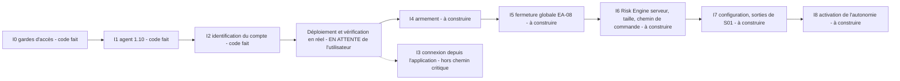

### 27.6 Blockers et points ouverts documentés

1. **Déploiement d'I0 à I2** : geste de l'utilisateur ; rien n'avance sans lui.
2. Capital de référence du compte réel (Settings) : **manquant** ; l'autonomie « refuse de démarrer sans ».
3. Confirmation des lectures du tableau de limites ; huit décisions de l'étude des règles ; relecture des ADR 0013 et 0014.
4. Plafond de stop à 7 pips et « demi-heure de Francfort » : ouverts.
5. Mesure du spread du **compte réel** : manquante (flux de démo à spread fixe).
6. Contradiction ADR 0015 / T02c (« sans clic » après la perte du jour contre accusé obligatoire) : tranchée par l'amendement du 2026-09-26 (levée par accusé) — code absent.
7. Défauts connus à corriger avant tout ordre : TD-01 à TD-07 (§ 30).

### 27.7 Risques de la phase

R-01 (activation d'un chemin d'ordre jamais exercé), R-02 (Risk Engine dans l'onglet), R-03 (persistance perdante), R-04 (panne d'exploitation), R-06 (décalage de version), R-12 (le garde-fou technique tombe, ne reste que le processus) — voir § 31.

### 27.8 Critères de sortie

| Cadre | Critère | Source |
|---|---|---|
| Vérification de I0-I2 | `/health` : `access` à trois `true` et `agentConnected` ; journal du backend sans refus d'agent ; cockpit connecté ; écran Account « Liaison MT5 » rempli par le vrai agent ; étapes 2 à 6 du README de l'agent passées avec traces | Étude, « Reprendre ici », point 3 ; README de l'agent |
| Avant la première entrée autonome | Risk Engine serveur ; taille depuis les spécifications du courtier ; stop et cible à l'ouverture ; gestion de sortie de S01 ; homme mort ; supervision et redémarrage | ADR 0015, « À construire avant la première entrée autonome » |
| Arrêts de stratégie | Drawdown de 20 R ; revue après 50 trades (< 20 gagnants : l'autonomie reste coupée) | ADR 0015, amendement |
| Vague 1 | Séance réelle complète sans règle contournée | `roadmap.md` (non rempli) |
| Aucun critère chiffré de **réussite** de l'autonomie | — | « Aucune prétention de performance » (ADR 0015) |

### 27.9 Propositions non acceptées

Le bilan du 2026-10-03 (`02_Plan_Projet/bilan-complet-2026-10-03.md`) propose notamment : « mur d'abord » (fermeture globale et aplatissement automatique avant le reste), une échelle de risque à la place de l'interface CONFIRM, le report ou l'abandon d'I3, des sorties portées par la commande, un service de décision unique et supervisé, un test séquentiel (SPRT) comme garde-fou statistique et un banc de rejeu. Treize décisions (D1 à D13) attendent l'utilisateur ; **rien n'y est approuvé** (statut : PROPOSED).

---

## 28. Future Phases

Trois catégories, jamais mélangées.

### 28.1 Roadmap explicite (documentée et acceptée)

| Élément | Source | Condition |
|---|---|---|
| I3, I4, I5, I6, I7, I8 | Étude du 2026-09-25 ; accords nommés des 2026-09-25 et 2026-09-26 (ADR 0013, ADR 0014 volet armement, EA-08, EA-07 jusqu'à CONFIRM, ADR 0015) | Chaque incrément après l'ADR ou la fiche qui le précède ; déploiement d'I0 à I2 d'abord |
| T10 — brief pré-séance | `roadmap.md` (Vague 3), « suite pré-autorisée » | « Pas encore commencé » |
| T19 — analyste IA RAG | `roadmap.md` (Vague 4), « pré-autorisé » | À démarrer seulement si T15 montre ses limites |
| T11, T12 (reste), T13, T14 | `roadmap.md` (Vague 3) | T11/T12 remontent « immédiatement en tête » si un second compte prop firm est ouvert |
| T16 ; S1, S2, S3 | `roadmap.md` (Vague 4, outils standalone) | Aucune dépendance |

### 28.2 Étapes logiques suivantes (déduites de l'état du code ; **non planifiées**)

1. Déployer et vérifier I0 à I2 (sans cela, tout le reste repose sur du code jamais exécuté).
2. Tests de composition : hub → bridge → writer, client → store, protocole agent (simulation de coupure et de crash).
3. Rendre la persistance et l'exploitation fiables : redémarrage automatique, rétention, sauvegarde planifiée, migrations.
4. Corriger les défauts d'exécution connus avant tout appel courtier (F01, F03, F04, F05, F06).
5. Banc de rejeu « événements seulement » (ADR 0011) pour connaître la fréquence de déclenchement de S01.
6. Déplacer le Risk Engine côté serveur (prévu par l'ADR 0015, I6) — liste ici car tout chemin d'ordre en dépend.
7. Traiter l'exposition du dépôt public contenant des numéros de compte.

### 28.3 Futur stratégique (orientation, sans engagement)

- Abstraction de plateforme d'exécution : `ExecutionAgent.platform` accepte `mt5`, `ctrader`, `ib`, `fix`, `mock` (`lib/domain/execution.ts:222`) ; seul MT5 existe.
- Hébergement distant (VPS, proxy inverse, Cloudflare, Redis, RabbitMQ, Seq, Prometheus, Grafana) décrit par `context/infrastructure/infrastructure_plan.md` ; rien n'existe dans le dépôt.
- Corrélations et intelligence de marché déterministes (T16), IA en lecture (T19).
- Multi-compte natif et multi-stratégie : conditionnés à un second compte ou à une seconde stratégie formalisée ; la charte actuelle exclut le multi-tenant.

---

## 29. Autonomous Trading Readiness

Source des exigences : la liste demandée par le mandat, complétée par l'ADR 0015 (§ « À construire avant la première entrée autonome »). Aucune ligne n'est cochée sans preuve dans le code ou une mesure ; « Blocking? » indique si l'exigence, non satisfaite, empêche à elle seule d'armer l'autonomie.

### 29.1 Checklist demandée

| Requirement | Status | Evidence | Blocking? |
|---|---|---|---|
| Market data | PARTIAL | Observateur live sur **un** symbole (choisi par `start-live` via la sonde du terminal) ; S01 lit des fichiers JSONL EURUSD datés du 2026-09-18 ; aucune fraîcheur de tick surveillée | **YES** |
| Strategy | PARTIAL | S01 : détection complète (54 tests), 0 proposition mesurée ; aucune sortie | **YES** |
| Risk kernel | PARTIAL | Gates pures et testées (51) ; évaluation dans le navigateur seulement (`signalr-client.ts:538`) | **YES** |
| Position sizing | **NO** | Facteur XAU en dur (`sizing.ts:44-47`), plancher 0,01 lot, non branché | **YES** |
| Broker-aware sizing | **NO** | Le `hello` ne publie ni valeur ni taille de tick, et seulement le premier symbole | **YES** |
| Execution | **NO — BLOCKED** | `MODE_OBSERVE` constant ; aucun producteur de commande ; `OrderSend` inatteignable | **YES** |
| SL/TP | PARTIAL | `sl > 0` exigé par l'agent, cible portée par la commande, calculés par S01 ; jamais exercé ; sens du stop non vérifié | **YES** |
| Reconciliation | PARTIAL | `ReconcileUnknownCommands` ; jamais exercée en réel ; `not_found` sans échéance | **YES** |
| Idempotency | PARTIAL | Journal disque, `DUPLICATE`, `report_id` déterministe ; jamais exercée avec un ordre réel | **YES** |
| Kill switch | PARTIAL | Halte locale de l'agent IMPLEMENTED ; arrêt d'urgence du cockpit = verrou seulement ; aucune fermeture globale (EA-08) | **YES** |
| Heartbeat | IMPLEMENTED | Observateur 3 s, agent 5 s, ping 5 s, watchdogs 8 s et 30 s | NO |
| Dead-man switch | PARTIAL | Ping et mesure du silence (`gatewaySilentMs`) ; l'action est liée à l'armement (I4), absente | **YES** |
| Supervisor | **NO** | Aucun superviseur ; `restart: no` ; tout arrêté depuis 7 jours | **YES** |
| Recovery | PARTIAL | Reconnexions et `UNKNOWN` ; aucune reprise de processus ni de machine | **YES** |
| Position management | **NO** | Aucun message `modify`/`close`, aucune sortie de S01 | **YES** |
| Journal | IMPLEMENTED | `closed_trades`, `trade_captures`, conformité ; écriture perdante par conception | NO (réserve : audit non durable) |
| Monitoring | PARTIAL | `/health` seulement ; aucune alerte sortante | **YES** |
| Testing | PARTIAL | 332 + 116 + 34 tests sur des fonctions pures ; aucun test du chemin d'ordre, du hub, de l'agent | **YES** |

**Décompte** : 2 IMPLEMENTED, 11 PARTIAL, 5 NO ; 16 exigences bloquantes sur 18.

### 29.2 Exigences complémentaires

| Requirement | Status | Evidence | Blocking? |
|---|---|---|---|
| Approbation de risque vérifiée avant toute commande | **NO** | `riskApprovalId` jamais vérifié (hub, agent) | **YES** |
| Armement sous bail serveur et plafond de mode compilé | **NO** | Constantes `MODE_OBSERVE` ; `control.set_mode` ignoré | **YES** |
| Limites par compte configurées (risque par trade, perte jour/totale, trades, positions) | **NO** | Valeurs seulement dans le journal de session ; défauts du code différents (1 % contre 0,1 %) | **YES** |
| Capital de référence du compte réel | **NO** | `EXNESS_REFERENCE_BALANCE = null` | **YES** |
| Arrêts de stratégie (20 R, revue à 50 trades) | **NO** | Non codés | **YES** |
| Levée des verrous par accusé côté serveur | PARTIAL | Registre persistant, accusé obligatoire ; publication par tout porteur de jeton | **YES** |
| Contrôle de compatibilité de build | **NO** | `buildId` publié, jamais imposé | **YES** |
| Preuve que la stratégie se déclenche et se comporte comme décrit | **NO** | 0 proposition ; aucun backtest (ADR 0002) ; banc de rejeu absent | **YES** |
| Mesure du spread et des coûts sur le compte réel | **NO** | Mesures faites sur la démo seulement | **YES** |
| I0 à I2 déployés et vérifiés en réel | **NO** | Non déployés | **YES** |
| Identité et isolation de compte | IMPLEMENTED (code) | `identity`, magic, instance unique ; non déployé | NO |
| Sauvegardes planifiées et restauration vérifiée | **NO** | Un dump manuel du 2026-09-25 | **YES** |
| Hygiène des secrets et de l'exposition | **NO** | § 23 | **YES** |
| Procédure d'incident écrite | PARTIAL | Halte documentée ; aucune procédure d'incident | **YES** |

```text
AUTONOMOUS READINESS:

NOT READY

Justification (preuves, pas intentions) :
- Le système n'a jamais émis un seul ordre réel ; l'unique OrderSend est inatteignable par construction.
- Le Risk Engine n'a pas d'autorité serveur ; la taille de position est fausse hors XAUUSD.
- Il n'existe ni sortie, ni fermeture globale, ni supervision, ni homme mort effectif.
- La stratégie n'a jamais produit une proposition mesurée ; aucune preuve de pertinence n'existe.
- I0 à I2 ne sont pas déployés ; l'exploitation est arrêtée depuis 7 jours.
Cette conclusion ne change que par des preuves (tests, déploiement vérifié, mesures), pas par des décisions.
```


---

## 30. Technical Debt

Échelle : **CRITICAL** = peut causer une perte financière irréversible ou la défaillance silencieuse d'un contrôle de sûreté dès que le chemin concerné est activé ; **HIGH** = neutralise un contrôle, ou bloque la validation ou l'exploitation ; **MEDIUM** = dégrade la fiabilité, la preuve ou la maintenabilité ; **LOW** = local ou cosmétique. Les références `F01`–`F13` renvoient au bilan du 2026-10-03.

### 30.1 CRITICAL — à traiter avant le premier ordre réel

| ID | Dette | Preuve | Conséquence |
|---|---|---|---|
| TD-01 | Dimensionnement faux hors XAUUSD et non branché (F01) | `lib/risk/sizing.ts:44-47`, `lib/risk/open-risk.ts:15,24` ; le `hello` de l'agent ne publie ni valeur ni taille de tick (`TradingOsAgent.mq5:657-694`) | Taille ≈ 1000× trop grande hors XAUUSD (ADR 0015) : environ 2000 lots au lieu de 2 pour 10 000 $, 1 % de risque et un stop de 5 pips (exemple de l'étude du 2026-09-25 et du bilan) ; la gate de risque ouvert est fausse de la même façon |
| TD-02 | Risk Engine uniquement dans le navigateur ; le hub ne vérifie ni approbation, ni verrou (F02) | `lib/realtime/signalr-client.ts:538` ; `CockpitHub.cs:87-125` | Sans onglet ouvert : aucune évaluation, aucun nouveau verrou ; un `riskApprovalId` arbitraire est accepté |
| TD-03 | Retours courtier ambigus enregistrés comme échec définitif (F03) | `TradingOsAgent.mq5:1055-1068` | Une position réelle peut être consignée « échec » hors de la réconciliation d'`UNKNOWN` |
| TD-04 | `deviation` présenté comme borne de remplissage (commentaire de `:74`), alors qu'il ne borne rien en exécution au marché d'après la documentation MQL5 consultée le 2026-10-03 (F04) | `TradingOsAgent.mq5:74,1047` ; **[web, non revérifié ici]** | Glissement non borné à l'entrée comme à la sortie sur stop |
| TD-05 | Barrière de volume en lots, pas en risque ; sens et distance du stop non vérifiés ; pas d'`OrderCheck` (F05) | `TradingOsAgent.mq5:846-853,70-71` | Un ordre « valide » peut engager un risque monétaire arbitraire |
| TD-06 | `risk.lockout.cleared` et `.acknowledged` publiables par tout porteur du jeton (F06) | `CockpitHub.cs:27-33` | Un bug ou un second client peut lever un verrou sans humain |
| TD-07 | Persistance perdante, y compris pour les faits d'exécution ; diffusion avant écriture (F08) | `PersistenceWriter.cs:42-48,148` ; commentaire de `use-persistence-health.ts` | Commandes, accusés, rapports ou verrous absents de la base tout en étant affichés |

### 30.2 HIGH

| ID | Dette | Preuve | Conséquence |
|---|---|---|---|
| TD-08 | Aucune garde de calendrier de marché : week-end, jours fériés, fraîcheur du tick (F07) | `lib/setup/preconditions.ts:40-43` | Une « killzone » le samedi compte comme ouverte |
| TD-09 | Aucune gestion de sortie (F09) | Fiche S01 ; `isInvalidatedByCe` jamais appelé ; aucun gestionnaire `modify`/`close` dans l'agent | Si le Gateway tombe après une entrée, seul le stop (et la cible) chez le courtier subsiste |
| TD-10 | Aucun contrôle de compatibilité de build agent/Gateway (F10) | `buildId` publié dans le `hello`, jamais imposé | Un ancien `.ex5` peut tourner à côté d'un nouveau Gateway (constaté le 2026-09-24 [docs]) |
| TD-11 | EA et DLL tiers dans le terminal (F11) | `Ultimate_ICT_Gold_Scalper_v4.0` présent [mesuré] ; DLL [docs, non revérifiée] | « Algo Trading » arme tous les experts ; l'agent ne fait que les lister (`attachedExperts`) |
| TD-12 | Tests d'intégration SQL creux (F12) | `AuditRepositoryIntegrationTests.cs:37` réussit à vide | Un défaut SQL ne casse aucun test |
| TD-13 | Limites du code ≠ décisions de l'utilisateur ; capital de référence `null` (F13) | `lib/risk/policy.ts` (1 %, 6 trades) contre 0,1 % et 4 trades ; `EXNESS_REFERENCE_BALANCE = null` | Le repli silencieux applique des valeurs que l'utilisateur n'a pas choisies |
| TD-14 | Aucune supervision, aucun redémarrage, aucune alerte ; démarrage manuel de dix composants | `restart` absent ; services arrêtés depuis 7 jours | Un système « autonome » qui ne se relance pas |
| TD-15 | Dépôt GitHub public contenant des numéros de compte ; mot de passe de base de développement dans 6 fichiers | § 23 | Exposition de la vie privée, pas de secret d'accès trouvé |
| TD-16 | Gate de spread : conversion en « points » avec le facteur de l'or | `lib/realtime/signalr-client.ts:523-525` | Spread faux pour le forex ; le spread n'est mesuré que sur le symbole de l'observateur |
| TD-17 | Fenêtres de session UTC fixes (Londres 07-12, New York AM 12-16) différentes des killzones déclarées (Londres 02-05 et New York AM 07-10, heure de New York) | `lib/analysis/config.ts:44-50` ; `lib/setup/preconditions.ts` | Le verdict de session et la conformité « fenêtre » ne mesurent pas la règle que l'utilisateur a énoncée ; insensibles à l'heure d'été |
| TD-18 | Composition non testée : hub, pont, écrivain, client temps réel, composants, agent MQL5, MCP | § 24.3 | Les défauts d'intégration ne sont vus qu'en réel |

### 30.3 MEDIUM

| ID | Dette | Preuve |
|---|---|---|
| TD-19 | Pas de migrations, de rétention, de compression ni de sauvegarde planifiée | `schema.sql` ; `backups/` |
| TD-20 | Contrats TypeScript/C# recopiés à la main, sans vecteurs communs ; `execution.reconciled` et `execution.position.scan` absents de l'union TypeScript | `lib/contracts/envelope.ts` ; `Contracts/Envelope.cs` |
| TD-21 | Code mort ou non branché : `buildPlaceOrderCommand`, `recordOrReplay`, `transition`, `SendHaltAsync` (sans appelant de production), `Mt5ObserverClient.SendCommandAsync`, gestionnaire de commandes hérité de l'observateur (`mt5_observer.py:558`), `TradingAccount`, `StrategySignal`, `Order`, `SpreadSample`, 21 types d'événements sans producteur | § 9.13, § 20 |
| TD-22 | `ACCOUNT_PROFILES` vide ; firme déduite par sous-chaîne du nom du courtier ; chaîne `company` FTMO jamais observée | `lib/accounts/registry.ts`, `firm.ts` |
| TD-23 | Observateur mono-symbole ; le `hello` de l'agent ne décrit que le premier symbole autorisé | `mt5_observer.py:672` ; `TradingOsAgent.mq5:657-694` |
| TD-24 | Pipeline S01 manuel : exportateur Python → JSONL → sonde de 60 s → base ; EURUSD seul ; données du 2026-09-18 | `scripts/run-setup-detection.ts:36` |
| TD-25 | Aucune CI, aucune mesure de couverture | `.github/` absent |
| TD-26 | Volume documentaire et dérive : `state.md` fait 285 lignes pour une règle d'environ 50 (ADR 0008) ; plusieurs documents d'état divergent | § 33 |
| TD-27 | Documents de planification hors du dépôt (`01_Recherche`, `02_Plan_Projet`, `03_Suivi_Projet`), une seule copie | `git rev-parse` échoue à la racine parente |
| TD-28 | Le hub n'accepte une commande que pour un agent en mode `observe` : à réécrire pour tout mode réel | `CockpitHub.cs:97-104` |

### 30.4 LOW

| ID | Dette | Preuve |
|---|---|---|
| TD-29 | Environnement du store codé `"demo"` ; `"live"` et `"paper"` jamais affectés | `lib/realtime/signalr-client.ts:159` |
| TD-30 | Deux types `Position` homonymes (domaine et read model) | `lib/domain/execution.ts:68`, `lib/contracts/snapshots.ts:75` |
| TD-31 | Tags d'image flottants ; réseau et volume Docker `external` aux noms hérités | `docker-compose.yml` |
| TD-32 | `ticks` horodaté à la réception et sans clé primaire | `schema.sql:34-41`, `PersistenceMapper.MapTick` |
| TD-33 | `next dev` utilisé pour l'usage réel (hydratation lente [docs]) | `scripts/start-live.ps1` |
| TD-34 | ADR 0015 amendé en place alors que le README des ADR énonce « un ADR ne se modifie pas » | `context/adr/README.md`, `0015-mode-autonome.md` |
| TD-35 | Commentaires périmés : en-tête de `lib/compliance/violations.ts` (deux types annoncés, trois présents) ; `Mt5ObserverClient` (« seul chemin sortant ») | fichiers cités |

---

## 31. Architecture Risks

Probabilité et impact sont des jugements de l'audit, fondés sur l'état du code ; ils ne sont pas mesurés.

| ID | Risque | Probabilité | Impact | Mécanisme | Parade existante | Parade manquante |
|---|---|---|---|---|---|---|
| R-01 | L'ouverture du chemin d'ordre active du code mort jamais exercé | Élevée | Très élevé | TD-01, TD-03, TD-04, TD-05 deviennent actifs au moment où `g_mode` change | Barrière de compilation ; accords nommés par incrément | Tests du chemin d'ordre (hors testeur de stratégie), corrections avant ouverture |
| R-02 | Les contrôles de risque n'existent que dans un onglet de navigateur | Élevée | Très élevé | Sous autonomie, personne n'ouvre d'onglet | Barrières statiques de l'agent (lots, positions) | Risk Engine serveur qui fait foi (I6) |
| R-03 | Les faits critiques sont perdus ou faux en base | Moyenne | Élevé | `DropWrite`, diffusion avant écriture, panne de base | Compteur `dropped` dans `/health` | Boîte d'envoi durable pour commandes, accusés, rapports, verrous |
| R-04 | Panne d'exploitation pendant une position ouverte | Élevée | Élevé | Aucun superviseur ; machine personnelle ; Windows Update ; pas de sortie logicielle | Stop chez le courtier | Supervision, alertes indépendantes, plan de sortie porté par la commande |
| R-05 | Stratégie non prouvée exécutée comme une expérience | Élevée | Moyen à élevé | 0 proposition mesurée ; aucun backtest par décision (ADR 0002) ; confirmer un avantage de +0,2 R par trade demanderait environ 390 trades (calcul du bilan du 2026-10-03) | Limites de perte, arrêts à 20 R et 50 trades (conçus, non codés) | Banc de rejeu, protocole de preuve écrit avant l'armement |
| R-06 | Décalage de versions agent / Gateway | Moyenne | Élevé | Recompilation sans rechargement ; `.ex5` périmé | `buildId` publié | Refus d'armer si le build diffère |
| R-07 | Autre expert dans le terminal | Moyenne | Élevé | EA tiers présent ; « Algo Trading » arme tous les experts | Liste `attachedExperts` publiée | Blocage de l'armement tant qu'un expert étranger est attaché |
| R-08 | Exposition de la vie privée et des secrets | Élevée (déjà réalisée pour les numéros de compte) | Moyen | Dépôt public ; mot de passe de développement en clair | Jetons gitignorés ; liaison loopback | Dépôt privé, secrets générés |
| R-09 | Dérive silencieuse des contrats TypeScript/C# | Moyenne | Moyen | Pas de vecteurs communs | Tests de traduction | Fixtures partagées ou génération de code |
| R-10 | Surcharge documentaire et état divergent | Élevée | Moyen | 94 000 mots dans `context/`, plusieurs « états » | Journal de session, ADR courts | Un seul état généré, rotation du journal |
| R-11 | Dépendance à une seule personne et à quatre langages | Élevée | Moyen | TypeScript, C#, Python, MQL5 pour un mainteneur | Documentation abondante | Réduction du périmètre, tests automatiques |
| R-12 | Le garde-fou technique tombe, ne reste que le processus | Certaine à terme | Très élevé | Quand `g_mode` cesse d'être constant, seul l'accord nommé empêche un ordre | Règles de `.claude/CLAUDE.md` | Armement sous bail serveur, plafond de mode compilé (ADR 0014) |

---

## 32. Missing Pieces

Éléments **absents du dépôt** et nécessaires au but déclaré. « Planifié » = présent dans l'étude I0-I8 ou le backlog ; sinon l'absence n'est pas planifiée.

| Élément manquant | Nécessaire pour | Planifié ? |
|---|---|---|
| Service de décision / Risk Engine serveur | Autonomie ; approbation de risque | Oui (I6) |
| Producteur de commande (proposition → décision → commande) | Tout ordre non manuel | Oui (I6) |
| Dimensionnement depuis les spécifications du courtier | Tout ordre | Oui (I6) |
| Gestion de sortie, messages `modify`/`close`, EA-08 | Autonomie ; mur de discipline | Oui (I5, I7) |
| Armement, bail, plafond de mode, homme mort effectif | Autonomie | Oui (I4, I8) |
| Superviseur de connexion de compte | Connexion depuis l'application | Oui (I3, hors chemin critique) |
| Supervision de processus, redémarrage, alertes sortantes | Exploitation autonome | Oui (I8, T14) |
| Calendrier de marché (week-end, jours fériés, heure d'été) | Préconditions fiables | **Non** |
| Banc de rejeu « événements seulement » | Connaître la fréquence de S01 | Autorisé par l'ADR 0011 ; **absent de l'étude I0-I8** |
| Rétention, compression, migrations, sauvegarde planifiée | Exploitation de la base | **Non** |
| Boîte d'envoi durable des faits d'exécution | Piste d'audit des ordres | **Non** |
| Tests d'intégration, E2E, harnais MQL5, CI | Confiance dans le chemin d'ordre | **Non** |
| Vecteurs ou génération de contrats TS ↔ C# | Cohérence des miroirs | **Non** |
| Écran de pilotage de l'autonomie (état, budgets, journal de décisions) | Surveillance humaine | **Non** (l'ADR 0014 prévoit l'armement seulement) |
| Indicateurs propres à l'autonomie (plomberie, surveillance de stratégie) | Mesure honnête (ADR 0015) | Partiel (ADR 0015) |
| Registre d'incidents et procédure | Réponse à un comportement anormal | **Non** |
| Contrôle de compatibilité de build | Éviter les versions mélangées | **Non** |
| Capital de référence, spread du compte réel, plafond de stop | Démarrage de l'autonomie | Oui (questions ouvertes) |
| Observateur multi-symbole ou flux M1 par symbole côté Gateway | Pipeline S01 sans fichiers | **Non** |
| Registre de stratégies et cycle de vie (activer, versionner) | Configuration de la stratégie | Partiel (I7) |
| Dépôt privé et gestion des secrets | Confidentialité | **Non** |

---

## 33. Contradictions & Inconsistencies

Aucune n'est « réparée » dans ce document : chacune est consignée avec la source qui fait foi selon la règle « le code l'emporte sur la documentation ».

| ID | Sujet | Énoncé A | Énoncé B | Ce que le code montre | Impact |
|---|---|---|---|---|---|
| C-01 | Approbation de risque | `context/execution/safety.md` : une commande non approuvée par le Risk Engine n'atteint pas l'agent ; `command-builder.ts` : « the ONLY way a command comes to exist » | `CockpitHub.SubmitCommand` ne contrôle rien ; `dev-submit-command.ts` fabrique des commandes avec `"dev-harness"` | B : aucune vérification d'approbation | Élevé (garantie documentaire inexistante) |
| C-02 | Transport MT5 | ADR 0003, ADR 0004, `context/realtime/mt5_wire_protocol.md` : « WSS » | Code : `ws://` non chiffré (observateur, loopback) et **TCP brut** (agent, port 9765) ; décision TCP dans la fiche EA-05 | B | Moyen (documents de référence périmés) |
| C-03 | Infrastructure cible | `context/infrastructure/infrastructure_plan.md` : Redis, RabbitMQ, Seq, Prometheus, Grafana, Traefik, Cloudflare | Aucun de ces composants dans le dépôt ; Docker Compose avec deux services | B | Faible (plan, non état) |
| C-04 | Usage de l'IA | `context/ai/ai_future.md` : « trade ranking », « parameter optimization » candidats ; « assist decisions before it automates » | ADR 0005 (aucune pondération de décision), ADR 0002 (pas d'optimiseur) | ADR : aucun composant IA | Moyen (document d'origine non aligné) |
| C-05 | Durée de la série 1 | ADR 0001 : « Neuf mois plus tard » | Historique git : du 2026-07-06 au 2026-07-28 puis pivot le 2026-09-04 (≈ 2 mois) | B | Faible |
| C-06 | Nombre d'états de commande | `execution-state.ts` : « Twelve states » ; `schema.sql` : « 12-state machine » | L'union compte 13 états | 13 | Faible |
| C-07 | Taille de `state.md` | ADR 0008 : « ne doit plus jamais dépasser ~50 lignes » | 285 lignes | B | Moyen (coût de lecture) |
| C-08 | Union des événements | ADR 0004 : le TypeScript fait foi, toute divergence est un défaut | `execution.reconciled`, `execution.position.scan` n'existent qu'en C# | Divergence réelle | Moyen |
| C-09 | Vision d'architecture | `context/architecture/system_overview.md` : moteurs de stratégie, de portefeuille, d'analytique ; corrélations | Charte v3 : pas de générateur de signaux ; une seule stratégie configurée | Charte et code | Moyen (héritage de la série 1) |
| C-10 | Commentaire de `Mt5ObserverClient` | « only outbound path » | `SendCommandAsync` n'a aucun appelant ; l'agent a son propre canal | Code mort | Faible |
| C-11 | Numéro T13 | « simulateur de règles pré-trade » (backlog) | « superviseur de connexion » (étude) | Collision de nom | Faible |
| C-12 | État de la mémoire de pilotage | `03_Suivi_Projet/Suivi.md` : ADR 0015 « proposé » | ADR 0015 accepté le 2026-09-26 | B | Moyen |
| C-13 | Statut de S01 | `context/product/tools/README.md` et fiche S01 : « à faire » | EA-01/EA-02 livrés : la détection existe et tourne | Détection livrée, stratégie non exécutable | Moyen |
| C-14 | Statut de T12 | `roadmap.md` : « à faire » | Fiche T12 : « en cours », incréments 1 et 2 livrés | B | Faible |
| C-15 | Limites de risque | ADR 0015 et journal du 2026-09-26 : 0,1 % par trade, 4 trades, 2 positions, pas de plafond de spread, 2 pertes de suite = fin de journée | Code : 1 %, 6 trades, 3 pertes consécutives, spread 40 points | Code (aucune ligne ne lit les valeurs retenues) | Élevé sous autonomie |
| C-16 | Fenêtres de trading | Utilisateur / S01 : killzones Londres 02-05 et New York AM 07-10 (New York) | Gate de session et conformité : fenêtres UTC fixes 07-12 et 12-16 | Code (deux jeux de fenêtres) | Moyen |
| C-17 | Types de violation | En-tête de `violations.ts` : « only two violation types ship » | `ViolationType` en déclare trois | Trois | Faible |
| C-18 | Environnement affiché | Écran Account : « RÉEL » depuis `tradeMode` | Menu de compte : environnement codé « demo » | Les deux coexistent | Faible |
| C-19 | README de l'observateur | `tools/mt5-observer/README.md` (2026-09-02) et `context/realtime/live_prototype.md` : connexion directe du navigateur, `NEXT_PUBLIC_MT5_WS_URL` | Depuis I0 l'observateur refuse tout `Origin` et exige un jeton ; la variable n'est lue par aucun code | Code | Moyen (documentation de démarrage trompeuse) |
| C-20 | Rendu T05 hors XAUUSD | Ligne de tableau de `state.md` : « Rendu cassé pour tout symbole hors XAUUSDm » | Même fichier : « Corrigé le 2026-09-15 » | Corrigé | Faible |
| C-21 | Validation de la Vague 1 | `state.md` (début) : T01-T05 « n'ont jamais tourné contre un vrai terminal » | `state.md` (plus bas) : kill switch et gate de perte quotidienne « ont tourné en réel plusieurs fois » | Les deux tiennent à des dates différentes | Faible |
| C-22 | « Écrit, testé et validé en live » | `.claude/CLAUDE.md` : `lib/risk/`, `lib/analysis/`, `lib/domain/`, `lib/contracts/` et toute la chaîne temps réel sont validés en live | `lib/risk/sizing.ts` et `open-risk.ts` sont faux hors XAUUSD ; `signalr-client.ts` sans test | Affirmation trop large | Moyen |
| C-23 | Immutabilité des ADR | `context/adr/README.md` : « un ADR ne se modifie pas » | ADR 0015 contient une section « Amendement » du même jour | Amendement en place | Faible |
| C-24 | État d'exploitation | `state.md` : base et backend tournent, agent connecté (au 2026-09-25) | Rien ne tourne [mesuré 2026-10-05] | Instantané périmé, pas une erreur | Faible |
| C-25 | Taux de conformité | Charte : KPI central | 3 détecteurs sur les 4 prévus ; non pertinent sous autonomie | Partiel | Moyen |

---

## 34. Architectural Decisions

Statut = celui du README des ADR ; « Dans le code » = ce que l'audit vérifie.

| ADR | Titre | Statut documentaire | Dans le code | Remarque |
|---|---|---|---|---|
| 0001 | Le process est le produit | Accepté | IMPLEMENTED | Amendé par 0015 (la stratégie configurée décide des entrées) |
| 0002 | Fin de la recherche d'edge | Accepté | IMPLEMENTED | Aucun backtester dans l'arbre ; historique dans les tags `archive/*` |
| 0003 | Stack et topologie | Accepté (amendé par 0012, 0013) | IMPLEMENTED | Monolithe modulaire ; transport « WSS » inexact (C-02) |
| 0004 | Contrats de domaine et wire MT5 | Accepté | PARTIAL | TypeScript canonique ; miroir C# manuel, divergence C-08 |
| 0005 | L'IA reste en lecture | Accepté | IMPLEMENTED | Serveur MCP en lecture seule ; aucune IA dans le runtime |
| 0006 | Gouvernance par outils et vagues | Accepté | IMPLEMENTED (processus) | Fiches d'outil, commandes `/outil-start` et `/outil-close` |
| 0007 | Risk Engine point de contrôle unique | Accepté | PARTIAL | Gates dans `lib/risk` ; évaluation côté navigateur seulement |
| 0008 | Journal de session borné | Accepté | PARTIAL | `state.md` dépasse sa borne (C-07) |
| 0009 | Le serveur capture des faits, le cockpit rend | Accepté | IMPLEMENTED | `trade_captures`, rendu à la demande |
| 0010 | Le Trading OS exécute, l'EA est un agent | Accepté | PARTIAL | Agent et protocole présents ; exécution inatteignable ; clause « pas d'AUTO » supersédée par 0015 |
| 0011 | Un banc de replay n'est pas un backtester | Accepté | DESIGNED | Banc non construit ; `setup_proposals` en tient lieu partiellement |
| 0012 | Système de design shadcn/ui | Accepté | IMPLEMENTED | `components/ui`, style « new-york » |
| 0013 | Connexion au compte depuis l'application | Accepté le 2026-09-25 ; rédigé le 2026-09-26 ; texte soumis à relecture | DESIGNED | Aucun code ; `tools/mt5-supervisor/` absent |
| 0014 | Armement de l'agent depuis l'application | Idem | DESIGNED | `control.set_mode` ignoré ; `g_mode` constant |
| 0015 | Mode autonome | Accepté le 2026-09-26 ; amendé le même jour | DESIGNED | Aucun code d'autonomie ; liste « à construire avant la première entrée » intacte |

Les ADR de la série 1 (`0001-platform-over-ea` à `0013-backtest-diagnostics`) ont été supprimés le 2026-09-04 ; des documents techniques et des commentaires de code en citent encore les numéros (table de correspondance dans le README des ADR).

---

## 35 à 44 — NON RÉDIGÉES

Restent à produire : 35 What the Project Really Is Today · 36 What the Project Could Become · 37 Target Architecture (PROPOSED / NOT IMPLEMENTED) · 38 Refactoring / Redesign Opportunities · 39 Recommended Development Order · 40 Strategic Questions Still Unanswered · 41 Glossary · 42 Master Status Dashboard · 43 Final Architectural Verdict (12 questions) · 44 Evidence & Confidence.

Les éléments de fond nécessaires à ces sections figurent déjà dans le document : verdict d'autonomie au § 29 (**NOT READY**), dette au § 30, risques au § 31, pièces manquantes au § 32, contradictions au § 33, décisions au § 34 ; propositions non acceptées du bilan du 2026-10-03 au § 27.9 ; questions ouvertes au § 27.6.

---

# Audit Quality Report

*Version intermédiaire — voir l'état de ce fichier en tête de document.*

## Files inspected

- **Code du dépôt** (racine git `04_code/`) : `lib/` (domain, contracts, risk, analysis, setup, accounts, compliance, realtime, security, execution, market), `app/`, `components/`, `proxy.ts`, `backend/src/*` (Contracts, Gateway, Host, Persistence, `schema.sql`) et `backend/tests`, `tools/` (observateur Python, agent MQL5 `TradingOsAgent.mq5` et includes, serveur MCP, revue hebdomadaire), `scripts/`, `docker-compose.yml`, `Dockerfile`, `package.json`, `.gitignore`.
- **Documentation** : `context/` (ADR 0001 à 0015, `project/state.md`, `session-log.md`, `roadmap.md`, `charter.md`, fiches d'outils, `backlog.md`, documents d'architecture, d'exécution, de sécurité, d'IA), `.claude/CLAUDE.md`, `AGENTS.md`, READMEs de l'observateur et de l'agent.
- **Hors dépôt (sources secondaires)** : `02_Plan_Projet/etude-connexion-pilotage-agent-2026-09-25.md` et `bilan-complet-2026-10-03.md`.
- **Historique git** (44 commits, tags `archive/*`), état du dépôt, branches.
- **Environnement local (lecture seule)** : `docker ps -a`, processus et ports en écoute, dossier de données MT5 (liste des experts et fichiers), horodatages des fichiers exportés.
- **Gates rejouées le 2026-10-05** : Vitest (332), `dotnet test` (116), `unittest` (34), `tsc --noEmit`, `npm run lint` ; l'arbre de travail est resté inchangé par ces exécutions.
- **Non trouvé** : `Perfectionner prompt trading.txt` (cherché dans `C:\Dev`, `C:\Ebrain`, Téléchargements, Bureau, Documents, profil utilisateur, racines de `C:\`).
- **Volontairement non lus** : valeurs de `.env`, préset `ea1.set`, contenu de la base, journaux d'experts MT5.

## Components inspected

Cockpit, client temps réel et store, hôte .NET, `CockpitHub`, `GatewayBridgeService`, adaptateurs Gateway, persistance et base, observateur MT5, agent d'exécution MQL5, Risk Engine, moteur d'analyse, stratégie S01 (détecteur, worker, exportateur), données de marché, journal et conformité, comptes et réglages, calendrier FRED, serveur MCP et revue hebdomadaire, exploitation (scripts, Docker). Composants **absents** et documentés comme tels : Trading Core, Monitoring, composant IA.

## Critical uncertainties

1. **Contenu de la base** : illisible (conteneurs arrêtés) ; aucune volumétrie, aucun comptage de propositions S01 ni de trades.
2. **État de MT5** : terminal fermé ; l'attache de l'agent et de l'EA tiers n'est pas vérifiable ; le comportement de l'observateur lors d'une fermeture du terminal en cours de route n'a pas été vérifié.
3. **Compte réel** : jamais observé par cet audit ; type, capital et spreads inconnus.
4. **Exposition du dépôt GitHub** (public, numéros de compte) : mesurée le 2026-10-03, **non remesurée**.
5. **F04 (`deviation`)** : repose sur la documentation MQL5 consultée le 2026-10-03, non revérifiée ici.
6. **Diagrammes Mermaid** : écrits avec soin mais **non validés par un analyseur**.
7. **Références `fichier:ligne`** : plusieurs ont été corrigées pendant la rédaction ; une revérification exhaustive finale n'a pas été faite.
8. **Cause de l'arrêt des conteneurs** (2026-09-28) : inconnue.

## Documentation/code contradictions

Vingt-cinq contradictions sont consignées au **§ 33** (C-01 à C-25), sans correction ; les plus lourdes : approbation de risque documentée mais non vérifiée (C-01), transport « WSS » documenté contre TCP brut (C-02), limites de risque retenues contre valeurs du code (C-15), fenêtres de session UTC fixes contre killzones déclarées (C-16).

## Areas requiring human decision

Déploiement d'I0 à I2 (geste de l'utilisateur) ; visibilité du dépôt GitHub ; ordre de construction (plan I3 → I8 ou « mur d'abord ») ; I3 (connexion par mot de passe) ; capital de référence, plafond de stop, demi-heure de Francfort, spread du compte réel ; relecture des ADR 0013 et 0014 ; huit décisions de l'étude des règles ; fermeture automatique sous verrou (accord nommé distinct) ; protocole de preuve avant armement ; hébergement. Les treize décisions D1 à D13 du bilan du 2026-10-03 sont des **propositions** non tranchées.

## Confidence in this audit

- **HIGH** : structure du code, statuts IMPLEMENTED/PARTIAL/DESIGNED, résultats des tests et des gates (rejoués le 2026-10-05), constat « aucun ordre réel possible ».
- **MEDIUM** : chronologie et statuts d'avancement issus de la documentation du projet (marqués [docs]).
- **LOW** : état d'exploitation au-delà des processus et ports observés (base, MT5, compte réel).
- **Complétude** : document **incomplet** (sections 35 à 44 absentes, mise en forme de 30 à 34 à harmoniser, relecture finale non faite).
